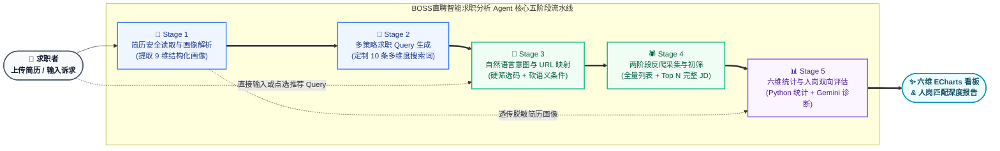
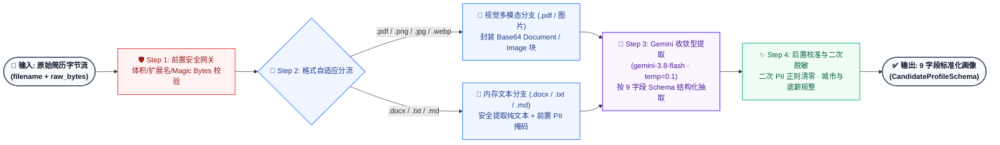
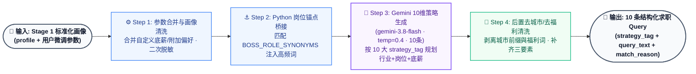
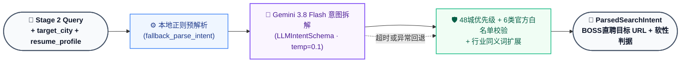
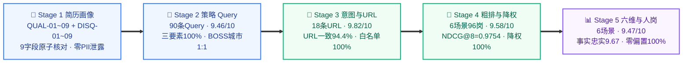

# BOSS直聘智能求职分析 Agent — 系统架构与分阶段设计文档 (`system_design.md`)

**📑 分页导航 (Page Navigation)**

[**第 1 页：全局设计逻辑与架构总览**](#page-1-全局设计逻辑与架构总览) ｜ [**第 2 页：Stage 1 简历读取与画像解析**](#page-2-stage-1-简历安全读取与多模态画像解析) ｜ [**第 3 页：Stage 2 多策略求职 Query 生成**](#page-3-stage-2-基于画像的多策略求职-query-生成) ｜ [**第 4 页：Stage 3 意图解析与 URL 映射**](#page-4-stage-3-自然语言求职意图解析与-url-映射) ｜ [**第 5 页：Stage 4 两阶段反爬采集与初筛**](#page-5-stage-4-boss直聘两阶段反爬采集与初筛打分) ｜ [**第 6 页：Stage 5 六维分析、看板与评测体系**](#page-6-stage-5-六维统计人岗匹配评估与三层评测体系)

---

## 【第 1 页 / 共 6 页】全局设计逻辑、核心架构思路与全链路总览

### 1.1 核心痛点与系统设计哲学 (Design Philosophy)

传统求职者在招聘平台搜索岗位时面临三大核心痛点：
1. **搜索词构建盲目（“不知道搜什么”）**：求职者往往不清楚自己的简历资历在目标城市适合搜索什么标准岗位名、定多少月薪底线、能争取哪些作息福利；
2. **列表页信息缺失与关键词误伤（“搜不准、看不全”）**：BOSS直聘列表页不展示完整职位描述（JD），“周末双休 vs 门店排班轮休”往往隐藏在详情页正文中；此外直接搜索带修饰词的“服装店面督导”会漏掉大量标题仅写“店面督导”但属于知名服装品牌公司的优质岗位；
3. **缺乏全局市场统计与人岗真实履历对比（“缺乏全局洞察”）**：求职者只能逐条点开查看，缺乏对数百个在招岗位的六维统计分布（行业、薪资、技能、经验学历、品牌规模、福利作息）以及结合自身真实简历的客观匹配度诊断。

围绕上述痛点，本系统确立了 **五大核心架构设计思路**：

| 核心设计原则 | 架构决策与工程思路 | 解决的核心问题 |
| :--- | :--- | :--- |
| **① 简历理解与策略生成双阶段解耦** | 将简历处理拆分为 **Stage 1（`core/resume_parser.py`，`temperature=0.1` 收敛型多模态事实抽取）** 与 **Stage 2（`core/query_generator.py`，`temperature=0.4` 发散型求职策略生成）**，中间插入 Python 确定性校准、PII 二次脱敏与 BOSS直聘 高频岗位词锚点桥接 | 兼顾“简历事实提取零幻觉”与“求职策略生成多样性”；前端修改意向城市/底薪时无需重传简历即可秒级重生成 10 条推荐 Query |
| **② 硬性 URL 筛选与软性语义条件分离** | **Stage 3** 将用户自然语言拆解为 **BOSS直聘 原生 URL 编码参数**（城市码、薪资档位码、剥离定语后的纯净岗位核心词）与 **软性评估条件**（具体底薪数值、双休要求、行业同义词扩展组） | 既保证 BOSS直聘 搜索引擎的高召回率（不因行业前缀漏掉好岗位），又为下游初筛打分与 LLM 深度评估提供精准判据 |
| **③ CDP 真实会话接管 + 两阶段采集** | **Stage 4** 通过 Playwright CDP 接管本机已登录 Chrome（`:9222`），先滚动拦截 `N` 批列表 JSON（广度覆盖 75~450 条），再经数学公式初筛打分，仅对 **Top 3~20** 候选岗同源 `fetch` 详情页完整 JD | 彻底规避 Headless 指纹封禁与高频详情页滑块验证码，以最小请求代价同时获取全量统计样本与头部岗位完整 JD |
| **④ Python 确定性统计 + LLM 语义推理** | **Stage 5** 由 Python 100% 精确计算六大维度分布、中位数与达标率，再将统计结果 + Top N 完整 JD + 候选人脱敏画像注入 Gemini 生成六维洞察与人岗双向评分 | 杜绝大模型算术统计幻觉（算错百分比/中位数），同时发挥 LLM 在隐性 JD 要求核查与人岗履历契合度诊断上的深度推理优势 |
| **⑤ 纵深防御安全网关 + 三层自动化评测** | 全程纯内存流式处理简历（零磁盘落盘）、五层文件魔数/防 XXE 校验、四类 PII 正则掩码、前端零 `innerHTML` 渲染，并配套 In-House 三层自动化评测看板（LLM-as-a-Judge + 确定性门禁） | 严格防御任意文件上传、Zip Bomb、XXE、Prompt 注入、PII 隐私泄露与 DOM XSS，并使每一阶段的质量可量化、可回归 |

---

### 1.2 全链路五阶段（Stage 1 ~ Stage 5）高层架构图

---

### 1.3 五大阶段职责边界与输入输出契约

| 阶段编号 | 阶段名称 | 核心代码模块 | 后端 API 端点 | 核心输入 | 核心输出 |
| :--- | :--- | :--- | :--- | :--- | :--- |
| **Stage 1** | **简历安全读取与多模态画像解析** | `core/resume_parser.py` | `POST /api/resume/parse-profile` | 原始简历字节流 (`raw_bytes`) + 文件名 | 经二次 PII 脱敏与标准化的 9 字段候选人画像 `profile` |
| **Stage 2** | **基于画像的多策略求职 Query 生成** | `core/query_generator.py` | `POST /api/resume/generate-queries` | Stage 1 `profile` + 用户可选微调项（城市/底薪/方向） | 10 条覆盖不同求职策略的自然语言 `recommended_queries` |
| **Stage 3** | **自然语言意图解析与 URL 映射** | `core/intent_parser.py` | `POST /api/intent/parse` & `POST /api/analyze` (Step 1) | `query` + `target_city` + `resume_profile` | `ParsedSearchIntent`（BOSS直聘目标搜索 URL + 软性过滤条件） |
| **Stage 4** | **两阶段反爬采集与初筛打分** | `core/boss_crawler.py` | `POST /api/analyze` (Step 2) | `ParsedSearchIntent` + `max_batches` + `top_detail_count` | 全量列表 `collected_jobs` + 含完整 JD 的 `top_candidates` + `.xlsx` |
| **Stage 5** | **六维统计、人岗匹配评估与三层评测** | `core/gemini_analyzer.py` / `eval/` | `POST /api/analyze` (Step 3) & `/api/eval/*` | 全量岗位 + Top N 完整 JD + `resume_profile` | 六维 ECharts 看板 JSON + 人岗匹配诊断 + 全链路评测报告 |

---

### 1.4 公共底层支撑：Gemini Interactions API 双通道自适应客户端 (`core/gemini_client.py`)

Stage 1、Stage 2、Stage 3 与 Stage 5 均通过底层统一客户端 `create_interaction_with_fallback` 调用 Gemini 模型：
1. **统一采用 `client.interactions.create(...)` 原生接口**：支持多模态输入块列表（`document` / `image` / `text`）与结构化 JSON Schema 约束输出（通过 `clean_json_schema` 自动递归展开 Pydantic `$defs` / `$ref` 嵌套引用）。
2. **Vertex AI Global 免代理直连 + AI Studio 自动回退双通道**：
   - 优先使用 GCP Vertex AI Global Endpoint (`location="global"`)，在企业网络或中国大陆环境下无需第三方代理即可低延迟直连；
   - 自动兼容 AI Studio API Key 通道与本地代理端口探测，并内置模型候选回退链缓存 `_RESOLVED_MODEL_CACHE`（主链路统一使用 `gemini-3.8-flash`，Eval LLM-as-a-Judge 统一使用 `gemini-4-argon`）。

---

## 【第 2 页 / 共 6 页】Stage 1：简历安全读取、多模态解析与结构化画像提取 (`core/resume_parser.py`)

> **返回总览**：[第 1 页：全局设计逻辑与架构总览](#page-1-全局设计逻辑与架构总览) ｜ **下一阶段**：[第 3 页：Stage 2 多策略求职 Query 生成](#page-3-stage-2-基于画像的多策略求职-query-生成)

### 2.1 设计目标与核心职责

Stage 1 是整个智能求职分析流水线的数据入口，旨在让系统“先读懂求职者，再去匹配市场”。对于初次接触本项目的开发人员，可从以下四个维度快速把握 Stage 1 的边界与职责：

- **核心定位**：将用户上传的任意主流格式简历（PDF、Word `.docx`、图片 `.png/.jpg/.webp`、纯文本 `.txt/.md`）在**纯内存**中完成安全校验、多模态解析与隐私脱敏，输出一份结构严谨、零幻觉的 **9 字段候选人求职画像 (`CandidateProfileSchema`)**。
- **代码与接口映射**：
  - 核心实现文件：`core/resume_parser.py`（主入口函数：`extract_resume_profile_with_gemini`）
  - 后端 API 端点：`POST /api/resume/parse-profile`
  - 独立评测模块：`eval/stage1_eval/`（评测主脚本 `evaluate_stage1_parser.py`、裁判模块 `llm_judge_stage1.py`、数据集 `eval/dataset/stage1/`）
- **默认模型配置**：
  - **画像提取模型 (`extract_model`)**：默认使用 `gemini-3.8-flash`，采样温度设为 `temperature=0.1`（强收敛模式，确保工作年限、学历院校、量化业绩等事实零编造）。
  - **评测裁判模型 (`judge_model`)**：在 Eval 阶段默认使用 `gemini-4-argon` 执行 9 字段原子级核对。
- **四大核心职责**：
  1. **五层前置安全拦截**：在解析前拦截空文件、超大文件（`>10MB`）、非法扩展名、伪造文件头魔数（Magic Bytes）、Word Zip Bomb / XXE 注入及非简历/Prompt 注入文本；
  2. **多模态与文本自适应分流**：视觉排版类简历走原生多模态通道，文档类简历走内存无损文本提取通道；
  3. **9 维求职画像精准提炼**：按统一 JSON Schema 提炼头衔、年限、本硕博完整学历、意向城市、行业背景、核心技能、量化亮点、月薪底线与福利偏好；
  4. **双端 PII 隐私清零**：确保输出的画像 JSON 中 100% 不包含姓名、手机号、身份证号、邮箱及家庭/学校详细门牌地址。

---

### 2.2 High-Level Design Flow 以及说明

**流程逐步说明（Step-by-Step Flow Walkthrough）**：

1. **Step 1 — 前置安全网关 (`validate_and_detect_resume_format`)**：
   接收前端上传的二进制字节流 `raw_bytes`（全程在内存中处理，不写临时文件）。依次校验文件非空、体积 `<= 10 MB`、扩展名在 8 种白名单内，并比对二进制文件头签名（Magic Bytes），防止将 `.exe` 或图片改名为 `.pdf` 绕过检查。
2. **Step 2 — 多模态与文本分流读取**：
   - **分支 A（`.pdf` 与 `.png/.jpg/.jpeg/.webp` 图片）**：由于 PDF 与图片简历常含双栏排版、图标或扫描件，直接将其编码为 Base64 多模态输入块（`document` 或 `image` 类型）连同指令送入 Gemini 视觉/文档理解通道；
   - **分支 B（`.docx` 与 `.txt/.md` 文本）**：调用 `extract_text_from_docx` 或 UTF-8/GB18030 解码在内存中提取纯文本，并在送入大模型前先调用一次 `mask_sensitive_pii` 完成前置隐私脱敏。
3. **Step 3 — Gemini 收敛型事实抽取 (`extract_resume_profile_with_gemini`)**：
   通过统一客户端调用 `gemini-3.8-flash`（`temperature=0.1`），传入 `response_format=CandidateProfileSchema` 强制模型返回符合 9 字段定义的合法 JSON。若遇网络离线或接口不可用，自动平滑降级至本地确定性规则提取函数 `build_heuristic_profile_from_text`。
4. **Step 4 — 后置确定性校准与二次脱敏 (`sanitize_and_normalize_profile`)**：
   对模型返回的 9 字段字典做最终清洗：遍历全部文本与列表字段执行二次 `mask_sensitive_pii` 兜底脱敏；将 `target_cities` 对齐至 BOSS直聘 标准城市名；将 `inferred_salary_floor` 统一规整为 `"X.Xw"` 格式（如 `"0.8w"`、`"1.5w"`），最终返回给前端并透传给 Stage 2。

---

### 2.3 核心子模块关键设计

#### (1) 子模块一：前置文件安全与 Magic Bytes 校验 (`validate_and_detect_resume_format`)

| 允许扩展名 | 标准 MIME 类型 | 二进制文件头 Magic Bytes 强校验逻辑 | 拦截的典型异常场景（对应 `eval/dataset/stage1/disqualified/`） |
| :--- | :--- | :--- | :--- |
| `.pdf` | `application/pdf` | `raw_bytes.startswith(b"%PDF-")` | 拦截伪装成 `.pdf` 的 JPEG 图片 (`DISQ-05`) 或可执行程序 (`DISQ-06`) |
| `.png` | `image/png` | `raw_bytes.startswith(b"\x89PNG\r\n\x1a\n")` | 拦截伪造 PNG 签名的文本或网页脚本 (`DISQ-08`) |
| `.jpg` / `.jpeg` | `image/jpeg` | `raw_bytes.startswith(b"\xff\xd8\xff")` | 拦截截断损坏或非 JPEG 图像文件 |
| `.webp` | `image/webp` | `len >= 12 and startswith(b"RIFF") and raw_bytes[8:12] == b"WEBP"` | 拦截非法 RIFF 容器格式 |
| `.docx` | `application/vnd.openxmlformats...` | `raw_bytes.startswith(b"PK\x03\x04")` 且内部含 `word/document.xml` | 拦截旧版二进制 `.doc` (`DISQ-01`) 与普通 `.zip` 压缩包 (`DISQ-02`) |
| `.txt` / `.md` | `text/plain` / `text/markdown` | 前 4096 字节不含空字节 `b"\x00"`，且通过文本内容守卫检查 | 拦截空白文件 (`DISQ-04`)、非简历菜单 (`DISQ-07`) 与 Prompt 注入 (`DISQ-09`) |

#### (2) 子模块二：`.docx` 内存安全解析与嵌套文本框去重 (`extract_text_from_docx`)
- **防 Zip Bomb 与防 XXE 攻击**：在内存 `ZipFile(BytesIO(raw_bytes))` 中累加所有成员的 `file_size`，若解压总大小超过 `20 MB`（`MAX_DOCX_UNCOMPRESSED_BYTES`）立即拒绝；读取 `word/document.xml` 时检查前 2048 字节，若出现 `<!DOCTYPE` 或 `<!ENTITY` 立即阻断。
- **解决中文 Word 简历模板段落重复问题**：许多复杂中文简历模板使用 `w:txbxContent`（绘图文本框）或 `mc:AlternateContent`（同时包含 `mc:Choice` 与 `mc:Fallback` 两套相同文本节点）。代码在遍历 `<w:p>` 节点时，**自动跳过内部嵌套了子 `<w:p>` 的外层容器节点**，仅提取最内层叶子段落并通过 `seen_lines` 集合去重，彻底消除文本重复提取。

#### (3) 子模块三：9 字段结构化 Schema 与核心提取规则 (`CandidateProfileSchema`)
在 Prompt 与后置标准化中，针对每个字段设计了明确的提取优先级与容错规则：

| 字段名称 | 类型 | 核心提取规则与边界处理逻辑 |
| :--- | :--- | :--- |
| `candidate_title` | `str` | **显式求职意向优先**：若简历明确写出求职意向岗位则直接提取；若未提及，则结合最近 1~2 份工作的核心岗位提炼精准专业头衔 |
| `years_of_experience` | `str` | 根据工作经历起止年份客观核算总年限与核心资历（在校/应届生明确标注“应届毕业生 / 具备XX实习经验”） |
| `education_summary` | `str` | **完整抓取高等教育轨迹**：不仅提取最高学历，若简历中同时包含本科与硕士研究生（或博士）经历，需完整提取全部高等教育层级、专业与院校（如 `"硕士 · 企业管理（XX大学） / 本科 · 市场营销（YY大学）"`） |
| `target_cities` / `target_city` / `target_city_code` | `List[str]` / `str` | **UI 上传前必选 BOSS直聘 1:1 映射城市**：用户在前端上传简历前须先从与 BOSS直聘 `CITY_CODE_MAP` 一一映射的列表中选择意向城市，解析完成后写入 Stage 1 输出 JSON 传递给 Stage 2；离线/Eval 未显式传参时，优先提取简历城市，未提及时回退至最高学历院校所在城市 |
| `industry_background` | `List[str]` | 提炼 2~4 个候选人过往任职的核心细分行业赛道标签 |
| `core_skills` | `List[str]` | 提炼 4~8 项核心专业技能、工具证书或业务统筹能力标签 |
| `experience_highlights` | `List[str]` | 提炼 2~4 条最具含金量的量化工作业绩（完整保留门店数、GMV、增长率等客观业务数字，同时剥离全部 PII） |
| `inferred_salary_floor` | `str` | 若简历明确写出期望薪资则严格按原值折算为月薪底线；若未写出则结合工作年限、职级与城市保守推断，统一规整为 `"X.Xw"`（如 `"0.8w"`） |
| `inferred_welfare_prefs` | `List[str]` | 提取或合理推断 2~4 项作息与福利诉求（如 `["周末双休", "五险一金", "年终奖"]`） |

#### (4) 子模块四：双端确定性 PII 隐私脱敏 (`mask_sensitive_pii`)
不依赖大模型自身的“自觉脱敏”，而是在 Python 层通过确定性正则表达式强制抹除四类敏感信息：
1. **手机号**：匹配中国大陆 11 位手机号（`1[3-9]\d{9}`），替换为 `138****0000`；
2. **身份证号**：匹配 18 位二代身份证号，替换为 `420106********1234`；
3. **电子邮箱**：匹配标准邮箱格式，掩码用户名部分；
4. **详细门牌地址**：匹配“住址/现居/宿舍/通讯地址”前缀及“XX路XX号”、“XX校区XX号楼XX室”等细粒度位置，统一替换为 `[地址已脱敏]`，确保 `target_cities` 与 `education_summary` 仅保留宏观城市名与学校名。

#### (5) 子模块五：Stage 1 独立评测体系 (`eval/stage1_eval/`)
- **评测脚本与数据集位置**：脚本独立存放于 `eval/stage1_eval/`（`evaluate_stage1_parser.py`、`llm_judge_stage1.py`、`stage1_schema_validator.py`），数据集存放于 `eval/dataset/stage1/`（含 9 份跨格式合格简历 `QUAL-01` ~ `QUAL-09` 与 9 份异常攻击文件 `DISQ-01` ~ `DISQ-09`），运行结果统一归档至 `eval/runs/`。
- **LLM-as-a-Judge 评分规则 (`gemini-4-argon`)**：对 9 个字段逐一打分（`0~10` 分）。对于工作年限、百分比、学校名及**简历中明确写出的期望薪资**严格执行“数字与硬实体零容忍”；对于简历未写明、由模型根据资历推断的 `inferred_salary_floor`，允许上下 `±40%` 的合理浮动区间。

---

## 【第 3 页 / 共 6 页】Stage 2：基于画像的多策略求职 Query 生成 (`core/query_generator.py`)

> **上一阶段**：[第 2 页：Stage 1 简历读取与画像解析](#page-2-stage-1-简历安全读取与多模态画像解析) ｜ **下一阶段**：[第 4 页：Stage 3 意图解析与 URL 映射](#page-4-stage-3-自然语言求职意图解析与-url-映射)

### 3.1 设计目标与核心职责

Stage 2 承接 Stage 1 产出的结构化候选人画像，扮演“资深猎头与求职搜索策略师”的角色。对于初次接触本项目的开发人员，可从以下四个维度快速理解 Stage 2：

- **核心定位**：基于候选人 9 字段脱敏画像（以及用户在前端自定义的底薪/方向微调项），自动生成 **10 条覆盖不同求职策略维度、可直接用于 BOSS直聘 搜索的高召回自然语言求职 Query (`recommended_queries`)**。
- **为什么要与 Stage 1 独立解耦（单独拆分出 `core/query_generator.py`）**：
  1. **认知模式与温度解耦**：Stage 1 是收敛型事实抽取（`temperature=0.1`），而 Stage 2 需要适度发散的职业路径推演（`temperature=0.4`），解耦后互不干扰；
  2. **中间层词库桥接**：解耦后可在 Stage 1 与 Stage 2 之间由 Python 注入 BOSS直聘 高频标准岗位词锚点，杜绝模型生造冷门岗位词；
  3. **免重传极速刷新**：用户在前端修改期望月薪底线或补充求职方向时，直接调用 Stage 2 接口即可秒级重新生成 10 条 Query，无需重新上传和解析原始简历文件。
- **代码与接口映射**：
  - 核心实现文件：`core/query_generator.py`（主入口函数：`generate_queries_from_profile_with_gemini`）
  - 后端 API 端点：`POST /api/resume/generate-queries`
  - 独立评测模块：`eval/stage2_eval/`（评测主脚本 `evaluate_stage2_queries.py`、裁判模块 `llm_judge_stage2.py`、数据集 `eval/dataset/stage2/`）
- **默认模型与生成参数配置**：
  - **Query 生成模型 (`model_name`)**：默认使用 `gemini-3.8-flash`
  - **生成采样温度 (`temperature`)**：默认 `0.4`
  - **默认输出条数 (`query_count`)**：默认 `10` 条
  - **评测裁判模型 (`judge_model`)**：在 Eval 阶段默认使用 `gemini-4-argon`

---

### 3.2 High-Level Design Flow 以及说明

**流程逐步说明（Step-by-Step Flow Walkthrough）**：

1. **Step 1 — 参数合并与画像清洗 (`sanitize_and_normalize_profile`)**：
   接收 Stage 1 的 `profile` 字典及可选的覆盖参数（如用户在页面上修改了 `salary_floor` 或填写了 `custom_focus`），将其合并为最新的有效画像 `effective_profile`，并确保存量字段已完成 PII 脱敏与薪资格式规整（如 `"1.0w"`）。
2. **Step 2 — Python 词库锚点桥接 (`_infer_boss_role_anchors`)**：
   扫描候选人的 `candidate_title`、`education_summary` 与 `core_skills`，匹配内置的 `BOSS_ROLE_SYNONYMS` 字典，提炼出 6~10 个在 BOSS直聘 上真实高频在招的标准岗位名称作为参考锚点注入 Prompt，防止模型输出无法检索出结果的生僻复合词。
3. **Step 3 — Gemini 10 维求职策略生成 (`generate_queries_from_profile_with_gemini`)**：
   以 `temperature=0.4` 调用 `gemini-3.8-flash`，要求模型严格按照预设的 **10 大求职策略维度 (`STRATEGY_DIMENSIONS`)** 生成 10 条 `RecommendedQueryItem`（包含 `strategy_tag`、`query_text`、`match_reason`）。若网络或 API 异常，自动切换至确定性规则生成器 `build_queries_from_profile_fallback` 生成 10 条兜底 Query。
4. **Step 4 — 后置去城市/去福利清洗与三要素校验 (`_strip_city_and_welfare_from_query`)**：
   对生成的每条 `query_text` 执行确定性后置清洗：自动剥离任何残留的城市名称前缀与“周末双休/五险一金”等作息福利套话，校验岗位名不含 `/` 斜杠拼接，并确保每条 Query 100% 符合 `“[目标行业赛道]的[单一标准核心岗位名]岗位，月薪至少X.Xw”` 三要素格式。

---

### 3.3 核心子模块关键设计

#### (1) 子模块一：为什么移除“城市”并将“作息/福利”替换为“行业”？（三要素 Query 语法设计）
- **为什么移除 `query_text` 中的城市名称，同时在输出 JSON 中独立携带 `target_city` / `target_city_code`**：在 BOSS直聘 的真实检索交互中，求职者是**先定位目标城市（`city_code`），再在搜索框输入岗位关键词**。因此 `query_text` 本身不塞入城市名以保证搜索词纯净；同时 Stage 2 在顶层 JSON 与每条 `RecommendedQueryItem` 中显式保留与 BOSS直聘 1:1 映射的 `target_city` 与 `target_city_code` 字段，且前端支持用户**动态切换意向城市后立即更新画像 JSON 并自动重发 Stage 2**（免重传简历）。
- **为什么将“作息/福利要求”替换为“目标行业赛道”**：作息与五险一金在列表页标签中往往不完整（需在 Stage 4B 抓取详情页 JD 后核验），而**候选人所属的行业赛道（如“互联网新媒体行业” vs “连锁餐饮行业”）直接决定了同一岗位名称下的业务场景与薪资带宽**。
- **最终确立的 Stage 2 Query 标准三要素公式**：
  $$\texttt{query\_text} = \text{【① 目标行业/细分赛道】的【② 单一标准核心岗位名称】岗位，月薪至少【③ 最低月薪底线(w)】}$$
  - **正例**：`"互联网新媒体行业的新媒体运营专员岗位，月薪至少0.7w"`、`"连锁餐饮与新茶饮行业的餐饮区域经理岗位，月薪至少1.5w"`
  - **反例（由 `_strip_city_and_welfare_from_query` 自动清洗修正）**：含城市前缀（`"深圳的..."`）、含斜杠拼接多岗位（`"新媒体运营/内容策划岗位"`，会导致搜索引擎召回为 0）、含福利套话（`"要求周末双休、五险一金"`）。

#### (2) 子模块二：`strategy_tag` 的来源与 10 大求职策略维度定义 (`STRATEGY_DIMENSIONS`)
为避免大模型生成 10 条同质化的近义词 Query，我们在 `core/query_generator.py` 中定义了 `STRATEGY_DIMENSIONS` 常量，并通过 Pydantic Schema (`RecommendedQueryItem.strategy_tag`) 与 System Prompt 规则强制模型按以下 **10 个正交策略维度** 规划岗位方向与薪资梯度（设候选人 Stage 1 基准底薪为 $B$）：

| 序号 | `strategy_tag` 策略标签 | 策略设计意图与岗位方向定位 | 目标底薪梯度设计 | 实测生成示例（以 `QUAL-04` 基准底薪 `1.0w` 为例） |
| :--- | :--- | :--- | :--- | :--- |
| **#1** | `精准对口` | 最贴合候选人当前核心头衔与主航道行业的同级标准岗 | $1.00 \times B$ | `"企业级软件与信息技术服务行业的大客户销售经理岗位，月薪至少1.0w"` |
| **#2** | `晋升冲刺` | 结合团队管理或核心项目经验，向高一职级（主管/经理/总监）冲刺 | $1.15 \sim 1.30 \times B$ | `"云计算与数字化转型服务行业的销售总监岗位，月薪至少1.3w"` |
| **#3** | `核心行业优选` | 锁定过往最擅长的主行业，拓展同赛道下第二匹配的职能岗位 | $1.00 \sim 1.10 \times B$ | `"智慧城市与政企信息化行业的政企客户经理岗位，月薪至少1.1w"` |
| **#4** | `跨界拓展` | 利用 `core_skills` 中的可迁移能力切入相邻高景气行业与横向岗位 | $1.00 \times B$ | `"互联网平台与企业服务行业的商务BD经理岗位，月薪至少1.0w"` |
| **#5** | `高薪突破` | 瞄准高客单价、高薪酬溢价赛道或核心攻坚岗，冲刺薪资上限 | $1.25 \sim 1.40 \times B$ | `"人工智能与大数据解决方案行业的KA大客户总监岗位，月薪至少1.4w"` |
| **#6** | `细分垂直深耕` | 聚焦候选人某一项垂直专精技能或特定垂直业务场景岗位 | $1.00 \sim 1.10 \times B$ | `"工业互联网与智能制造软件行业的解决方案销售经理岗位，月薪至少1.1w"` |
| **#7** | `头部名企/大厂` | 结合学历与标杆业绩，匹配大型集团或头部平台企业的标准岗 | $1.15 \sim 1.25 \times B$ | `"头部科技集团与上市公司的高级大客户经理岗位，月薪至少1.2w"` |
| **#8** | `复合技能溢价` | 发挥候选人“业务+技术/数据/管理”多维复合背景的交叉溢价岗 | $1.10 \sim 1.20 \times B$ | `"企业数字化咨询与软件服务行业的售前商务经理岗位，月薪至少1.1w"` |
| **#9** | `高成长潜力岗` | 面向新兴高增长赛道（AI应用、出海、新消费等）的核心业务岗 | $1.00 \sim 1.10 \times B$ | `"企业级SaaS与云原生软件行业的渠道销售经理岗位，月薪至少1.0w"` |
| **#10** | `稳健保底优选` | 在主流对口行业适度放宽起薪门槛，换取最高面试邀约密度与保底 Offer | $0.85 \sim 0.90 \times B$ | `"通用软件与IT技术服务行业的软件销售经理岗位，月薪至少0.9w"` |

#### (3) 子模块三：Python 岗位词库锚点桥接 (`_infer_boss_role_anchors` & `BOSS_ROLE_SYNONYMS`)
- `core/query_generator.py` 内置了覆盖运营、市场、新媒体、软件研发、AI算法、项目管理、外贸、行政、零售督导、餐饮、医疗等十余个领域的 `BOSS_ROLE_SYNONYMS` 高频岗位词库。
- `_infer_boss_role_anchors(profile)` 根据候选人画像自动提取 6~10 个标准岗位词注入 Prompt；即使在无网络环境下，确定性兜底函数 `build_queries_from_profile_fallback` 也能结合该词库与候选人行业背景，按上述 10 大策略维度与薪资系数自动组装出 10 条合规 Query。

#### (4) 子模块四：Stage 2 独立评测体系 (`eval/stage2_eval/`)
- **评测脚本与数据集位置**：评测主脚本 `evaluate_stage2_queries.py` 与 LLM 裁判模块 `llm_judge_stage2.py` 独立存放在 `eval/stage2_eval/`；Stage 2 专用数据集存放在 `eval/dataset/stage2/stage2_qualified_manifest.json`；评测结果统一归档至 `eval/runs/`。
- **双层核验机制（确定性三要素拆解 + `gemini-4-argon` LLM-as-a-Judge）**：
  1. `decompose_query_three_elements` 对生成的 90 条 Query（9 份合格简历 × 10 条）逐条拆解出 `parsed_industry`、`parsed_role`、`parsed_salary_w`；
  2. 严格核验 **三要素完整率**、**无城市/无福利纯净率**、**单一标准岗位名（无斜杠）率** 与 **PII 零泄露率**；
  3. 调用默认裁判模型 **`gemini-4-argon`** (`evaluate_queries_with_llm_judge`) 核验 10 条 Query 的策略梯度合理性与 `match_reason` 简历事实忠实度。

---

## 【第 4 页 / 共 6 页】Stage 3：自然语言求职意图解析与 URL 映射 (`core/intent_parser.py`)

> **上一阶段**：[第 3 页：Stage 2 多策略求职 Query 生成](#page-3-stage-2-基于画像的多策略求职-query-生成) ｜ **下一阶段**：[第 5 页：Stage 4 两阶段反爬采集与初筛](#page-5-stage-4-boss直聘两阶段反爬采集与初筛打分)

### 4.1 Stage 3 设计思路：硬性 URL 筛选与软性语义条件解耦

当用户在前端点击 Stage 2 预生成的任意推荐 Query（或手动输入如 *“深圳的服装店面督导，月薪至少1w，周末要双休，五险一金齐全”*）并发起分析时，Stage 3（`parse_user_intent`）负责将其转化为结构化的 `ParsedSearchIntent` 对象：

1. **为什么不能把整句话或“行业+岗位”直接塞进 BOSS直聘 搜索词 `query`？**
   - 如果在 BOSS直聘 搜索 `query=服装店面督导`，搜索引擎只匹配职位名称字面包含“服装”二字的岗位，导致优衣库、UR、绫致时装等大批职位名称仅写 `"店面督导"` 或 `"零售督导"` 的知名服装品牌岗位被全部漏掉！
   - 因此，Stage 3 专门执行**「核心岗位词去定语提纯 + 行业同义词组扩展」**：将 URL 搜索词 `query` 提纯为 `"店面督导"`（保障最大化召回），同时将 `"服装"` 结合内置词典 `DOMAIN_SYNONYMS` 扩展为 `industry_keywords = ["服装", "服饰", "女装", "男装", "鞋服", "时尚", "零售", "连锁"]`，交由 Stage 4 初筛打分器对公司行业、职位名与技能标签进行加权匹配。
2. **硬性 URL 参数 vs 软性语义判据分离**：
   - **硬性 URL 参数（由 `build_boss_url()` 编码进请求地址）**：`city_code`（如深圳 `101280600`）、纯净 `query`、薪资档位码 `salary_code`（如 `405` 对应 `10-20K`）、经验码 `experience_code`、学历码 `degree_code`；
   - **软性语义判据（透传给 Stage 4 初筛与 Stage 5 深度评估）**：精确期望底薪数值 `min_salary_k`（如 `12` 代表 `12K`）、是否要求周末双休 `require_double_weekend`（布尔值）、行业近义词列表 `industry_keywords`、福利软性要求列表 `soft_requirements`。

---

### 4.2 Stage 3 解析流程、确定性城市优先级与双擎容灾架构

- **默认解析模型**：`DEFAULT_STAGE3_INTENT_MODEL = "gemini-3.8-flash"`（`temperature=0.1`，已彻底移除 `gemini-3.5-flash-lite`）。
- **确定性城市优先级（`resolve_intent_city`）**：`Query 文本显式城市 > 显式传入 target_city（Stage 2 JSON / UI 选择器） > resume_profile["target_city"] > 默认"深圳"`，1:1 映射 48 城官方 `CITY_CODE_MAP`，彻底杜绝 LLM 误覆盖或静默回退默认城市。
- **独立接口与链路透传**：新增 `POST /api/intent/parse` 独立调试/评测接口；`POST /api/analyze` 与前端 `static/app.js` 同步透传 `target_city` 与 `resume_profile`。

---

### 4.3 核心字典映射、全量官方白名单与 Stage 3 评测闭环

| 映射维度 | 字典常量 (`core/intent_parser.py`) | 关键编码与转换规则 |
| :--- | :--- | :--- |
| **48 城官方编码** | `CITY_CODE_MAP` | 1:1 映射 `/wapi/zpCommon/data/cityGroup.json`（全国 + 47 热门城市：`深圳: 101280600`, `上海: 101020100`, `北京: 101010100`, `广州: 101280100`, `武汉: 101200100`, `杭州: 101210100` 等） |
| **薪资档位映射** | `SALARY_CODE_LABELS` | 小数四舍五入 `int(round(float(w) * 10))` 转为整数 `K`；`<3K` $\rightarrow$ `402`，`3-5K` $\rightarrow$ `403`，`5-10K` $\rightarrow$ `404`，**`10-20K` $\rightarrow$ `405`**，`20-50K` $\rightarrow$ `406`，`50K+` $\rightarrow$ `407` |
| **经验与学历编码** | `EXPERIENCE_CODE_LABELS` / `DEGREE_CODE_LABELS` | 经验：`101`~`108`；学历：`202`~`209`（未提及一律留空 `""` 防过筛） |
| **规模与融资白名单** | `SCALE_CODE_LABELS` / `STAGE_CODE_LABELS` | 公司规模：`301`~`306`；融资阶段：`801`~`808`（非法/幻觉编码自动清洗为 `""`） |
| **行业同义词扩展** | `DOMAIN_SYNONYMS` | 内置 24 组行业近义词簇（服装、餐饮、美妆、互联网、AI、大数据、软件、新媒体、跨境电商、SaaS、医疗、金融、教育等），支持 Stage 2 三要素句式正则拆解 |
| **Stage 3 实测评测** | `eval/stage3_eval/` (`#eval` Stage 3 看板) | 复用 `QUAL-01`~`QUAL-09` 18 条分层抽样集，经 `gemini-4-argon` 生成 Ground Truth URL 并通过人工 Manual Review；`gemini-3.8-flash` 实测 Argon 综合均分 **`9.82/10`**，BOSS URL 精准一致率 **`94.4%`** (17/18)，城市/薪资/白名单/岗位纯净率 **`100%`** |

---

## 【第 5 页 / 共 6 页】Stage 4：BOSS直聘两阶段反爬采集与初筛打分 (`core/boss_crawler.py`)

> **上一阶段**：[第 4 页：Stage 3 意图解析与 URL 映射](#page-4-stage-3-自然语言求职意图解析与-url-映射) ｜ **下一阶段**：[第 6 页：Stage 5 六维分析、看板与评测体系](#page-6-stage-5-六维统计人岗匹配评估与三层评测体系)

### 5.1 Stage 4 设计思路：为什么采用「CDP 接管 + 两阶段采集」

BOSS直聘具备极强的动态反爬机制（`__zp_stoken__` 环境指纹签名、`disable-devtool` 调试器检测、高频请求详情页触发滑块验证码）。Stage 4（`crawl_boss_two_stage`）通过三大机制实现稳定采集：
1. **接管本机真实已登录 Chrome (`127.0.0.1:9222`)**：通过 `p.chromium.connect_over_cdp("http://127.0.0.1:9222")` 复用真实浏览器指纹、登录态 Cookie 与 `__zp_stoken__` 生成环境；
2. **路由层反调试剥离 + 网络层被动监听 JSON**：通过 `page.route` 拦截 `**/static.zhipin.com/**/*.js*`，将反调试跳转函数 `"this.seact(),"` 动态替换为 `"return;this.seact(),"`；通过 `page.on("response")` 直接捕获后台 `/wapi/zpgeek/search/joblist.json` 响应包，避免脆弱的 DOM 解析；
3. **Stage 4A（全量列表广度采集）+ 数学公式初筛 + Stage 4B（Top 3~20 详情页同源 `fetch` 深挖）**：
   - **Stage 4A** 滚动加载 `5~30` 批列表（75~450 个岗位），提取 14 项基础字段用于全局六维统计；
   - **初筛排序** 使用确定性评分公式计算每个岗位的初筛分；
   - **Stage 4B** 仅对排名前 `top_detail_count`（用户在前端可自定义 `3~20`，默认 `8`）的候选岗位，在浏览器上下文内执行同源 `fetch('/wapi/zpgeek/job/detail.json?...')`，获取完整职位描述 (`postDescription`)、精确办公地址 (`address`) 与 HR 活跃状态 (`activeTimeDesc`)。

---

### 5.2 离线过滤粗排与非破坏性垫底降权模型 (`rank_and_filter_jobs` & `score_candidate_for_detail`)

Stage 4 已将纯计算排序引擎从浏览器 I/O 中解耦为独立函数 `rank_and_filter_jobs(jobs, intent, top_k=8, resume_profile=None)` 并对外暴露独立接口 `POST /api/jobs/rank`。初筛评分函数（基础分 `50.0` 分，同步输出可解释 `score_breakdown`）：

$$\text{Score} = 50.0 + S_{\text{title}} + S_{\text{industry}} + S_{\text{salary}} + S_{\text{weekend}} + S_{\text{skill}} + S_{\text{company}} + P_{\text{demote}}$$

- **非破坏性双层确定性排序（异地/低薪保留全量池，强制垫底降权）**：
  - 标记 `is_city_mismatch`（非目标城市）与 `is_below_salary_floor`（最高月薪 `< intent.min_salary_k`），组合 `is_demoted = is_city_mismatch or is_below_salary_floor`；
  - 全量列表按 `(0 if not is_demoted else 1, -初筛得分)` 排序：**所有合规岗位严格排在降权岗位之前**，确保降权岗位零混入 Top-K 详情抓取，同时保留在全量池与导出 Excel 底部供复查；
  - Stage 4B 补全完整 JD 后，基于最新 `作息制度` 与 `完整JD` 重算 `初筛得分` 并对 `top_candidates` 执行二次重排。

| 评分因子 | 符号 | 计算逻辑与分值权重 | 设计目的 |
| :--- | :--- | :--- | :--- |
| **核心岗位词 & 词元匹配** | $S_{\text{title}}$ | 精确包含 `intent.query`：**`+20.0` 分**；否则提取英文技术词 + 中文 2-gram 词元模糊匹配（上限 **`+16.0` 分**） | 兼顾精确匹配与同义标题变体（如 `"Java后端开发"` 匹配 `"Java开发工程师"`） |
| **行业同义词命中** | $S_{\text{industry}}$ | 统计 `岗位名+行业+公司名+技能+福利+完整JD` 命中的 `industry_keywords` 词数 $k$： • $k \ge 1$：**$+\min(24.0, 12.0 + 4.0k)$ 分** • 用户有行业要求但 $k = 0$：**`-10.0` 分** | 找回标题未写行业词但所属公司/技能属于目标行业的知名品牌岗位 |
| **薪资解析与底线达标** | $S_{\text{salary}}$ | `parse_salary_bounds` 支持 `K`、`W`/`万` 与日薪 `元/天`（按 `21.75` 工作日换算）： • $\text{min\_k} \ge M$：**`+12.0` 分**；$\text{max\_k} \ge M$：**`+5.0` 分**；$\text{max\_k} < M$：**`-25.0` 分**并触发低薪降权 | 拉开“底薪稳超期望”与“最高薪不达标”的差距 |
| **作息双休匹配度** | $S_{\text{weekend}}$ | 当 `require_double_weekend=True` 时，经 `detect_weekend_policy` 判定： • `"周末双休"`：**`+15.0` 分**；`"大小周/单双休"`：**`-6.0` 分**；`"排班轮休/单休"`：**`-12.0` 分** | 精准惩罚非双休岗位（Stage 4B 拿到完整 JD 后二次刷新并重排） |
| **简历核心技能重合** | $S_{\text{skill}}$ | 匹配 `resume_profile["core_skills"]` 与岗位元信息/JD：每项 **`+2.5` 分**（上限 **`+10.0` 分**） | 融合 Stage 1 真实技能画像提升人岗初筛精准度 |
| **企业规模与活跃度** | $S_{\text{company}}$ | `500人以上` **`+6.0`**、`100-499人` **`+3.0`**；福利每项 **`+0.8`**（上限 `+5.0`）；HR 在线 **`+2.0`** | 优先推荐福利完善、正在积极招人的规范企业 |
| **异地/低薪降权罚分** | $P_{\text{demote}}$ | `is_city_mismatch` **`-40.0` 分**；`is_below_salary_floor` **`-30.0` 分**（并触发二层排序置底） | 确保异地/低薪陷阱绝不挤占 Top-K 详情抓取配额 |

---

### 5.3 作息防误判状态机、Excel 导出与 Stage 4 离线评测闭环

- **作息制度防误判状态机 (`detect_weekend_policy`)**：
  严格按**「否定/单休/排班 → 大小周/单双休/隔周双休 → 周末双休」**优先级判定，彻底消除 `"单双休"` / `"隔周双休"` / `"非双休"` / `"不双休"` 因字面含 `"双休"` 被误判为周末双休的缺陷：
  1. 命中 `["非双休", "不双休", "不是双休", "无双休", "单休", "做六休一", "月休4天", "月休6天", "月休8天", "排班", "轮休", "调休"]` $\rightarrow$ **`"排班轮休/单休"`**；
  2. 命中 `["大小周", "大小休", "隔周双休", "单双休", "双单休"]` $\rightarrow$ **`"大小周/单双休"`**；
  3. 命中 `["周末双休", "双休", "做五休二", "五天八小时", "5天8小时", "周六日休"]` $\rightarrow$ **`"周末双休"`**；
  4. 均未命中 $\rightarrow$ **`"未明确注明"`**。
- **17 列格式化 Excel 自动导出 (`export_jobs_to_excel`)**：
  每次采集完成后按合规优先 + 初筛得分降序导出带冻结首行、品牌青色表头与自适应列宽的 `.xlsx` 文件至 `output/` 目录，降权岗位完整保留在表格底部。
- **Stage 4 离线评测闭环 (`eval/stage4_eval/` & `#eval` STAGE 4 看板)**：
  基于 `gemini-4-argon` 合成并经人工 Manual Review 批准的 6 场景 96 条 BOSS直聘候选岗位 + 12 条薪资/作息边界用例（`eval/dataset/stage4/stage4_ranking_manifest.json`），实测 **`NDCG@8 = 0.9754`**、**`Recall@8 = 89.6%`**、**异地/低薪降权垫底准确率 `100.0%`**、**薪资/作息边界准确率 `100.0%`**、**Argon 综合均分 `9.58 / 10`**（单场景纯离线粗排耗时 `0.49 ms`）。

---

## 【第 6 页 / 共 6 页】Stage 5：六维统计计算、人岗双向评估与分阶段评测体系 (`core/gemini_analyzer.py` & `eval/`)

> **上一阶段**：[第 5 页：Stage 4 两阶段反爬采集与初筛](#page-5-stage-4-boss直聘两阶段反爬采集与初筛打分) ｜ **返回总览**：[第 1 页：全局设计逻辑与架构总览](#page-1-全局设计逻辑与架构总览)

### 6.1 Python 六维确定性统计 + Gemini 人岗双向深度评估 (`core/gemini_analyzer.py`)

Stage 5 采用**「Python 算术统计零误差 + Gemini 语义推理深洞察」**的分工架构：

| 维度编号 | 维度名称 | Python 确定性统计函数 (`compute_six_dimension_stats`) | 前端 ECharts 图表形态 (`static/app.js`) | Gemini 结合简历画像的深度分析重点 |
| :--- | :--- | :--- | :--- | :--- |
| **维度 01** | **所属行业分布** | Top 10 行业频次 `distribution` + 命中目标行业词占比 `matched_keyword_ratio` | 环形饼图 (`pie`) | 盘点主流招聘行业构成、跨界机会及与候选人过往行业背景契合度 |
| **维度 02** | **薪资水平分布** | 7 档月薪分桶（`<8K` ~ `30K+`）、平均起薪 `avg_min_k`、平均上限 `avg_max_k`、中位数 `median_mid_k`、13薪+占比、期望底薪达标率 `meet_expected_ratio` | 4 枚 KPI 胶囊 + 圆角柱状图 (`bar`) | 评估候选人期望月薪在当前市场的真实分位值，拆解底薪与绩效提成结构 |
| **维度 03** | **核心技能要求** | 拆分全部岗位技能标签统计 Top 15 高频词频 | 水平条形排名图 (`bar`) | 对比市场 Top 12 硬技能 + Top N 完整 JD 隐性要求与候选人 `core_skills` 的重合与缺口 |
| **维度 04** | **经验与学历门槛** | `experience_dist`（经验分布）+ `degree_dist`（学历分布） | 左右双环形对比饼图 (`pie`) | 评估候选人真实学历与工作年限在目标市场中的竞争身位 |
| **维度 05** | **公司品牌与规模** | `scale_dist`、`stage_dist` + 自动提炼 `500人以上`/`已上市` 知名企业列表 `notable_companies` | 知名品牌标签云 + 双环形饼图 | 点名盘点在招头部连锁/上市企业，区分品牌直招与代招机构 |
| **维度 06** | **福利待遇与作息** | `weekend_dist`（双休/大小周/排班/未注明）+ Top 12 高频福利词频 `top_welfare` | 左作息饼图 + 右福利水平条形图 | 结合详情页完整 JD 核查真实双休占比、五险一金与年终奖兑现度 |

- **合规池隔离、领域中立与人岗双向契合度评分 (`analyze_jobs_with_gemini` & `POST /api/analysis/evaluate`)**：
  - `compute_six_dimension_stats` 优先基于 Stage 4 合规岗位池（`not is_demoted`）计算均薪、中位数与行业占比，隔离异地/低薪陷阱并显式透出 `compliant_jobs_count` 与 `demoted_jobs_count`。
  - 默认采用 `DEFAULT_STAGE5_ANALYSIS_MODEL = "gemini-3.8-flash"`（`temperature=0.2`），彻底清零历史服装/门店督导硬编码，强化 `0..100` 分值边界与零幻觉事实溯源约束，并新增独立离线接口 `POST /api/analysis/evaluate`。
  - 当用户在 Stage 1 上传过简历时，后端将脱敏后的 `resume_profile` 注入 Stage 5 Prompt，使 `overall_match_score` (`0-100`)、三栏诊断（核心优势 / 潜在风险 / 行动建议）以及 **Top 3~20 候选岗位逐一测评卡片 (`job_evaluations`)** 均直接引用候选人的真实年限、技能与量化业绩进行定制化点评。

---

### 6.2 In-House 全链路 5 阶段自动化评测体系 (`eval/` & `#eval`)

为持续度量并保障各阶段质量，系统采用按 Stage 解耦的标准评测目录架构（`eval/`），并配套前端可视化评测工作台 (`#eval-workspace-section`)，**STAGE 1 ~ STAGE 5 已全部点亮 `Live`**：

1. **标准化评测目录结构 (`eval/`)**：
   - **`eval/dataset/stage1..stage5/`**：按阶段隔离存放黄金评测数据集与人工/Argon 基准清单（`qualified_manifest.json`、`stage3_intent_manifest.json`、`stage4_ranking_manifest.json`、`stage5_analysis_manifest.json`）。
   - **`eval/stage1_eval..stage5_eval/`**：每个阶段的独立评测脚本与 `gemini-4-argon` LLM-as-a-Judge 裁判模块均按阶段解耦。
   - **`eval/runs/`**：统一归档全部 5 个阶段每次运行的时间戳快照与最新报告（`latest_stage1_eval_report.json` ~ `latest_stage5_eval_report.json`）。
2. **双引擎评分机制（确定性门禁 + `gemini-4-argon` LLM-as-a-Judge）**：
   - **Stage 1 (`eval/stage1_eval/`)**：对 9 份合格简历执行 9 字段逐项打分（硬实体零篡改、底薪推断容差与零 PII 泄露），对 9 份不合格样本验证 `error_code` 100% 精准拦截。
   - **Stage 2 (`eval/stage2_eval/`)**：对 `9 × 10 = 90` 条 Query 执行三要素、无城市/无福利、单一岗位词、BOSS 城市 1:1 映射与 `gemini-4-argon` 评审（`9.46/10`，全门禁 `100%`）。
   - **Stage 3 (`eval/stage3_eval/`)**：复用 18 条分层抽样人工批准 Ground Truth URL，由 `gemini-3.8-flash` 解析、`gemini-4-argon` 裁判（`9.82/10`，URL 精准一致率 `94.4%`，城市/薪资/白名单/岗位纯净率 `100%`）。
   - **Stage 4 (`eval/stage4_eval/`)**：基于人工批准的 6 场景 96 条岗位 + 12 条薪资/作息边界用例，实测 `NDCG@8 = 0.9754`、`Recall@8 = 89.6%`、异地/低薪降权垫底与边界准确率 `100%`、Argon `9.58/10`。
   - **Stage 5 (`eval/stage5_eval/`)**：复用 Stage 4 的 6 组跨行业场景，`gemini-3.8-flash` 生成六维报告、`gemini-4-argon` 自动锚点+四维裁判（`9.47/10`，JD 事实忠实度 `9.67`，六维 Schema/Top-8 覆盖/零领域污染/事实溯源均 `100%`）。
3. **前端全链路可视化看板（`/api/eval/overview` & `#eval`）**：
   - 支持在 Web 界面一键切换查看 **STAGE 1 ~ STAGE 5** 全部 5 个阶段的 KPI 卡片、ECharts 图表与逐条明细审查表。
