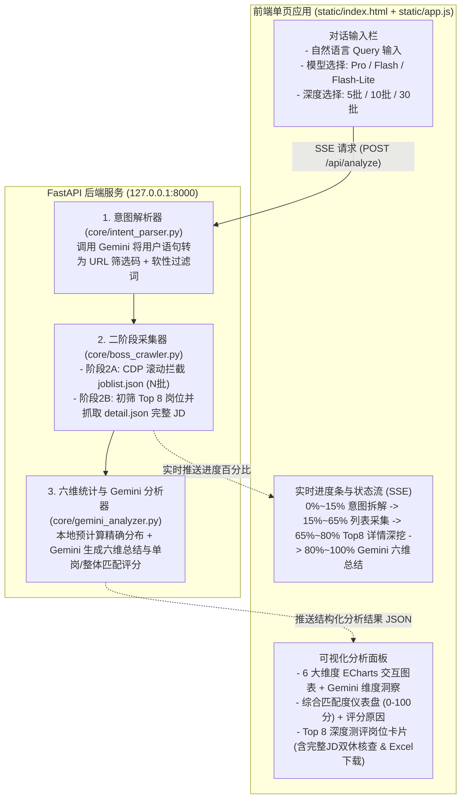

# BOSS直聘智能岗位分析 Chat Agent 系统设计方案

## 1. 核心设计决策确认 (Confirmed Decisions)

| 决策项 | 最终选定方案 |
| :--- | :--- |
| **前端与部署形态** | **极简一体化架构**：FastAPI 托管静态单页应用（HTML5 + CSS + Apache ECharts），免登录、无需 Node.js 编译，一条 `python app.py` 命令即可在本地 `http://127.0.0.1:8000` 启动。 |
| **Gemini 模型调用** | 使用官方 `google-genai` SDK，通过环境变量 `GEMINI_API_KEY` 认证；前端支持下拉切换 **`Gemini Pro` (`gemini-2.5-pro`)**、**`Gemini Flash` (`gemini-2.5-flash`)**、**`Gemini Flash-Lite` (`gemini-2.5-flash-lite`)**。 |
| **抓取深度控制** | 前端输入框旁提供档位选择：**快速 (5批/75条)**、**标准 (10批/150条)**、**全量 (30批/最多450条，遇 `hasMore=False` 自动停止)**。 |
| **二阶段深度采集** | **阶段 1（全景列表抓取）**：下拉获取全部列表岗位（用于 6 大维度全景图表统计）；<br>**阶段 2（Top 8 详情深挖）**：根据软硬条件初筛出最匹配的 Top 8 候选岗位，自动在浏览器中拉取 `/wapi/zpgeek/job/detail.json`，提取**完整 JD 岗位职责正文 (`postDescription`)**、**精确办公地址 (`address`)** 和 **HR 活跃状态 (`activeTimeDesc`)**，交由 Gemini 做精准匹配打分。 |

---

## 2. 系统架构与数据流图 (System Architecture)



---

## 3. 详细模块划分与文件结构 (Project Layout)

```text
/Users/yafan/boss-zhipin-crawler/
├── design/
│   ├── system_design.md                 # 系统架构与实现设计文档
│   └── boss_api_and_labels_reference.md # BOSS直聘 URL 查询参数与数据字段字典
├── app.py                               # FastAPI 主入口（静态页挂载 + /api/analyze SSE 接口 + /api/download Excel 下载）
├── core/
│   ├── __init__.py
│   ├── intent_parser.py                 # 使用 Gemini Structured Output 将自然语言转为 BOSS直聘 URL 参数与软条件
│   ├── boss_crawler.py                  # 二阶段采集引擎（阶段1抓列表 + 阶段2抓 Top 8 岗位详情 JD 与 HR 活跃度）
│   └── gemini_analyzer.py               # 预聚合 6 大维度统计数据，并将全量概览 + Top 8 完整 JD 发送给 Gemini 生成报告
├── static/
│   ├── index.html                       # 对话式 Chat + 可视化看板单页 UI
│   ├── styles.css                       # 现代化深色/浅色自适应仪表盘样式
│   └── app.js                           # 前端交互、SSE 进度条更新及 ECharts 六维图表渲染逻辑
├── output/                              # 每次查询自动归档导出的 Excel 文件目录
├── crawl_boss_poc.py                    # 命令行独立采集脚本
├── start_chrome.sh                      # 启动调试 Chrome 脚本
└── requirements.txt                     # 依赖清单
```

---

## 4. 六大维度图表与评分输出设计 (Visualization & Scoring Schema)

采用 **“Python 精确统计分布 + Gemini 深度解读与打分”** 的混合模式：

1. **所属行业维度 (`industry`)**：
   * **图表**：ECharts 环形饼图（统计全部抓取岗位的 `brandIndustry` 分布）。
   * **Gemini 总结**：分析目标行业（如服饰/零售）占比，指出是否存在跨行业串词。
2. **薪资维度 (`salary`)**：
   * **图表**：ECharts 薪资区间分布柱状图（`<10K`, `10-12K`, `12-15K`, `15-20K`, `20K+`）及平均薪资对比。
   * **Gemini 总结**：结合底薪/提成描述，评估用户期望薪资（如“至少 1w”）在当前市场的真实分位值。
3. **技能要求维度 (`skills`)**：
   * **图表**：ECharts 横向柱状排行榜（统计 Top 12 高频 `skills` 标签）。
   * **Gemini 总结**：提炼该岗位最看重的硬技能与软素质（如门店运营、陈列、团队管理、巡店督导等）。
4. **经验与学历维度 (`experience_degree`)**：
   * **图表**：ECharts 柱状/饼图组合（不同工作年限要求与学历要求分布）。
   * **Gemini 总结**：总结主流经验门槛及对学历的实际宽容度。
5. **招聘公司品牌知名度与规模 (`brand_scale`)**：
   * **图表**：ECharts 规模与融资阶段分布图（公司规模 `0-20人` 至 `万人以上` 结合融资阶段）。
   * **Gemini 总结**：从采集列表中直接点名盘点知名的连锁/上市/大中型品牌公司，并区分直招与代招机构。
6. **福利待遇维度 (`welfare`)**：
   * **图表**：ECharts 条形覆盖率图（统计 `五险一金`、`双休`、`带薪年假`、`底薪加提成`、`年终奖` 等福利出现率）。
   * **Gemini 总结**：重点结合 **Top 8 详情页完整 JD**，核查用户关心的核心痛点（例如“周末双休”在零售督导岗中的真实满足情况，区分固定双休 vs 排班月休 6-8 天）。
7. **综合匹配度评分与原因 (`match_evaluation`)**：
   * **图表**：ECharts 仪表盘（`0 - 100` 分）。
   * **输出内容**：
     * **整体市场匹配度总分 + 核心原因分析**（从供需数量、薪资达标率、作息福利匹配度三个角度给出客观结论）。
     * **Top 8 精选岗位深度测评卡片**：展示每个岗位的单独匹配得分、HR 活跃度（如 `刚刚活跃`）、详细办公地址、JD 中关于薪资/作息的关键摘录、推荐/避坑理由，以及直达 BOSS直聘 的链接与一键下载全量 Excel 按钮。
