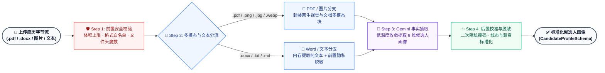
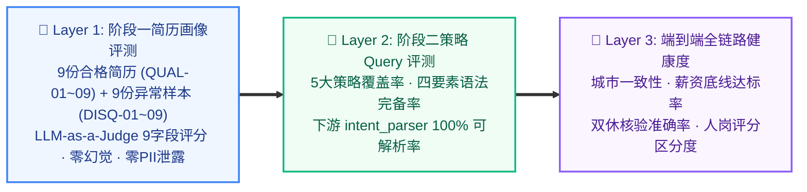

# BOSS直聘智能求职分析 Agent — 系统架构与分阶段设计文档 (`system_design.md`)

**📑 分页导航 (Page Navigation)**

[**第 1 页：全局设计逻辑与架构总览**](#page-1-全局设计逻辑与架构总览) ｜ [**第 2 页：Stage 1 简历读取与画像解析**](#page-2-stage-1-简历安全读取与多模态画像解析) ｜ [**第 3 页：Stage 2 多策略求职 Query 生成**](#page-3-stage-2-基于画像的多策略求职-query-生成) ｜ [**第 4 页：Stage 3 意图解析与 URL 映射**](#page-4-stage-3-自然语言求职意图解析与-url-映射) ｜ [**第 5 页：Stage 4 两阶段反爬采集与初筛**](#page-5-stage-4-boss直聘两阶段反爬采集与初筛打分) ｜ [**第 6 页：Stage 5 六维分析、看板与评测体系**](#page-6-stage-5-六维统计人岗匹配评估与三层评测体系)

---

## 【第 1 页 / 共 6 页】全局设计逻辑、核心架构思路与全链路总览

### 1.1 核心痛点与系统设计哲学 (Design Philosophy)

传统求职者在招聘平台搜索岗位时面临三大核心痛点：
1. **搜索词构建盲目（“不知道搜什么”）**：求职者往往不清楚自己的简历资历在目标城市适合搜索什么标准岗位名、定多少月薪底线、能争取哪些作息福利；
2. **列表页信息缺失与关键词误伤（“搜不准、看不全”）**：BOSS直聘列表页不展示完整职位描述（JD），“周末双休 vs 门店排班轮休”往往隐藏在详情页正文中；此外直接搜索带修饰词的“服装店面督导”会漏掉大量标题仅写“店面督导”但属于知名服装品牌公司的优质岗位；
3. **缺乏全局市场统计与人岗真实履历对比（“缺乏全局洞察”）**：求职者只能逐条点开查看，缺乏对数百个在招岗位的六维统计分布（行业、薪资、技能、经验学历、品牌规模、福利作息）以及结合自身真实简历的客观匹配度诊断。

围绕上述痛点，本系统确立了 **五大核心架构设计思路**：

| 核心设计原则 | 架构决策与工程思路 | 解决的核心问题 |
| :--- | :--- | :--- |
| **① 简历理解与策略生成双阶段解耦** | 将简历处理拆分为 **Stage 1（`core/resume_parser.py`，`temperature=0.1` 收敛型多模态事实抽取）** 与 **Stage 2（`core/query_generator.py`，`temperature=0.4` 发散型求职策略生成）**，中间插入 Python 确定性校准、PII 二次脱敏与 BOSS直聘 高频岗位词锚点桥接 | 兼顾“简历事实提取零幻觉”与“求职策略生成多样性”；前端修改意向城市/底薪时无需重传简历即可秒级重生成 10 条推荐 Query |
| **② 硬性 URL 筛选与软性语义条件分离** | **Stage 3** 将用户自然语言拆解为 **BOSS直聘 原生 URL 编码参数**（城市码、薪资档位码、剥离定语后的纯净岗位核心词）与 **软性评估条件**（具体底薪数值、双休要求、行业同义词扩展组） | 既保证 BOSS直聘 搜索引擎的高召回率（不因行业前缀漏掉好岗位），又为下游初筛打分与 LLM 深度评估提供精准判据 |
| **③ CDP 真实会话接管 + 两阶段采集** | **Stage 4** 通过 Playwright CDP 接管本机已登录 Chrome（`:9222`），先滚动拦截 `N` 批列表 JSON（广度覆盖 75~450 条），再经数学公式初筛打分，仅对 **Top 3~20** 候选岗同源 `fetch` 详情页完整 JD | 彻底规避 Headless 指纹封禁与高频详情页滑块验证码，以最小请求代价同时获取全量统计样本与头部岗位完整 JD |
| **④ Python 确定性统计 + LLM 语义推理** | **Stage 5** 由 Python 100% 精确计算六大维度分布、中位数与达标率，再将统计结果 + Top N 完整 JD + 候选人脱敏画像注入 Gemini 生成六维洞察与人岗双向评分 | 杜绝大模型算术统计幻觉（算错百分比/中位数），同时发挥 LLM 在隐性 JD 要求核查与人岗履历契合度诊断上的深度推理优势 |
| **⑤ 纵深防御安全网关 + 三层自动化评测** | 全程纯内存流式处理简历（零磁盘落盘）、五层文件魔数/防 XXE 校验、四类 PII 正则掩码、前端零 `innerHTML` 渲染，并配套 In-House 三层自动化评测看板（LLM-as-a-Judge + 确定性门禁） | 严格防御任意文件上传、Zip Bomb、XXE、Prompt 注入、PII 隐私泄露与 DOM XSS，并使每一阶段的质量可量化、可回归 |

---

### 1.2 全链路五阶段（Stage 1 ~ Stage 5）高层架构图

---

### 1.3 五大阶段职责边界与输入输出契约

| 阶段编号 | 阶段名称 | 核心代码模块 | 后端 API 端点 | 核心输入 | 核心输出 |
| :--- | :--- | :--- | :--- | :--- | :--- |
| **Stage 1** | **简历安全读取与多模态画像解析** | `core/resume_parser.py` | `POST /api/resume/parse-profile` | 原始简历字节流 (`raw_bytes`) + 文件名 | 经二次 PII 脱敏与标准化的 9 字段候选人画像 `profile` |
| **Stage 2** | **基于画像的多策略求职 Query 生成** | `core/query_generator.py` | `POST /api/resume/generate-queries` | Stage 1 `profile` + 用户可选微调项（城市/底薪/方向） | 10 条覆盖不同求职策略的自然语言 `recommended_queries` |
| **Stage 3** | **自然语言意图解析与 URL 映射** | `core/intent_parser.py` | `POST /api/analyze` (Step 1) | 自然语言求职句子 `query` | `ParsedSearchIntent`（目标搜索 URL + 软性过滤条件） |
| **Stage 4** | **两阶段反爬采集与初筛打分** | `core/boss_crawler.py` | `POST /api/analyze` (Step 2) | `ParsedSearchIntent` + `max_batches` + `top_detail_count` | 全量列表 `collected_jobs` + 含完整 JD 的 `top_candidates` + `.xlsx` |
| **Stage 5** | **六维统计、人岗匹配评估与三层评测** | `core/gemini_analyzer.py` / `resume_eval_benchmark/` | `POST /api/analyze` (Step 3) & `/api/eval/*` | 全量岗位 + Top N 完整 JD + `resume_profile` | 六维 ECharts 看板 JSON + 人岗匹配诊断 + 三层评测报告 |

---

### 1.4 公共底层支撑：Gemini Interactions API 双通道自适应客户端 (`core/gemini_client.py`)

Stage 1、Stage 2、Stage 3 与 Stage 5 均通过底层统一客户端 `create_interaction_with_fallback` 调用 Gemini 模型：
1. **统一采用 `client.interactions.create(...)` 原生接口**：支持多模态输入块列表（`document` / `image` / `text`）与结构化 JSON Schema 约束输出（通过 `clean_json_schema` 自动递归展开 Pydantic `$defs` / `$ref` 嵌套引用）。
2. **Vertex AI Global 免代理直连 + AI Studio 自动回退双通道**：
   - 优先使用 GCP Vertex AI Global Endpoint (`location="global"`)，在企业网络或中国大陆环境下无需第三方代理即可低延迟直连；
   - 自动兼容 AI Studio API Key 通道与本地代理端口探测，并内置模型候选回退链缓存 `_RESOLVED_MODEL_CACHE`（支持 `gemini-3.8-flash`、`gemini-3.5-flash-lite`、`gemini-3.1-pro`、`gemini-4-argon`）。

---

## 【第 2 页 / 共 6 页】Stage 1：简历安全读取、多模态解析与结构化画像提取 (`core/resume_parser.py`)

> **返回总览**：[第 1 页：全局设计逻辑与架构总览](#page-1-全局设计逻辑与架构总览) ｜ **下一阶段**：[第 3 页：Stage 2 多策略求职 Query 生成](#page-3-stage-2-基于画像的多策略求职-query-生成)

### 2.1 Stage 1 设计目标与核心职责

Stage 1 对应后端独立接口 `POST /api/resume/parse-profile` 与核心入口函数 `extract_resume_profile_with_gemini`。其核心任务是将用户上传的异构格式简历（PDF、Word、图片、Markdown/纯文本）**在纯内存中安全读取、校验、脱敏，并转化为零幻觉、高保真的 9 字段结构化候选人求职画像 (`CandidateProfileSchema`)**。

---

### 2.2 `resume_parser.py` 读取与解析高层设计流程 (High-Level Design Flow)

高层处理流程分为四个核心阶段：
1. **Step 1 — 前置安全与魔数校验 (`validate_and_detect_resume_format`)**：在纯内存中拦截空文件、超限文件（`>10MB`）、非白名单扩展名以及扩展名与二进制文件头签名（Magic Bytes）不匹配的伪装文件。
2. **Step 2 — 多模态与文本分流读取**：
   - **视觉与排版敏感格式（`.pdf` 与图片）**：直接编码为 Base64 多模态内容块（`DocumentContent` / `ImageContent`），完整保留双栏、时间轴与图文混排结构；
   - **文档与文本格式（`.docx` / `.txt` / `.md`）**：在内存中安全解析段落文本（防 Zip Bomb 与 XXE），并在送入模型前执行前置 PII 隐私脱敏。
3. **Step 3 — Gemini 收敛型事实抽取 (`extract_resume_profile_with_gemini`)**：以 `temperature=0.1` 调用 Gemini Interactions API，严格按 `CandidateProfileSchema` 提取 9 个核心画像字段（若网络异常则自动切换本地启发式规则 `build_heuristic_profile_from_text` 兜底）。
4. **Step 4 — Python 后置确定性校准 (`sanitize_and_normalize_profile`)**：对模型输出的全部字段执行二次 PII 掩码兜底、目标城市词库对齐（`_normalize_city_list`）及期望底薪格式统一（`_normalize_salary_floor`）。

---

### 2.3 核心子模块关键设计细节

#### (1) 前置文件安全与 Magic Bytes 校验规则 (`validate_and_detect_resume_format`)

| 允许的扩展名 | 标准 MIME 类型 | 二进制文件头 Magic Bytes 强校验规则 | 典型拦截场景（对应评测集 `DISQ-*`） |
| :--- | :--- | :--- | :--- |
| `.pdf` | `application/pdf` | `raw_bytes.startswith(b"%PDF-")` | 拦截改名为 `.pdf` 的 JPEG 图片 (`DISQ-05`) 或 EXE 程序 (`DISQ-06`) |
| `.png` | `image/png` | `raw_bytes.startswith(b"\x89PNG\r\n\x1a\n")` | 拦截伪造 PNG 文件头的非图像文件 |
| `.jpg` / `.jpeg` | `image/jpeg` | `raw_bytes.startswith(b"\xff\xd8\xff")` | 拦截伪造 JPEG 扩展名的损坏或异构文件 |
| `.webp` | `image/webp` | `len >= 12 and startswith(b"RIFF") and raw_bytes[8:12] == b"WEBP"` | 拦截非法 RIFF 容器文件 |
| `.docx` | `application/vnd.openxmlformats...` | `raw_bytes.startswith(b"PK\x03\x04")` 且含 `word/document.xml` | 拦截旧版二进制 Word 97-2003 `.doc` (`DISQ-01`) 或普通 `.zip` (`DISQ-02`) |
| `.txt` / `.md` | `text/plain` / `text/markdown` | 前 4096 字节不含二进制空字节 `b"\x00"` | 拦截二进制流伪装为文本文件 |

#### (2) `.docx` 安全提取与防文本框重复机制 (`extract_text_from_docx`)
- **防 Zip Bomb 与防 XXE**：在内存 `ZipFile(BytesIO)` 中校验所有条目未压缩总体积 `<= 20 MB`（`MAX_DOCX_UNCOMPRESSED_BYTES`），并检查 `word/document.xml` 前 2048 字节拒绝 `<!DOCTYPE` 与 `<!ENTITY`。
- **消除绘图文本框嵌套与兼容块重复**：针对复杂中文 Word 简历模板中包含 `w:txbxContent`（绘图文本框）或 `mc:AlternateContent`（`mc:Choice` + `mc:Fallback`）的结构，自动跳过包含嵌套子 `<w:p>` 的外层容器节点，并通过 `seen_lines` 集合对叶子段落去重。

#### (3) 双端确定性 PII 隐私脱敏 (`mask_sensitive_pii`)
在送入模型前与模型输出后，通过确定性正则掩码抹除 4 大类敏感隐私：
1. **中国大陆 11 位手机号**（如 `138****0000`）；
2. **18 位二代身份证号**（如 `420106********1234`）；
3. **电子邮箱地址**（如 `h***@163.com`）；
4. **详细家庭住址 / 学校校区 / 学生宿舍门牌地址**（覆盖显式地址标签、街道门牌号、小区/校区/宿舍楼栋室号，统一替换为 `[地址已脱敏]`）。

#### (4) 9 字段结构化画像 Schema 与后置校准 (`CandidateProfileSchema` & `sanitize_and_normalize_profile`)

| 字段名 | 类型 | 提取规则与 Python 后置校准 (`sanitize_and_normalize_profile`) |
| :--- | :--- | :--- |
| `candidate_title` | `str` | 结合最近 1~2 份工作与求职意向提炼专业头衔 + 二次 PII 掩码 |
| `years_of_experience` | `str` | 核算工作时间线总年限与核心资历（应届生标注实习经历）+ 二次 PII 掩码 |
| `education_summary` | `str` | 最高学历 · 专业（院校名称），严禁包含校区街道或宿舍楼号 + 二次 PII 掩码 |
| `target_cities` | `List[str]` | 经 `_normalize_city_list` 优先匹配 `CITY_CODE_MAP` 标准市名，剥离区县街道门牌，最多保留 3 个城市 |
| `industry_background` | `List[str]` | 2~4 个过往从业细分行业标签 |
| `core_skills` | `List[str]` | 4~8 个核心硬技能与业务管理能力标签 |
| `experience_highlights` | `List[str]` | 2~4 条最具说服力的量化业绩或项目成果（严禁含任何 PII） |
| `inferred_salary_floor` | `str` | 经 `_normalize_salary_floor` 统一将 `12000` / `12k` / `1.2万` 规整为 `"1.2w"` 格式 |
| `inferred_welfare_prefs` | `List[str]` | 2~4 项建议争取的作息与福利条件（默认兜底 `["周末双休", "五险一金", "年终奖"]`） |

---

## 【第 3 页 / 共 6 页】Stage 2：基于画像的多策略求职 Query 生成 (`core/query_generator.py`)

> **上一阶段**：[第 2 页：Stage 1 简历读取与画像解析](#page-2-stage-1-简历安全读取与多模态画像解析) ｜ **下一阶段**：[第 4 页：Stage 3 意图解析与 URL 映射](#page-4-stage-3-自然语言求职意图解析与-url-映射)

### 3.1 Stage 2 设计目标与为什么独立解耦

Stage 2 对应独立模块 `core/query_generator.py`、后端独立接口 `POST /api/resume/generate-queries` 与核心函数 `generate_queries_from_profile_with_gemini`（默认模型 `gemini-3.8-flash`，默认 `temperature=0.4`，默认输出 `10` 条求职 Query）。将 Stage 2 从 `core/resume_parser.py` 中独立出来的三大工程收益：
1. **温度参数与认知模式分离**：Stage 1 (`core/resume_parser.py`) 需要 `temperature=0.1` 的严格事实收敛，而 Stage 2 (`core/query_generator.py`) 需要 `temperature=0.4` 的猎头级职业规划发散能力（推演精准对口、晋升冲刺、跨界拓展、细分垂直深耕等 10 条差异化路径）；
2. **Python 词库锚点注入防生造词**：在 Stage 1 得到 `profile` 后，Python 中间层调用 `_infer_boss_role_anchors` 匹配 `BOSS_ROLE_SYNONYMS`，将 BOSS直聘 上真实高频存在的简洁岗位词注入 Stage 2 Prompt，防止模型生成带斜杠或无人搜索的生造长难词；
3. **前端免重传秒级交互闭环**：用户在前端简历卡片上调整“意向城市”、“月薪底线”或输入“附加求职偏好”时，前端仅需向 `/api/resume/generate-queries` 发送轻量级 JSON（约 300 Tokens），即可秒级刷新 10 条推荐 Query，无需重新上传和解析简历文件。

---

### 3.2 Stage 2 处理流程与十维求职策略矩阵

#### 十大差异化求职策略维度规范

由于 BOSS直聘 上是先定位城市再进行搜索，每条生成的 `query_text` **不包含城市名称**，并将原福利要求替换为**目标行业赛道**，严格包含 **【① 目标行业/细分赛道 + ② BOSS直聘高频简洁单一岗位名（2~8字，严禁含 `/` 拼接）+ ③ 明确最低月薪底线】** 3 个核心要素，以便与下游 Stage 3 (`intent_parser.py`) 100% 无缝对接：

| 策略序号 | `strategy_tag` | 岗位方向定位 | 薪资梯度设计 | 典型生成示例 (`query_text`) |
| :--- | :--- | :--- | :--- | :--- |
| **策略 1** | `精准对口` | 最贴合候选人核心头衔与过往行业的同级高频岗位 | 基准月薪 (`base_salary`) | `"企业服务软件行业的Java开发工程师岗位，月薪至少1.2w"` |
| **策略 2** | `晋升冲刺` | 结合管理经验或核心业绩亮点向上跃迁一级（主管/经理/架构） | 基准月薪上浮 `15%~30%` | `"连锁服装零售行业的区域运营经理岗位，月薪至少1.5w"` |
| **策略 3** | `核心行业优选` | 聚焦候选人履历中最具竞争力的主航道行业标准岗位 | 稳健底薪，对口赛道 | `"互联网新媒体行业的新媒体运营岗位，月薪至少0.8w"` |
| **策略 4** | `跨界拓展` | 利用候选人 `core_skills` 中的可迁移能力切入相邻高景气赛道 | 基准月薪 (`base_salary`) | `"消费电子与智能硬件行业的互联网产品运营主管，月薪至少1w"` |
| **策略 5** | `高薪突破` | 面向高薪酬溢价行业或高壁垒资深业务统筹岗 | 基准月薪上浮 `25%~40%` | `"金融科技行业的数字营销项目经理岗位，月薪至少1.8w"` |
| **策略 6** | `细分垂直深耕` | 围绕候选人最擅长的一项垂直专业技能或细分垂直行业场景 | 基准月薪 (`base_salary`) | `"MCN与短视频电商行业的短视频内容策划岗位，月薪至少0.9w"` |
| **策略 7** | `头部名企/大厂` | 结合学历背景与代表性项目经历，匹配中大型企业主导行业标准岗 | 基准月薪上浮 `10%~20%` | `"大型跨国贸易与供应链企业的国际贸易专员岗位，月薪至少0.8w"` |
| **策略 8** | `复合技能溢价` | 结合 2 项以上交叉技能（如“技术+项目管理”、“外语+跨境贸易”） | 基准月薪上浮 `15%~25%` | `"跨境电商出海行业的跨境电商运营主管岗位，月薪至少1.2w"` |
| **策略 9** | `高成长潜力岗` | 面向新兴数字化、AI 应用、智能制造或高增长业务线潜力岗 | 基准月薪 (`base_salary`) | `"人工智能与大模型行业的AI应用研发工程师岗位，月薪至少1.2w"` |
| **策略 10** | `稳健保底优选` | 在对口主流行业适当放宽起薪门槛以换取极高的面试邀约密度 | 基准月薪下调 `10%~15%` | `"信息化软件开发行业的软件开发工程师岗位，月薪至少0.7w"` |

---

## 【第 4 页 / 共 6 页】Stage 3：自然语言求职意图解析与 URL 映射 (`core/intent_parser.py`)

> **上一阶段**：[第 3 页：Stage 2 多策略求职 Query 生成](#page-3-stage-2-基于画像的多策略求职-query-生成) ｜ **下一阶段**：[第 5 页：Stage 4 两阶段反爬采集与初筛](#page-5-stage-4-boss直聘两阶段反爬采集与初筛打分)

### 4.1 Stage 3 设计思路：硬性 URL 筛选与软性语义条件解耦

当用户在前端点击 Stage 2 预生成的任意推荐 Query（或手动输入如 *“深圳的服装店面督导，月薪至少1w，周末要双休，五险一金齐全”*）并发起分析时，Stage 3（`parse_user_intent`）负责将其转化为结构化的 `ParsedSearchIntent` 对象：

1. **为什么不能把整句话或“行业+岗位”直接塞进 BOSS直聘 搜索词 `query`？**
   - 如果在 BOSS直聘 搜索 `query=服装店面督导`，搜索引擎只匹配职位名称字面包含“服装”二字的岗位，导致优衣库、UR、绫致时装等大批职位名称仅写 `"店面督导"` 或 `"零售督导"` 的知名服装品牌岗位被全部漏掉！
   - 因此，Stage 3 专门执行**「核心岗位词去定语提纯 + 行业同义词组扩展」**：将 URL 搜索词 `query` 提纯为 `"店面督导"`（保障最大化召回），同时将 `"服装"` 结合内置词典 `DOMAIN_SYNONYMS` 扩展为 `industry_keywords = ["服装", "服饰", "女装", "男装", "鞋服", "时尚", "零售", "连锁"]`，交由 Stage 4 初筛打分器对公司行业、职位名与技能标签进行加权匹配。
2. **硬性 URL 参数 vs 软性语义判据分离**：
   - **硬性 URL 参数（由 `build_boss_url()` 编码进请求地址）**：`city_code`（如深圳 `101280600`）、纯净 `query`、薪资档位码 `salary_code`（如 `405` 对应 `10-20K`）、经验码 `experience_code`、学历码 `degree_code`；
   - **软性语义判据（透传给 Stage 4 初筛与 Stage 5 深度评估）**：精确期望底薪数值 `min_salary_k`（如 `12` 代表 `12K`）、是否要求周末双休 `require_double_weekend`（布尔值）、行业近义词列表 `industry_keywords`、福利软性要求列表 `soft_requirements`。

---

### 4.2 Stage 3 解析流程与双擎容灾架构

---

### 4.3 核心字典映射与正则提纯规则

| 映射维度 | 字典常量 (`core/intent_parser.py`) | 关键编码与转换规则 |
| :--- | :--- | :--- |
| **21 城标准编码** | `CITY_CODE_MAP` | `深圳: 101280600`, `广州: 101280100`, `上海: 101020100`, `北京: 101010100`, `武汉: 101200100`, `成都: 101270100`, `杭州: 101210100` 等 |
| **薪资档位映射** | `SALARY_CODE_LABELS` | 正则提取 `(\d+(?:\.\d+)?)\s*[wW万]` 乘以 10 转为 `K`；`<3K` $\rightarrow$ `402`，`3-5K` $\rightarrow$ `403`，`5-10K` $\rightarrow$ `404`，**`10-20K` $\rightarrow$ `405`**，`20-50K` $\rightarrow$ `406`，`50K+` $\rightarrow$ `407` |
| **经验与学历编码** | `EXPERIENCE_CODE_LABELS` / `DEGREE_CODE_LABELS` | 经验：`101`(不限), `103`(1年以内), `104`(1-3年), `105`(3-5年), `106`(5-10年)；学历：`202`(大专), `203`(本科), `204`(硕士), `205`(博士) |
| **行业同义词扩展** | `DOMAIN_SYNONYMS` | 内置 `服装`、`餐饮`、`美妆`、`数码`、`珠宝`、`商超`、`教育`、`医疗` 8 大高频零售与服务赛道近义词簇 |

---

## 【第 5 页 / 共 6 页】Stage 4：BOSS直聘两阶段反爬采集与初筛打分 (`core/boss_crawler.py`)

> **上一阶段**：[第 4 页：Stage 3 意图解析与 URL 映射](#page-4-stage-3-自然语言求职意图解析与-url-映射) ｜ **下一阶段**：[第 6 页：Stage 5 六维分析、看板与评测体系](#page-6-stage-5-六维统计人岗匹配评估与三层评测体系)

### 5.1 Stage 4 设计思路：为什么采用「CDP 接管 + 两阶段采集」

BOSS直聘具备极强的动态反爬机制（`__zp_stoken__` 环境指纹签名、`disable-devtool` 调试器检测、高频请求详情页触发滑块验证码）。Stage 4（`crawl_boss_two_stage`）通过三大机制实现稳定采集：
1. **接管本机真实已登录 Chrome (`127.0.0.1:9222`)**：通过 `p.chromium.connect_over_cdp("http://127.0.0.1:9222")` 复用真实浏览器指纹、登录态 Cookie 与 `__zp_stoken__` 生成环境；
2. **路由层反调试剥离 + 网络层被动监听 JSON**：通过 `page.route` 拦截 `**/static.zhipin.com/**/*.js*`，将反调试跳转函数 `"this.seact(),"` 动态替换为 `"return;this.seact(),"`；通过 `page.on("response")` 直接捕获后台 `/wapi/zpgeek/search/joblist.json` 响应包，避免脆弱的 DOM 解析；
3. **Stage 4A（全量列表广度采集）+ 数学公式初筛 + Stage 4B（Top 3~20 详情页同源 `fetch` 深挖）**：
   - **Stage 4A** 滚动加载 `5~30` 批列表（75~450 个岗位），提取 14 项基础字段用于全局六维统计；
   - **初筛排序** 使用确定性评分公式计算每个岗位的初筛分；
   - **Stage 4B** 仅对排名前 `top_detail_count`（用户在前端可自定义 `3~20`，默认 `8`）的候选岗位，在浏览器上下文内执行同源 `fetch('/wapi/zpgeek/job/detail.json?...')`，获取完整职位描述 (`postDescription`)、精确办公地址 (`address`) 与 HR 活跃状态 (`activeTimeDesc`)。

---

### 5.2 候选岗位初筛打分数学模型 (`score_candidate_for_detail`)

为确保宝贵的 Stage 4B 详情页请求名额分配给最匹配的岗位，定义初筛评分函数（基础分 `50.0` 分）：

$$\text{Score} = 50.0 + S_{\text{title}} + S_{\text{industry}} + S_{\text{salary}} + S_{\text{weekend}} + S_{\text{scale}} + S_{\text{welfare}} + S_{\text{online}}$$

| 评分因子 | 符号 | 计算逻辑与分值权重 | 设计目的 |
| :--- | :--- | :--- | :--- |
| **核心岗位词命中** | $S_{\text{title}}$ | 若 `intent.query` 出现在 `岗位名称` 中：**`+18.0` 分** | 优先召回职能直接对口的岗位 |
| **行业同义词命中** | $S_{\text{industry}}$ | 统计 `岗位名+行业+公司名+技能+福利` 命中的 `industry_keywords` 词数 $k$： • $k \ge 1$：**$+\min(25.0, 12.0 + 4.0k)$ 分** • 用户有行业要求但 $k = 0$：**`-10.0` 分** | 找回标题未写行业词但所属公司/技能属于目标行业的知名品牌岗位 |
| **薪资底线达标度** | $S_{\text{salary}}$ | 设用户期望底薪为 $M = \text{min\_salary\_k} > 0$： • 岗位最低薪 $\text{min\_k} \ge M$（底薪稳超期望）：**`+12.0` 分** • $\text{min\_k} < M \le \text{max\_k}$（上限覆盖期望）：**`+5.0` 分** • $\text{max\_k} < M$（最高薪仍不达标）：**`-15.0` 分** | 拉开“底薪实打实达标”与“靠提成才摸到期望线”的差距 |
| **作息双休匹配度** | $S_{\text{weekend}}$ | 当 `require_double_weekend=True` 时，经 `detect_weekend_policy` 判定： • `"周末双休"`：**`+15.0` 分** • `"大小周/单双休"` 或 `"排班轮休/单休"`：**`-8.0` 分** | 过滤门店排班单休岗（注：Stage 4B 拿到完整 JD 后会二次刷新该项得分） |
| **企业规模与活跃度** | $S_{\text{scale}} + S_{\text{welfare}} + S_{\text{online}}$ | • `500人以上` 大中型企业 **`+6.0` 分**，`100-499人` **`+3.0` 分** • 每项福利标签 **`+0.8` 分**（上限 `+5.0` 分） • HR 在线 (`BOSS在线 == True`) **`+2.0` 分** | 优先推荐福利完善、正在积极招人的大中型规范企业 |

---

### 5.3 作息制度三级状态机与 Excel 归档导出

- **作息制度识别状态机 (`detect_weekend_policy`)**：
  联合扫描列表页 `福利待遇` 标签与详情页 `完整职责描述 (postDescription)`：
  1. 命中 `["双休", "做五休二", "周末双休", "五天八小时", "5天8小时", "周六日休"]` $\rightarrow$ **`"周末双休"`**；
  2. 命中 `["大小周", "大小休", "隔周双休", "单双休"]` $\rightarrow$ **`"大小周/单双休"`**；
  3. 命中 `["月休6天", "月休8天", "月休4天", "排班", "轮休", "调休", "做六休一", "单休"]` $\rightarrow$ **`"排班轮休/单休"`**；
  4. 均未命中 $\rightarrow$ **`"未明确注明"`**。
- **17 列格式化 Excel 自动导出 (`export_jobs_to_excel`)**：
  每次采集完成后自动按初筛匹配分降序排列，使用 `openpyxl` 导出带冻结首行、品牌青色表头与自适应列宽的 `.xlsx` 文件至 `output/` 目录。

---

## 【第 6 页 / 共 6 页】Stage 5：六维统计计算、人岗双向评估与三层评测体系 (`core/gemini_analyzer.py` & `resume_eval_benchmark/`)

> **上一阶段**：[第 5 页：Stage 4 两阶段反爬采集与初筛](#page-5-stage-4-boss直聘两阶段反爬采集与初筛打分) ｜ **返回总览**：[第 1 页：全局设计逻辑与架构总览](#page-1-全局设计逻辑与架构总览)

### 6.1 Python 六维确定性统计 + Gemini 人岗双向深度评估 (`core/gemini_analyzer.py`)

Stage 5 采用**「Python 算术统计零误差 + Gemini 语义推理深洞察」**的分工架构：

| 维度编号 | 维度名称 | Python 确定性统计函数 (`compute_six_dimension_stats`) | 前端 ECharts 图表形态 (`static/app.js`) | Gemini 结合简历画像的深度分析重点 |
| :--- | :--- | :--- | :--- | :--- |
| **维度 01** | **所属行业分布** | Top 10 行业频次 `distribution` + 命中目标行业词占比 `matched_keyword_ratio` | 环形饼图 (`pie`) | 盘点主流招聘行业构成、跨界机会及与候选人过往行业背景契合度 |
| **维度 02** | **薪资水平分布** | 7 档月薪分桶（`<8K` ~ `30K+`）、平均起薪 `avg_min_k`、平均上限 `avg_max_k`、中位数 `median_mid_k`、13薪+占比、期望底薪达标率 `meet_expected_ratio` | 4 枚 KPI 胶囊 + 圆角柱状图 (`bar`) | 评估候选人期望月薪在当前市场的真实分位值，拆解底薪与绩效提成结构 |
| **维度 03** | **核心技能要求** | 拆分全部岗位技能标签统计 Top 15 高频词频 | 水平条形排名图 (`bar`) | 对比市场 Top 12 硬技能 + Top N 完整 JD 隐性要求与候选人 `core_skills` 的重合与缺口 |
| **维度 04** | **经验与学历门槛** | `experience_dist`（经验分布）+ `degree_dist`（学历分布） | 左右双环形对比饼图 (`pie`) | 评估候选人真实学历与工作年限在目标市场中的竞争身位 |
| **维度 05** | **公司品牌与规模** | `scale_dist`、`stage_dist` + 自动提炼 `500人以上`/`已上市` 知名企业列表 `notable_companies` | 知名品牌标签云 + 双环形饼图 | 点名盘点在招头部连锁/上市企业，区分品牌直招与代招机构 |
| **维度 06** | **福利待遇与作息** | `weekend_dist`（双休/大小周/排班/未注明）+ Top 12 高频福利词频 `top_welfare` | 左作息饼图 + 右福利水平条形图 | 结合详情页完整 JD 核查真实双休占比、五险一金与年终奖兑现度 |

- **人岗双向契合度评分 (`analyze_jobs_with_gemini`)**：
  当用户在 Stage 1 上传过简历时，后端将脱敏后的 `resume_profile` 注入 Stage 5 Prompt，使模型输出的 `overall_match_score` (`0-100`)、三栏诊断（核心优势 / 潜在风险 / 行动建议）以及 **Top 3~20 候选岗位逐一测评卡片 (`job_evaluations`)** 均直接引用候选人的真实年限、技能与量化业绩进行定制化点评。

---

### 6.2 In-House 三层自动化评测工作台 (`resume_eval_benchmark/`)

为持续度量并保障各阶段质量，系统内置了完整的 **三层评测基准与前端可视化评测面板 (`#eval-workspace-section`)**：

1. **黄金基准数据集（Golden Benchmark Dataset）**：
   - **合格简历集 (`qualified_manifest.json`)**：包含 `QUAL-01` ~ `QUAL-09` 共 9 份跨格式真实简历（4 份 PDF、2 份 DOCX、2 份 JPG 视觉简历、1 份 Markdown 简历，其中 `QUAL-04.pdf` 与 `QUAL-09.md` 为同一候选人跨格式一致性对照样本），每份均标注了 9 个字段的 Ground Truth 与 `raw_pii_tokens` 隐私红线词。
   - **不合格防御集 (`disqualified_manifest.json`)**：包含 `DISQ-01` ~ `DISQ-09` 共 9 份异常样本，覆盖 5 大安全与语义拒识维度（`UNSUPPORTED_EXTENSION`、`FILE_TOO_LARGE`、`EMPTY_FILE`、`INVALID_MAGIC_BYTES`、`NOT_A_RESUME`、`PROMPT_INJECTION_DETECTED`）。
2. **原子级 LLM-as-a-Judge 评分引擎 (`llm_judge_evaluator.py`)**：
   - 对合格简历的 9 个输出字段逐一与 `ground_truth` 及 `raw_resume_text` 对比，输出 `0~10` 分（支持 `gemini` 裁判模式与 `offline_heuristic` 确定性离线裁判模式），并严格核查 `entity_and_number_match`（学校/公司/量化指标无篡改）与 `zero_hallucination`（零无中生有）。
3. **前端一键触发与历史归档看板（`/api/eval/overview` & `/api/eval/run`）**：
   - 支持在 Web 界面直接切换查看 Stage 1 / Stage 2 / E2E 三层评测报告、雷达图、格式分桶得分、9×9 字段热力矩阵与 9 类不合格样本拦截明细表。
