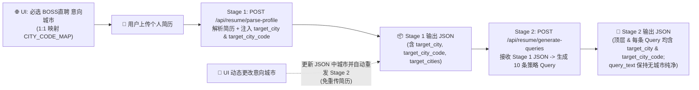

# Technical Design: User-Selected City Propagation (UI -> Stage 1 -> Stage 2)

## 1. End-to-End Data Flow

## 2. Canonical BOSS直聘 City Mapping (1:1 Contract)
- Single source of truth: `CITY_CODE_MAP` in `core/intent_parser.py` (expanded to cover major Chinese tier-1/2/3 & provincial capital cities with official BOSS直聘 codes).
- `GET /api/config` returns `boss_cities: [{"name": "深圳", "code": "101280600"}, ...]` so frontend dropdown options are 100% 1:1 mapped to BOSS直聘 official city codes.
- Helper `resolve_boss_city(city_name: str) -> Tuple[str, str]` strips trailing `"市"` and verifies exact membership in `CITY_CODE_MAP`; raises `ValueError` (`INVALID_TARGET_CITY`) if an explicit UI city is not in `CITY_CODE_MAP`.

## 3. Stage 1 Contract Changes (`core/resume_parser.py` & `app.py`)
- `POST /api/resume/parse-profile` accepts multipart form field `target_city: str` (required from UI; optional in internal/eval calls with fallback to resume extraction).
- `extract_resume_profile_with_gemini(..., target_city: Optional[str] = None)`:
  - When `target_city` is provided, validate it against `CITY_CODE_MAP` to get `(canonical_city, city_code)`.
  - After LLM extraction and `sanitize_and_normalize_profile`, inject into the returned `profile` and top-level JSON:
    - `profile["target_city"] = canonical_city`
    - `profile["target_city_code"] = city_code`
    - `profile["target_cities"] = [canonical_city]` (or placing `canonical_city` first while keeping it strictly BOSS-mapped)
  - Top-level Stage 1 JSON also exposes `"target_city": canonical_city` and `"target_city_code": city_code`.

## 4. Stage 2 Contract Changes (`core/query_generator.py` & `app.py`)
- `POST /api/resume/generate-queries` receives `profile` JSON (already carrying `target_city` and `target_city_code`, plus optional `target_city` override).
- `RecommendedQueryItem` schema adds:
  - `target_city: str`
  - `target_city_code: str`
- Top-level Stage 2 response JSON adds:
  - `target_city: str`
  - `target_city_code: str`
  - `target_cities: List[str]`
- `_sanitize_queries_list` deterministically binds each item's `target_city` and `target_city_code` to the validated BOSS直聘 city from `effective_profile`, while `_strip_city_and_welfare_from_query` continues ensuring `query_text` itself contains zero city names and zero welfare terms.

## 5. Frontend UI Behavior (`static/index.html` & `static/app.js`)
1. **Pre-Upload City Selector**:
   - Place a prominent `<select id="resume-target-city-select">` populated dynamically from `/api/config`'s `boss_cities`, defaulting to placeholder `"-- 请先选择 BOSS直聘 意向城市 --"`.
   - Clicking upload or dropping a resume file before selecting a city triggers a clear inline validation prompt and focuses the city selector without sending a request.
2. **Dynamic City Change After Parsing**:
   - Once `currentResumeProfile` exists, changing the city selector (either the main selector or the profile bar's city selector, kept in sync) immediately:
     1. Updates `currentResumeProfile.target_city`, `currentResumeProfile.target_city_code`, and `currentResumeProfile.target_cities` with the newly selected BOSS直聘 city;
     2. Automatically triggers `POST /api/resume/generate-queries` with the updated `currentResumeProfile` JSON;
     3. Re-renders the 10 recommended query cards with the updated `target_city` badge and loading state feedback.
