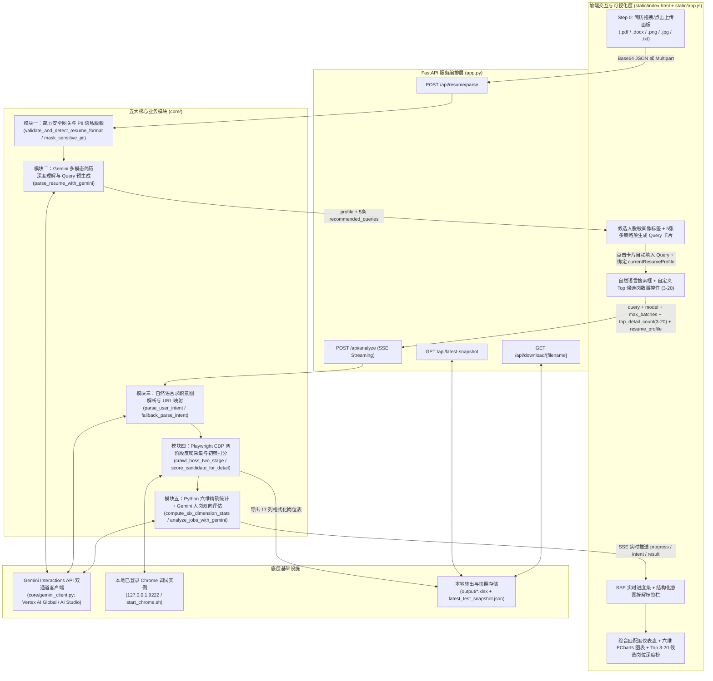
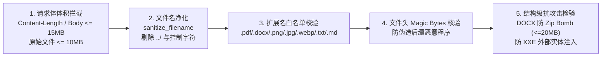
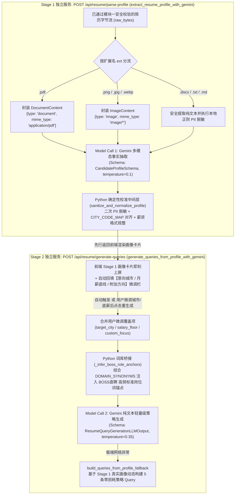
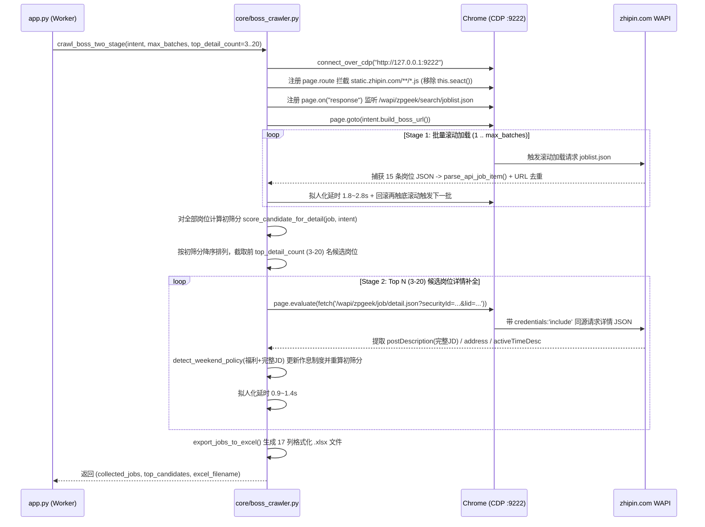

# BOSS直聘智能求职分析 Agent — 五大核心模块系统架构与实现详解 (`system_design.md`)

> [!IMPORTANT]
> 本文档完整梳理 **BOSS直聘智能求职分析 Agent** 的系统架构、五大核心模块的**设计思路（Design Philosophy）**、**设计细节（Design Details）**与**代码级实现细节（Implementation Details）**，并附带底层双通道 Gemini Interactions API 架构及端到端实测验证数据。

---

## 目录

1. [系统整体架构与端到端数据流](#1-系统整体架构与端到端数据流)
2. [底层支撑：Gemini Interactions API 双通道自适应客户端](#2-底层支撑gemini-interactions-api-双通道自适应客户端)
3. [模块一：简历文件安全网关与 PII 隐私脱敏模块](#3-模块一简历文件安全网关与-pii-隐私脱敏模块)
4. [模块二：Gemini 多模态简历深度理解与多策略 Query 预生成模块](#4-模块二gemini-多模态简历深度理解与多策略-query-预生成模块)
5. [模块三：自然语言求职意图解析与 BOSS直聘 URL 映射模块](#5-模块三自然语言求职意图解析与-boss直聘-url-映射模块)
6. [模块四：BOSS直聘两阶段反爬采集与候选岗位初筛打分模块](#6-模块四boss直聘两阶段反爬采集与候选岗位初筛打分模块)
7. [模块五：六维统计计算、人岗双向深度匹配评估与可视化看板模块](#7-模块五六维统计计算人岗双向深度匹配评估与可视化看板模块)
8. [全链路接口契约与安全编码规范汇总](#8-全链路接口契约与安全编码规范汇总)

---

## 1. 系统整体架构与端到端数据流

### 1.1 系统设计目标
本系统旨在解决传统求职者在招聘平台搜索岗位时的三大核心痛点：
1. **搜索词构建盲目**：求职者往往不清楚自己的简历资历在目标城市适合搜什么岗位词、定多少底薪、能争取什么福利；
2. **列表页信息缺失与关键词误伤**：BOSS直聘列表页不展示完整职位描述（JD），且“周末双休 vs 门店排班轮休”往往隐藏在详情页正文中；此外直接搜索“服装店面督导”会漏掉大量标题仅写“店面督导”但属于知名服装品牌公司的岗位；
3. **缺乏全局市场统计与人岗真实履历对比**：求职者只能逐条点开查看，缺乏对几百个在招岗位的六维统计分布（行业、薪资、技能、经验学历、品牌规模、福利作息）以及结合自身真实简历的客观匹配度诊断。

### 1.2 端到端系统架构图



### 1.3 代码仓库目录结构与核心文件映射

| 模块层级 | 文件路径 | 核心职责与关键符号 |
| :--- | :--- | :--- |
| **Web 服务入口** | [app.py](file:///Users/yafan/boss-zhipin-crawler/app.py) | FastAPI 路由编排、SSE 异步流推送、`CRAWL_LOCK` 并发互斥锁、快照持久化 |
| **底层 AI 客户端** | [core/gemini_client.py](file:///Users/yafan/boss-zhipin-crawler/core/gemini_client.py) | [`create_interaction_with_fallback`](file:///Users/yafan/boss-zhipin-crawler/core/gemini_client.py#L363-L551)、Vertex AI / AI Studio 双通道切换、SSL 证书修复 |
| **模块一 & 模块二** | [core/resume_parser.py](file:///Users/yafan/boss-zhipin-crawler/core/resume_parser.py) | [`validate_and_detect_resume_format`](file:///Users/yafan/boss-zhipin-crawler/core/resume_parser.py#L136-L190)、[`mask_sensitive_pii`](file:///Users/yafan/boss-zhipin-crawler/core/resume_parser.py#L108-L134)、[`parse_resume_with_gemini`](file:///Users/yafan/boss-zhipin-crawler/core/resume_parser.py#L357-L466) |
| **模块三** | [core/intent_parser.py](file:///Users/yafan/boss-zhipin-crawler/core/intent_parser.py) | [`parse_user_intent`](file:///Users/yafan/boss-zhipin-crawler/core/intent_parser.py#L253-L311)、[`fallback_parse_intent`](file:///Users/yafan/boss-zhipin-crawler/core/intent_parser.py#L163-L251)、[`ParsedSearchIntent`](file:///Users/yafan/boss-zhipin-crawler/core/intent_parser.py#L127-L161) |
| **模块四** | [core/boss_crawler.py](file:///Users/yafan/boss-zhipin-crawler/core/boss_crawler.py) | [`crawl_boss_two_stage`](file:///Users/yafan/boss-zhipin-crawler/core/boss_crawler.py#L224-L437)、[`score_candidate_for_detail`](file:///Users/yafan/boss-zhipin-crawler/core/boss_crawler.py#L110-L165)、[`detect_weekend_policy`](file:///Users/yafan/boss-zhipin-crawler/core/boss_crawler.py#L50-L60) |
| **模块五（后端）** | [core/gemini_analyzer.py](file:///Users/yafan/boss-zhipin-crawler/core/gemini_analyzer.py) | [`compute_six_dimension_stats`](file:///Users/yafan/boss-zhipin-crawler/core/gemini_analyzer.py#L87-L241)、[`analyze_jobs_with_gemini`](file:///Users/yafan/boss-zhipin-crawler/core/gemini_analyzer.py#L379-L580) |
| **模块五（前端）** | [static/index.html](file:///Users/yafan/boss-zhipin-crawler/static/index.html)、[static/app.js](file:///Users/yafan/boss-zhipin-crawler/static/app.js)、[static/styles.css](file:///Users/yafan/boss-zhipin-crawler/static/styles.css) | Step 0 简历面板、ECharts 六维图表、自定义 Top 3-20 双向同步控件、零 XSS DOM 渲染 |

---

## 2. 底层支撑：Gemini Interactions API 双通道自适应客户端

在深入五大业务模块前，模块二、三、五均依赖底层 [core/gemini_client.py](file:///Users/yafan/boss-zhipin-crawler/core/gemini_client.py) 提供的统一大模型推理能力。

### 2.1 设计思路
1. **全面采用 Interactions API**：遵循 Google GenAI 最新规范，统一使用 `client.interactions.create(...)` 接口替代旧版 `generate_content`，原生支持多模态输入块（`document` / `image` / `text`）与结构化 JSON Schema 输出（`response_format` + `response_mime_type="application/json"`）。
2. **解决中国大陆 + Google Corp VPN 环境痛点**：
   - 消费级 Google AI Studio (`generativelanguage.googleapis.com`) 会对中国大陆出口 IP 返回 `400 FAILED_PRECONDITION: User location is not supported for the API use`；
   - 企业级 **GCP Vertex AI Global Endpoint (`aiplatform.googleapis.com`, `location="global"`)** 不受消费级地区封锁限制，在 Corp VPN 下无需第三方代理即可直连。
   - 因此设计了**「Vertex AI OAuth ADC 优先 + AI Studio 本地代理自动探测」双通道自适应路由**。
3. **解决 macOS Python 3.14 SSL 证书报错与 mTLS 冲突**：
   - 自动注入 `certifi.where()` 与 `/etc/ssl/cert.pem` 双根证书库；
   - 强制设置 `os.environ["GOOGLE_API_USE_CLIENT_CERTIFICATE"] = "false"`，防止 Corp Mac 上的客户端证书触发 Vertex AI mTLS 校验异常；
   - 若遇到本地代理网关 MITM 自签名证书导致 `CERTIFICATE_VERIFY_FAILED`，自动降级 `verify_ssl=False` 重试。

### 2.2 实现细节
- **JSON Schema 内联展开算法 ([`clean_json_schema`](file:///Users/yafan/boss-zhipin-crawler/core/gemini_client.py#L94-L120))**：
  Pydantic 生成的嵌套模型 Schema 会包含 `$defs` 与 `$ref` 引用，而 Interactions API 的 `response_format` 要求纯平内联 Schema。`clean_json_schema` 递归遍历字典树，将所有 `{"$ref": "#/$defs/SubModel"}` 替换为对应子模型的完整定义，并剔除冗余 `title` 与 `$defs` 键。
- **四大模型候选回退链 ([`MODEL_CANDIDATES_MAP`](file:///Users/yafan/boss-zhipin-crawler/core/gemini_client.py#L50-L72))**：
  - `gemini-3.8-flash`: `["gemini-3.8-flash", "gemini-3.7-flash", "gemini-3.6-flash", "gemini-3.5-flash", "gemini-flash-latest"]`
  - `gemini-3.5-flash-lite`: `["gemini-3.5-flash-lite", "gemini-3.1-flash-lite", "gemini-3.8-flash"]`
  - `gemini-3.1-pro`: `["gemini-3.1-pro-preview", "gemini-3.1-pro", "gemini-3.8-flash"]`
  - `gemini-4-argon`: `["gemini-4-argon", "gemini-3.8-flash"]`
  一旦某个具体模型标识在当前通道调用成功，立即缓存至 `_RESOLVED_MODEL_CACHE[(backend, requested_model)]`，后续请求直接命中，实现 **0 探测延迟**。
- **密钥后端隔离 ([`load_backend_api_key`](file:///Users/yafan/boss-zhipin-crawler/core/gemini_client.py#L225-L241))**：
  API Key 仅从服务端环境变量 `GEMINI_API_KEY` 或后端 `0600` 权限私有文件 `.gemini_runtime.json` 读取，前端 UI 与接口响应绝不暴露任何密钥明文。

---

## 3. 模块一：简历文件安全网关与 PII 隐私脱敏模块

### 3.1 设计思路 (Design Philosophy)
简历文件属于高敏感个人数据且来源不可信（用户可能误传伪造后缀的可执行程序、超大型文件、损坏的压缩包，同时简历内包含手机号、身份证号、私人邮箱等敏感隐私）。因此模块一遵循两条核心原则：
1. **纵深防御（Defense-in-Depth）与纯内存流式处理**：上传的简历字节流全程在 Python 内存 (`bytes` / `io.BytesIO`) 中完成校验、解析与 Base64 编码，**绝不写入服务器磁盘临时目录**，从根源上消除恶意脚本落地执行与历史简历文件泄露风险。
2. **个人敏感隐私（PII）双端强制脱敏**：不仅在提取文本送入 LLM 前以及 LLM 返回结果后通过确定性正则掩码（Masking）抹除手机号、身份证号和邮箱，还在 Prompt 层面指令约束模型禁止输出个人联系方式。

### 3.2 设计细节 (Design Details)

#### 五层文件上传安全校验流水线


| 校验层级 | 安全威胁防护目标 | 具体阈值与判定规则 |
| :--- | :--- | :--- |
| **L1 体积上限** | 防止内存耗尽型 DoS | 原始字节流 `MAX_RESUME_BYTES = 10 * 1024 * 1024` (10 MB)；HTTP 请求体上限 15 MB（兼容 Base64 1.37 倍膨胀） |
| **L2 文件名净化** | 防止路径穿越（Path Traversal）与日志注入 | `os.path.basename` + 正则替换 `[\x00-\x1f\x7f/\\]+` 为 `_`，长度截断 120 字符 |
| **L3 扩展名白名单** | 拦截 `.exe` / `.sh` / `.html` / `.svg` 等高危格式 | 仅允许 `.pdf`, `.png`, `.jpg`, `.jpeg`, `.webp`, `.docx`, `.txt`, `.md`（注：排除可内嵌 `<script>` 的 `.svg`） |
| **L4 Magic Bytes 签名** | 拦截改名为 `resume.pdf` 的可执行文件或脚本 | 逐字节核对二进制文件头魔数（见下方实现表） |
| **L5 压缩与 XML 安全** | 防御 DOCX Zip Bomb 炸弹与 XXE 注入攻击 | 累计未压缩体积 `sum(info.file_size) <= 20 MB`；扫描 XML 前 2048 字节拒绝 `<!DOCTYPE` 与 `<!ENTITY` |

### 3.3 实现细节 (Implementation Details)

#### (1) 文件头魔数（Magic Bytes）精确核验（[`validate_and_detect_resume_format`](file:///Users/yafan/boss-zhipin-crawler/core/resume_parser.py#L136-L190)）
- **PDF (`.pdf`)**：必须以 `b"%PDF-"` 开头，返回 `("application/pdf")`；
- **PNG (`.png`)**：必须以 `b"\x89PNG\r\n\x1a\n"` 开头，返回 `("image/png")`；
- **JPEG (`.jpg` / `.jpeg`)**：必须以 `b"\xff\xd8\xff"` 开头，返回 `("image/jpeg")`；
- **WebP (`.webp`)**：长度 `>= 12` 且前 4 字节为 `b"RIFF"`、第 8~12 字节为 `b"WEBP"`，返回 `("image/webp")`；
- **Word (`.docx`)**：必须以 PKZip 签名 `b"PK\x03\x04"` 开头，且内部包含 `word/document.xml`；
- **纯文本 (`.txt` / `.md`)**：检查前 4096 字节不得包含空字节 `b"\x00"`（拦截二进制文件伪装文本），并按 `("utf-8-sig", "utf-8", "gb18030")` 顺序自适应解码。

#### (2) DOCX 内存安全解析（[`extract_text_from_docx`](file:///Users/yafan/boss-zhipin-crawler/core/resume_parser.py#L192-L240)）
许多中文简历使用表格（Table）排版，单纯按段落读取会丢失表格或产生重复文本。实现中通过 `xml.etree.ElementTree.fromstring` 解析 `word/document.xml`，遍历 `<w:p>`（段落）与 `<w:tr>`（表格行）节点，拼接内部 `<w:t>` 文本与 `<w:tab>` 制表符，并对相邻重复行去重，截断前 `15,000` 字符。

#### (3) PII 个人隐私正则掩码算法（[`mask_sensitive_pii`](file:///Users/yafan/boss-zhipin-crawler/core/resume_parser.py#L132-L190)）
涵盖 **手机号、18 位身份证号、电子邮箱** 以及 **家庭或学校详细地址（街道门牌、住宅小区楼栋室号、学校校区与学生宿舍）**：
```python
# 1. 中国大陆 11 位手机号脱敏：18682447902 -> 186****7902
masked = re.sub(r"(?<!\d)(1[3-9]\d)\d{4}(\d{4})(?!\d)", r"\1****\2", text)
# 2. 18 位二代身份证号脱敏：420106199908151234 -> 420106********1234
masked = re.sub(r"(?<!\d)(\d{6})\d{8}(\d{3}[\dXx])(?!\d)", r"\1********\2", masked)
# 3. 电子邮箱脱敏：345360875@qq.com -> 3***@qq.com
masked = re.sub(r"([A-Za-z0-9._%+-])[A-Za-z0-9._%+-]*(@[A-Za-z0-9.-]+\.[A-Za-z]{2,})", r"\1***\2", masked)
# 4a. 带显式标签的家庭/学校/现居/户籍/宿舍/通讯详细地址脱敏
masked = re.sub(r"((?:家庭|现居|居住|联系|通讯|户籍|学校|院校|校区|宿舍|详细)(?:住址|地址)\s*[:：]\s*)([^\n，,；;。｜|]+)", r"\1[地址已脱敏]", masked)
# 4b. 具体街道/路/巷 + 门牌号 + 小区/楼栋/校区/宿舍详细地址脱敏
masked = re.sub(r"(?:[\u4e00-\u9fa5]{2,8}(?:区|县|镇|街道|乡))?[\u4e00-\u9fa5]{2,12}(?:路|街|道|大道|巷|弄|胡同)\s*(?:特?\d{1,5}\s*号(?:院|附\d+号)?)(?:[\u4e00-\u9fa5A-Za-z0-9\-—#幢栋座单元室层号楼苑园庭院村小区大厦广场公寓中心花园公馆校区宿舍]{0,25})?", "[地址已脱敏]", masked)
# 4c. 住宅小区/花园/公寓/学校校区/学生宿舍 + 楼栋/单元/室号脱敏
masked = re.sub(r"[\u4e00-\u9fa5]{2,14}(?:小区|花园|新村|公寓|家园|名苑|豪庭|雅苑|公馆|山庄|学生公寓|研究生公寓|宿舍(?:楼|区)?|校区)\s*(?:[A-Za-z0-9一二三四五六七八九十]{1,4}\s*(?:栋|幢|座|号楼|单元|期|区))+(?:\s*\d{1,5}\s*(?:室|房|号|层))?", "[地址已脱敏]", masked)
# 4d. 独立楼栋 + 单元 + 门牌室号脱敏（如“3栋2单元502室”）
masked = re.sub(r"(?<![A-Za-z0-9])\d{1,3}\s*(?:栋|幢|座|号楼)\s*(?:\d{1,2}\s*单元\s*)?\d{2,5}\s*(?:室|房|号)", "[地址已脱敏]", masked)
```
此外，在 [`_normalize_city_list`](file:///Users/yafan/boss-zhipin-crawler/core/resume_parser.py#L282-L310) 中，即使 `target_cities` 传入了完整地址（如 `"深圳市南山区粤海街道科技南十二路18号"`），也会自动剥离区县街道门牌细节，仅保留市级标准名 `["深圳"]`。

#### (4) 零外部依赖 Multipart 解析器（[`_extract_resume_from_multipart`](file:///Users/yafan/boss-zhipin-crawler/app.py#L120-L141)）
在 [app.py](file:///Users/yafan/boss-zhipin-crawler/app.py#L169-L230) 的 `POST /api/resume/parse` 端点中，同时支持前端 JSON Base64 传输与标准 `multipart/form-data` 表单上传。为了不引入第三方 `python-multipart` 依赖，直接使用 Python 标准库 `email.parser.BytesParser` 解析 HTTP `Content-Type` 与请求体字节流，提取 `file` 二进制载荷与 `model` 字段。

---

## 4. 模块二：Gemini 多模态简历深度理解与多策略 Query 预生成模块（双阶段解耦微服务架构）

### 4.1 设计思路 (Design Philosophy)
1. **双阶段认知解耦与独立微服务化（Stage 1 事实抽取 + Stage 2 策略规划）**：
   - **为什么拆分为两次独立调用与两个独立接口？**
     - **任务认知特征不同**：任务一（理解简历提取 `profile`）是**收敛型事实抽取（Information Extraction）**，要求严格忠于原文、零幻觉，最佳温度为 `temperature=0.1`；任务二（预生成 5 条求职 Query）是**发散型职业策略规划（Career Strategy Generation）**，需要跨赛道迁移、职级晋升推演与 BOSS直聘 热搜词对齐，最佳温度为 `temperature=0.35`。
     - **Python 确定性中间层赋能**：在 Stage 1 与 Stage 2 之间，Python 代码可介入执行 **PII 二次脱敏**、**标准城市词库对齐（[`_normalize_city_list`](file:///Users/yafan/boss-zhipin-crawler/core/resume_parser.py#L254-L270)）**、**薪资单位规整（[`_normalize_salary_floor`](file:///Users/yafan/boss-zhipin-crawler/core/resume_parser.py#L273-L291)）**，并根据画像自动匹配 **BOSS直聘 高频标准岗位词锚点（[`_infer_boss_role_anchors`](file:///Users/yafan/boss-zhipin-crawler/core/resume_parser.py#L331-L360)）** 注入 Stage 2 Prompt，彻底杜绝生造词。
     - **前后端渐进式渲染与免重传秒级重生成**：前端先调 Stage 1（`POST /api/resume/parse-profile`），2~3 秒即刻渲染简历画像卡片；再调 Stage 2（`POST /api/resume/generate-queries`）生成 5 条推荐 Query。用户后续在 UI 上修改意向城市、期望底薪或补充求职方向时，**无需重新上传和解析 10MB 简历文件**，直接调用纯文本轻量级 Stage 2 接口（~300 Tokens，1.5 秒内）即可刷新 5 条定制化 Query。
2. **原生多模态理解优于传统 OCR/PDF 文本抽取**：
   真实求职者的 PDF 简历往往采用双栏排版、图标时间轴甚至扫描件图片。Stage 1 直接将 PDF 原始字节流构造为 Interactions API 的 `{"type": "document", "data": base64, "mime_type": "application/pdf"}`（图片简历构造为 `{"type": "image", ...}`）送入 **Gemini 3.8 Flash**，由模型直接结合视觉版面与文字语义提取画像。
3. **猎头级五维求职策略生成与下游意图解析器 100% 契合**：
   Stage 2 一次性生成 **5 条不同策略维度（`精准对口`、`晋升冲刺`、`作息福利优选`、`跨界拓展`、`高薪突破`）** 的自然语言求职 Query，且每条均严格包含 **【城市 + 简洁高频单一岗位名 + 月薪底线 + 作息/福利要求】** 四大要素。

### 4.2 设计细节 (Design Details)

#### 双阶段解耦多模态解析与策略生成架构图


### 4.3 实现细节 (Implementation Details)

#### (1) 双阶段独立函数与结构化 Schema 定义（[`core/resume_parser.py`](file:///Users/yafan/boss-zhipin-crawler/core/resume_parser.py)）
- **阶段一独立函数 [`extract_resume_profile_with_gemini`](file:///Users/yafan/boss-zhipin-crawler/core/resume_parser.py#L462-L566)**：
  - 输出 Schema 为 [`CandidateProfileSchema`](file:///Users/yafan/boss-zhipin-crawler/core/resume_parser.py#L48-L78)，包含 `candidate_title`、`years_of_experience`、`education_summary`、`target_cities`、`industry_background`、`core_skills`、`experience_highlights`、`inferred_salary_floor`、`inferred_welfare_prefs`。
- **阶段二独立函数 [`generate_queries_from_profile_with_gemini`](file:///Users/yafan/boss-zhipin-crawler/core/resume_parser.py#L572-L689)**：
  - 接收 `profile: Dict[str, Any]` 及可选微调参数 `target_city`、`salary_floor`、`welfare_prefs`、`custom_focus`；
  - 输出 Schema 为 [`ResumeQueryGenerationLLMOutput`](file:///Users/yafan/boss-zhipin-crawler/core/resume_parser.py#L98-L103)，内含 5 条 [`RecommendedQueryItem`](file:///Users/yafan/boss-zhipin-crawler/core/resume_parser.py#L81-L95)（`strategy_tag`、`query_text`、`match_reason`）。
- **向后兼容组合入口 [`parse_resume_with_gemini`](file:///Users/yafan/boss-zhipin-crawler/core/resume_parser.py#L695-L725)**：
  - 内部串联调用 Stage 1 与 Stage 2，保障旧版单接口调用方无缝兼容。

---

## 5. 模块三：自然语言求职意图解析与 BOSS直聘 URL 映射模块

### 5.1 设计思路 (Design Philosophy)
1. **「硬性 URL 筛选参数」与「软性语义评估条件」双层解耦**：
   用户在自然语言中输入的需求包含两类性质截然不同的条件：
   - **硬性参数（Hard Filters）**：BOSS直聘搜索接口原生支持的 URL 参数，如城市代码 (`city=101280600`)、核心岗位词 (`query=区域运营经理`)、薪资档位代码 (`salary=405`)、经验代码 (`experience`)、学历代码 (`degree`)；
   - **软性偏好（Soft Requirements）**：BOSS直聘 URL 无法直接过滤、必须靠爬虫抓取后通过文本分析与 Gemini 语义推理核验的条件，如 `周末双休` (`require_double_weekend=True`)、具体底薪数值 (`min_salary_k=12`)、行业近义词集合 (`industry_keywords`)、五险一金与年终奖 (`soft_requirements`)。
2. **核心岗位词「去定语剥离 + 行业同义词扩展」策略**：
   若用户输入 *“深圳的服装店面督导，月薪至少1w，周末要双休”*，如果把 `query` 直接设为 `"服装店面督导"`，BOSS直聘只会召回岗位标题字面带有“服装”二字的职位，导致大批标题叫 `"店面督导"` 或 `"零售督导"` 的知名服装企业（如优衣库、UR、歌力思等）被漏掉。
   因此本模块专门设计了**核心词剥离机制**：将 `query` 提纯为 `"店面督导"`，同时将 `"服装"` 扩展为近义词组 `["服装", "服饰", "女装", "男装", "鞋服", "纺织", "时尚"]` 存入 `industry_keywords`，在模块四初筛打分与模块五匹配度评估中进行加权！
3. **LLM 极速解析 + 本地确定性正则引擎双擎容灾**：
   优先调用低延迟的 **Gemini 3.5 Flash Light (`gemini-3.5-flash-lite`)** 进行结构化拆解；同时内置毫秒级确定性正则解析器 [`fallback_parse_intent`](file:///Users/yafan/boss-zhipin-crawler/core/intent_parser.py#L163-L251)，对 LLM 输出的编码合法性进行白名单兜底校验，即使离线或网络异常也能 100% 生成合法 URL。

### 5.2 设计细节 (Design Details)

#### BOSS直聘核心参数编码映射表（[`core/intent_parser.py`](file:///Users/yafan/boss-zhipin-crawler/core/intent_parser.py#L17-L76)）

| 参数维度 | 字典常量名 | 核心编码映射关系 |
| :--- | :--- | :--- |
| **城市 (`city`)** | [`CITY_CODE_MAP`](file:///Users/yafan/boss-zhipin-crawler/core/intent_parser.py#L18-L40) | `深圳`: `101280600`, `广州`: `101280100`, `上海`: `101020100`, `北京`: `101010100`, `武汉`: `101200100`, `杭州`: `101210100`, `成都`: `101270100` 等 21 个主流城市 |
| **薪资 (`salary`)** | [`SALARY_CODE_LABELS`](file:///Users/yafan/boss-zhipin-crawler/core/intent_parser.py#L43-L51) | `402`: 3K以下, `403`: 3-5K, `404`: 5-10K, **`405`: 10-20K**（覆盖 1w~2w 区间）, `406`: 20-50K, `407`: 50K以上 |
| **经验 (`experience`)** | [`EXPERIENCE_CODE_LABELS`](file:///Users/yafan/boss-zhipin-crawler/core/intent_parser.py#L54-L64) | `101`: 经验不限, `103`: 1年以内, `104`: 1-3年, `105`: 3-5年, `106`: 5-10年, `107`: 10年以上 |
| **学历 (`degree`)** | [`DEGREE_CODE_LABELS`](file:///Users/yafan/boss-zhipin-crawler/core/intent_parser.py#L67-L76) | `202`: 大专, `203`: 本科, `204`: 硕士, `205`: 博士 |

### 5.3 实现细节 (Implementation Details)

1. **薪资单位自适应换算与档位映射（[`fallback_parse_intent`](file:///Users/yafan/boss-zhipin-crawler/core/intent_parser.py#L175-L195)）**：
   - 正则 `r"(\d+(?:\.\d+)?)\s*[wW万]"` 捕获以“万/w”为单位的薪资并乘以 10 转换为 `K`（如 `1.2w` -> `min_salary_k = 12`）；
   - 正则 `r"(\d+)\s*[kK千]"` 捕获以“千/k”为单位的薪资（如 `15k` -> `min_salary_k = 15`）；
   - 当 `10 <= min_salary_k < 20` 时，自动映射 `salary_code = "405"` (`10-20K`)。
2. **分句剥离提取纯净岗位词（[`fallback_parse_intent`](file:///Users/yafan/boss-zhipin-crawler/core/intent_parser.py#L213-L226)）**：
   - 按中英文标点 `[，,。；;！!]` 切分子句，取第一子句（如 `"深圳的区域运营经理岗位"`）；
   - 依次剥离城市前缀（`"深圳的"`）、行业前缀、动词前缀 `r"^(找|想找|搜索|查询|招聘|的)+"` 以及名词后缀 `r"(岗位|职位|工作)+$"`，得到纯净核心词 `"区域运营经理"`。
3. **目标 URL 构造器（[`ParsedSearchIntent.build_boss_url`](file:///Users/yafan/boss-zhipin-crawler/core/intent_parser.py#L147-L161)）**：
   使用 `urllib.parse.urlencode` 对非空硬性参数进行标准 URL 编码，生成形如：
   `https://www.zhipin.com/web/geek/jobs?query=%E5%8C%BA%E5%9F%9F%E8%BF%90%E8%90%A5%E7%BB%8F%E7%90%86&city=101280600&salary=405` 的标准搜索地址。

---

## 6. 模块四：BOSS直聘两阶段反爬采集与候选岗位初筛打分模块

### 6.1 设计思路 (Design Philosophy)
BOSS直聘具有极其严格的反爬机制（`__zp_stoken__` 动态加密签名、`disable-devtool` 开发者工具检测、高频打开详情页触发滑块验证码甚至账号封禁）。为了在**绝对安全**的前提下兼顾**全量统计广度**与**完整 JD 深度**，模块四采用了三大核心设计：
1. **Playwright CDP 接管本机真实 Chrome 会话 (`127.0.0.1:9222`)**：
   不启动容易被指纹识别的 Headless 浏览器，而是通过 `p.chromium.connect_over_cdp("http://127.0.0.1:9222")` 连接到用户通过 `./start_chrome.sh` 启动并已登录的真实 Chrome 实例，天然复用真实 Cookie、浏览器指纹与 `__zp_stoken__` 环境。
2. **路由层反调试剥离 + 网络层被动监听 JSON**：
   通过 Playwright `page.route` 拦截 BOSS直聘前端脚本中的反调试死循环跳转代码；同时不依赖脆弱的 DOM CSS 选择器解析列表，而是直接通过 `page.on("response")` 监听后台接口 `/wapi/zpgeek/search/joblist.json` 的原生 JSON 数据包。
3. **Stage 1（广度滚动采集）+ 初筛打分排序 + Stage 2（自定义 Top 3-20 详情页同源 `fetch` 补全）两阶段架构**：
   - **Stage 1** 通过拟人化滚动列表页，快速采集 `5~30` 批（约 `75~450` 条）岗位的 14 项基础元数据，支撑全量六维统计；
   - **初筛打分** 利用确定性多维评分函数 [`score_candidate_for_detail`](file:///Users/yafan/boss-zhipin-crawler/core/boss_crawler.py#L110-L165) 对所有采集到的岗位按匹配度排序；
   - **Stage 2** 仅针对排名最高的 **Top N（用户在 UI 自定义 `3-20`，默认 `8`）** 个候选岗位，在页面上下文内发起同源 `fetch('/wapi/zpgeek/job/detail.json?...')` 拉取完整职位描述（`postDescription`）、详细办公地址与 HR 活跃度，并用完整 JD 二次刷新作息制度识别与初筛得分。

### 6.2 设计细节 (Design Details)

#### 两阶段采集与初筛打分流程图


### 6.3 实现细节 (Implementation Details)

#### (1) 反调试脚本动态剥离（[`handle_js_route`](file:///Users/yafan/boss-zhipin-crawler/core/boss_crawler.py#L245-L258)）
BOSS直聘静态脚本中包含检测 CDP 调试端口并执行 `this.seact()` 跳转空白页或报错页的逻辑。`handle_js_route` 拦截 `**/static.zhipin.com/**/*.js*`，将响应文本中的 `"this.seact(),"` 替换为 `"return;this.seact(),"` 后写回浏览器，彻底解除反调试限制。

#### (2) Stage 1 拟人化防卡死滚动算法（[`crawl_boss_two_stage`](file:///Users/yafan/boss-zhipin-crawler/core/boss_crawler.py#L297-L358)）
单纯执行 `window.scrollTo(0, document.body.scrollHeight)` 在 BOSS直聘前端有时无法触发 IntersectionObserver 懒加载。实现中采用**「先向上微滚 `-400px` -> 150ms 后滚到底部 -> 调用最后一个 `.job-card-box` 的 `scrollIntoView({block: 'end'})` -> 派发 `page.mouse.wheel(0, 4500)` 鼠标滚轮事件」**组合动作，并配合 `1.8s ~ 2.8s` 随机抖动延时；若检测到 URL 跳转至 `security-check` 或 `verify`，立即通过 SSE 向前端推送滑块验证提醒。

#### (3) 作息制度三级分类状态机（[`detect_weekend_policy`](file:///Users/yafan/boss-zhipin-crawler/core/boss_crawler.py#L50-L60)）
按优先级扫描福利标签与完整 JD 文本：
1. **周末双休**：命中 `["双休", "做五休二", "周末双休", "五天八小时", "5天8小时", "周六日休"]`；
2. **大小周/单双休**：命中 `["大小周", "大小休", "隔周双休", "单双休"]`；
3. **排班轮休/单休**：命中 `["月休6天", "月休8天", "月休4天", "排班", "轮休", "调休", "做六休一", "单休"]`；
4. **未明确注明**：以上均未命中。

#### (4) 候选岗位初筛打分数学公式（[`score_candidate_for_detail`](file:///Users/yafan/boss-zhipin-crawler/core/boss_crawler.py#L110-L165)）
为确保 Stage 2 有限的详情页请求名额（`3-20` 个）分配给最优质的岗位，定义初筛分计算公式（基础分 `50.0` 分）：

$$\text{Score} = 50.0 + S_{\text{title}} + S_{\text{industry}} + S_{\text{salary}} + S_{\text{weekend}} + S_{\text{scale}} + S_{\text{welfare}} + S_{\text{online}}$$

各分项权重如下：
- **核心岗位词匹配 ($S_{\text{title}}$)**：若 `intent.query` 出现在 `岗位名称` 中，`+18.0` 分；
- **行业关键词匹配 ($S_{\text{industry}}$)**：统计 `岗位名称 + 所属行业 + 公司名称 + 技能标签 + 福利待遇` 中命中的 `intent.industry_keywords` 个数 $k$：若 $k \ge 1$，加 $\min(25.0, 12.0 + 4.0k)$ 分；若用户有行业要求但 $k = 0$，扣 `-10.0` 分；
- **薪资达标度 ($S_{\text{salary}}$)**：当用户设定了期望底薪 $M = \text{intent.min\_salary\_k} > 0$ 时：
  - 若岗位最低月薪 $\text{min\_k} \ge M$（底薪稳超期望）：`+12.0` 分；
  - 若 $\text{min\_k} < M \le \text{max\_k}$（薪资上限覆盖期望）：`+5.0` 分；
  - 若 $\text{max\_k} < M$（最高薪资仍不达标）：`-15.0` 分；
- **双休偏好匹配 ($S_{\text{weekend}}$)**：当 `intent.require_double_weekend == True` 时：
  - 若识别为 `"周末双休"`：`+15.0` 分；
  - 若识别为 `"大小周/单双休"` 或 `"排班轮休/单休"`：`-8.0` 分；
- **公司规模与福利加分 ($S_{\text{scale}} + S_{\text{welfare}} + S_{\text{online}}$)**：
  - `500人以上` 大中型企业 `+6.0` 分，`100-499人` `+3.0` 分；
  - 每项福利标签 `+0.8` 分（上限 `+5.0` 分）；
  - HR 在线 (`BOSS在线 == True`) `+2.0` 分。

---

## 7. 模块五：六维统计计算、人岗双向深度匹配评估与可视化看板模块

### 7.1 设计思路 (Design Philosophy)
1. **「Python 确定性统计 + Gemini 深度语义推理」混合架构**：
   - 大语言模型直接对几百条岗位做算术统计容易产生幻觉（如算错百分比或中位数）；
   - 因此，全量样本的**六大维度基础图表数据与统计指标**（行业占比、薪资分桶、平均起薪/上限/中位数、13薪+占比、Top 15 技能频次、经验与学历分布、公司规模与融资分布、作息制度与福利频次）**100% 由 Python [`compute_six_dimension_stats`](file:///Users/yafan/boss-zhipin-crawler/core/gemini_analyzer.py#L87-L241) 精确计算**；
   - 计算出的精确统计字典 + Stage 2 抓取的 **Top N（3-20）完整 JD** + **候选人真实简历画像 (`resume_profile`)** 一并注入 **Gemini 3.8 Flash / 3.1 Pro**，由模型生成专家级六维文字洞察、整体市场匹配度评分 (`0-100`) 以及对每个候选岗位的逐一打分点评。
2. **人岗双向契合度评估（Resume-Aware Match Evaluation）**：
   当用户上传了简历时，评估不再仅仅是“市场岗位是否符合搜索词”，而是升级为**「市场供给 ↔ 用户求职诉求 ↔ 候选人真实履历资历」三角契合度诊断**，在 `match_reason` 中直接指出候选人的哪段经历、哪项业绩与目标岗位 JD 高度吻合，以及哪些短板需要在面试中重点准备。
3. **UI 自定义 Top 3-20 双向同步与零 XSS 安全渲染**：
   用户在顶部配置栏或榜单右上角修改 `Top 候选岗 (3-20)` 时，已加载看板会**毫秒级动态切片重绘**对应数量的候选岗位卡片；发起新采集时则将 `top_detail_count` 透传至后端。前端所有 DOM 节点均使用 `document.createElement` + `textContent` 构建，严禁 `innerHTML`，彻底杜绝第三方招聘页面数据引发的 DOM XSS 攻击。

### 7.2 设计细节 (Design Details)

#### 六大统计与可视化维度设计矩阵

| 维度编号与名称 | Python 统计指标 ([`compute_six_dimension_stats`](file:///Users/yafan/boss-zhipin-crawler/core/gemini_analyzer.py#L87-L241)) | 前端 ECharts 图表形态 ([`static/app.js`](file:///Users/yafan/boss-zhipin-crawler/static/app.js#L218-L391)) | Gemini 深度洞察重点 |
| :--- | :--- | :--- | :--- |
| **01 所属行业分布** | Top 10 行业频次 `distribution`、命中用户行业关键词岗位数与占比 `matched_keyword_ratio` | 环形饼图 (`pie`, `radius: ["40%", "68%"]`) | 主流招聘行业构成、目标行业占比及跨界机会 |
| **02 薪资水平分布** | 7 档月薪分桶（`<8K` 至 `30K+`，按月薪中值 `(min+max)/2` 归档）、平均起薪 `avg_min_k`、平均上限 `avg_max_k`、中位数 `median_mid_k`、13薪+占比 `bonus_months_ratio`、期望底薪达标率 `meet_expected_ratio` | 顶部 4 枚 KPI 胶囊 + 圆角柱状图 (`bar`) | 薪资区间结构、底薪与绩效比例、与期望月薪及简历资历契合度 |
| **03 核心技能要求** | 拆分全部岗位 `技能标签` 统计 Top 15 高频技能词频 | 水平条形排名图 (`bar`, 倒序排列 Top 12) | 显性高频技能标签 + 详情页完整 JD 中的隐性能力要求 |
| **04 经验与学历门槛** | `experience_dist`（经验要求分布）+ `degree_dist`（学历要求分布） | 左右双环形对比饼图 (`center: ["28%", "44%"]` & `["74%", "44%"]`) | 主流工作年限与学历准入门槛、候选人资历竞争优势评估 |
| **05 公司品牌知名度** | `scale_dist`（规模分布）、`stage_dist`（融资阶段分布）、自动识别 `500人以上` 或 `已上市` 的头部知名企业列表 `notable_companies` | 顶部知名品牌标签云 + 左右双环形饼图（规模 + 融资） | 招聘企业规模结构、头部连锁品牌特点与背书价值 |
| **06 福利待遇与作息** | `weekend_dist`（周末双休 / 大小周 / 排班轮休 / 未注明）+ Top 12 高频福利词频 `top_welfare` | 左饼图（作息制度占比）+ 右水平条形图（Top 8 高频福利）同画布联动 | 五险一金、补贴福利及双休 vs 门店排班轮休的真实占比分析 |

### 7.3 实现细节 (Implementation Details)

#### (1) 综合匹配度评分体系与降级兜底（[`analyze_jobs_with_gemini`](file:///Users/yafan/boss-zhipin-crawler/core/gemini_analyzer.py#L379-L580) & [`build_fallback_analysis`](file:///Users/yafan/boss-zhipin-crawler/core/gemini_analyzer.py#L244-L376)）
- **Gemini 深度评估输出 ([`GeminiAnalysisLLMOutput`](file:///Users/yafan/boss-zhipin-crawler/core/gemini_analyzer.py#L43-L85))**：
  - `overall_match_score` (`0-100`)：由仪表盘 (`gauge`) 直观展示（`<60` 琥珀色预警，`60-80` BOSS 青色良性匹配，`>80` 翠绿色高度契合）；
  - `match_verdict`：一句话核心定性结论；
  - `match_strengths` / `match_risks` / `actionable_advice`：三栏式对照诊断卡片；
  - `job_evaluations`：对 `0 .. len(top_candidates)-1` 的每一个 Top 候选岗位输出 `match_score`、`match_reason`、`highlights`（2~4 个亮点标签）与 `risks`（1~3 个风险提示），后端合并后按 `match_score` 降序重排并赋予 `#1 .. #N` 排名。
- **统计兜底引擎 (`build_fallback_analysis`)**：
  当未配置凭证或网络中断时，系统不会崩溃，而是自动基于 Python 六维统计结果合成可读的中文洞察报告，并利用初筛得分映射生成候选岗位推荐卡片。

#### (2) SSE 异步流式推送与并发互斥锁（[`analyze_endpoint`](file:///Users/yafan/boss-zhipin-crawler/app.py#L232-L373)）
- **单实例浏览器保护锁 (`CRAWL_LOCK = asyncio.Lock()`)**：防止多个请求同时操控同一个 Chrome CDP 实例导致页面冲突；
- **线程安全异步桥接**：由于 Playwright Sync API 在后台 `threading.Thread` 中运行，工作线程通过 `loop.call_soon_threadsafe(queue.put_nowait, format_sse(event_type, payload))` 将 `progress`、`intent`、`result`、`error` 四类事件实时推入主事件循环的 `asyncio.Queue`，由 FastAPI `StreamingResponse` (`text/event-stream`) 毫秒级推送至浏览器。

#### (3) 前端自定义 Top 3-20 双向同步与快照预加载（[`static/app.js`](file:///Users/yafan/boss-zhipin-crawler/static/app.js#L55-L86)）
- **边界钳制函数 [`clampTopCount`](file:///Users/yafan/boss-zhipin-crawler/static/app.js#L57-L61)**：将任意输入值强制取整并限制在 `[3, 20]` 闭区间内（非法输入默认归为 `8`）；
- **双向同步与动态切片函数 [`syncTopCountUI`](file:///Users/yafan/boss-zhipin-crawler/static/app.js#L63-L86)**：
  监听顶部 `#top-count-input` 与榜单区 `#top-count-inline-input` 的 `input` 和 `change` 事件，同步更新两处输入框数值、动态修改榜单标题（`Top N 候选岗位深度匹配榜`）、仪表盘说明文字（`Top N`）及顶部元数据徽章，并从 `currentDashboardPayload.report.recommended_jobs` 中切片前 `N` 条立即调用 `renderRecommendedJobs(shownList)` 重绘卡片；
- **首屏快照秒开 ([`loadInitialSnapshot`](file:///Users/yafan/boss-zhipin-crawler/static/app.js#L941-L966))**：
  页面打开时自动请求 `GET /api/latest-snapshot`（读取 [latest_test_snapshot.json](file:///Users/yafan/boss-zhipin-crawler/output/latest_test_snapshot.json)），无需等待爬虫即可直接展示最新一次简历解析结果、5 条推荐 Query、六维 ECharts 图表及 Top 20 候选岗位池。

---

## 8. 全链路接口契约与安全编码规范汇总

### 8.1 后端 REST & SSE 接口一览（[app.py](file:///Users/yafan/boss-zhipin-crawler/app.py)）

| HTTP 方法与路径 | 请求参数 / 请求体 | 响应类型 | 功能说明 |
| :--- | :--- | :--- | :--- |
| `GET /` | 无 | `text/html` (`no-store`) | 返回单页应用主页 [static/index.html](file:///Users/yafan/boss-zhipin-crawler/static/index.html) |
| `GET /api/status` | 无 | `application/json` | 返回后端 AI 凭证就绪布尔值与支持的四大 Gemini 模型列表（不暴露任何密钥） |
| `GET /api/latest-snapshot` | 无 | `application/json` | 返回最近一次简历解析与六维分析快照（含 Top 20 候选岗位池） |
| `POST /api/resume/parse-profile` | JSON (`filename`, `content_base64`, `model`) 或 `multipart/form-data` | `application/json` | **【Stage 1 独立服务】** 执行五层安全校验与 Gemini 多模态简历深度理解 (`temp=0.1`)，即刻返回标准化脱敏画像 `profile` |
| `POST /api/resume/generate-queries` | [`GenerateQueriesRequest`](file:///Users/yafan/boss-zhipin-crawler/app.py#L131-L157) (`profile`, `target_city`, `salary_floor`, `welfare_prefs`, `custom_focus`, `model`) | `application/json` | **【Stage 2 独立服务】** 基于结构化画像（及用户微调偏好）注入 BOSS直聘 词库锚点，调用 Gemini (`temp=0.35`) 秒级生成 5 条求职 Query（无需重传简历） |
| `POST /api/resume/parse` | JSON (`filename`, `content_base64`, `model`) 或 `multipart/form-data` | `application/json` | **【组合兼容接口】** 内部串联执行 Stage 1 + Stage 2，返回完整 `profile` + `recommended_queries` |
| `POST /api/analyze` | [`AnalyzeRequest`](file:///Users/yafan/boss-zhipin-crawler/app.py#L110-L124) (`query`, `model`, `max_batches`, `top_detail_count: 3..20`, `resume_profile`) | `text/event-stream` (SSE) | 实时流式执行：意图解析 -> 两阶段爬虫采集 -> Gemini 六维分析与人岗匹配评估 |
| `GET /api/download/{filename}` | 路径参数 `filename` (仅限 `.xlsx`) | `application/vnd.openxmlformats...` | 严格校验路径边界 (`resolve()` 前缀比对) 后安全下载导出的 Excel 岗位明细表 |

### 8.2 安全与质量保障清单
- **零前端密钥暴露**：移除所有前端 API Key 输入框与 `localStorage` 存储，密钥完全收敛至服务端；
- **零 DOM XSS 漏洞**：前端 [static/app.js](file:///Users/yafan/boss-zhipin-crawler/static/app.js) 100% 采用 `document.createElement`、`textContent`、`replaceChildren` 渲染数据，并对岗位详情跳转链接强制校验 `job_url.startsWith("https://www.zhipin.com/")` 及添加 `rel="noopener noreferrer"`；
- **零任意文件读写/路径穿越**：上传简历纯内存解析不落盘；Excel 下载接口 [`download_excel`](file:///Users/yafan/boss-zhipin-crawler/app.py#L383-L399) 使用 `os.path.basename` + `.endswith(".xlsx")` + `Path.resolve()` 目录前缀强校验。
