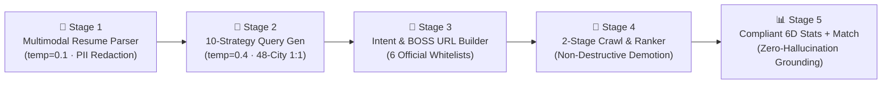

# Chapter 00: Quickstart & Browser-Free Offline Sandbox (10-Minute Setup)

> 🌐 **Language Switcher**: **[简体中文](../zh/00-quickstart-and-sandbox.md)** | **English**
> 🧭 **Navigation**: **[Back to Tutorial Hub](../README.md)** | **[Next: 01 · Taming Vibe Coding with OpenSpec →](./01-openspec-foundation.md)**

---

## 1. What You Will Accomplish
Before rebuilding the entire Agent architecture from scratch, let's get the reference repository running on your machine in **10 minutes**. You will:
1. Set up an isolated Python virtual environment and configure Gemini credentials (Google AI Studio API Key or GCP Vertex AI);
2. Explore the full **Stage 1 ~ Stage 5 Evaluation Dashboard (`/#eval`)** immediately **without launching Chrome or scraping**;
3. Test the standalone, browser-free Stage 3 (Intent Parsing), Stage 4 (Offline Ranking), and Stage 5 (6D Analysis) REST endpoints using `curl`;
4. *(Optional)* Launch debug Chrome on port `9222` to run live end-to-end job collection.

---

## 2. System Architecture at a Glance

Beginners often try to build a "Job Assistant Agent" with one giant prompt: *"Here is my resume and some jobs, pick the best ones."* In production engineering, we decompose the workflow into **5 decoupled, independently testable, quantitatively evaluated Stages**:



> [!TIP]
> **Key Architectural Insight**: **Stages 1, 2, 3, 5, and Stage 4's core ranking engine (`rank_and_filter_jobs`) all expose pure offline REST APIs.** You can run, test, and study 100% of the AI Agent intelligence without logging into any job board or launching a browser!

---

## 3. Step 1: Clone & Configure Environment (3 Minutes)

```bash
# 1. Clone the repository
git clone git@github.com:jason-haha-69135/boss-zhipin-crawler.git
cd boss-zhipin-crawler

# 2. Create and activate an isolated virtual environment
python3 -m venv .venv
source .venv/bin/activate

# 3. Install dependencies
pip install -r requirements.txt

# 4. Copy the environment variable template
cp .env.example .env
```

Configure your **Gemini credentials** (pick **one** option; [`core/gemini_client.py`](../../core/gemini_client.py) auto-detects the active channel):

### Option A: Google AI Studio API Key (Simplest for Individual Developers)
```bash
export GEMINI_API_KEY="YOUR_GEMINI_API_KEY"
```

### Option B: Google Cloud Vertex AI (Application Default Credentials)
```bash
gcloud auth application-default login
export GOOGLE_CLOUD_PROJECT="YOUR_GCP_PROJECT_ID"
```

---

## 4. Step 2: Start the Server & Tour the 5-Stage `#eval` Dashboard (2 Minutes)

```bash
python app.py
```

Once `Uvicorn running on http://127.0.0.1:8000` appears, open two tabs in your browser:

1. **5-Stage Evaluation Dashboard (Zero-Setup Ready)**: `http://127.0.0.1:8000/#eval`
   - Click through **STAGE 1 → STAGE 2 → STAGE 3 → STAGE 4 → STAGE 5** in the top stepper;
   - Pre-archived benchmark runs in `eval/runs/` let you inspect every stage immediately: Stage 1 9-field atomic verification, Stage 2 10-strategy compliance (`9.46/10`), Stage 3 BOSS URL exact match (`94.4%`), Stage 4 ranking quality (`NDCG@8 = 0.9754`), and Stage 5 groundedness (`9.47/10`).
2. **Main Job Intelligence Workspace**: `http://127.0.0.1:8000/`
   - First select a **Target City** (mapped 1:1 to BOSS Zhipin city codes, e.g., `上海`), then upload a sample resume from `eval/dataset/stage1/qualified/QUAL-01.pdf` to watch **Stage 1 PII-redacted profile extraction → Stage 2 multi-strategy query generation** in real time. Try switching the city dropdown afterward—Stage 2 regenerates queries dynamically without re-uploading the PDF!

---

## 5. Step 3: Browser-Free Sandbox Lab — Test Stage 3 & Stage 4 via `curl`

Keep `python app.py` running, open a second terminal, and run these two commands:

### Lab 1: Standalone Stage 3 Intent Parsing & BOSS URL Assembly (`POST /api/intent/parse`)
```bash
curl -s -X POST http://127.0.0.1:8000/api/intent/parse \
  -H "Content-Type: application/json" \
  -d '{
    "query": "互联网软件行业的Java开发工程师岗位，月薪至少1.2w",
    "target_city": "杭州"
  }' | python3 -m json.tool
```
**What to observe**:
- `intent.query` is purified to `"Java开发工程师"` (stripping industry modifiers and `"岗位"` so search recall isn't throttled);
- `intent.city_code` resolves 1:1 to Hangzhou (`"101210100"`) and `salary_code` maps to `"405"` (`10-20K`);
- `boss_url` outputs the exact BOSS Zhipin search URL ready for Stage 4.

### Lab 2: Standalone Stage 4 Offline Ranking & Non-Destructive Demotion (`POST /api/jobs/rank`)
```bash
curl -s -X POST http://127.0.0.1:8000/api/jobs/rank \
  -H "Content-Type: application/json" \
  -d '{
    "top_k": 2,
    "intent": {
      "raw_query": "广州Java开发工程师，月薪至少10K，周末双休",
      "query": "Java开发工程师",
      "city_name": "广州",
      "city_code": "101280100",
      "salary_code": "405",
      "min_salary_k": 10,
      "industry_keywords": ["互联网", "软件"],
      "require_double_weekend": true
    },
    "resume_profile": {"core_skills": ["Java", "MySQL", "SpringBoot"]},
    "jobs": [
      {"岗位名称": "Java开发工程师", "薪资范围": "18-25K", "工作地点": "深圳·南山", "所属行业": "互联网", "福利待遇": "周末双休", "技能标签": "Java"},
      {"岗位名称": "Java开发工程师", "薪资范围": "6-8K", "工作地点": "广州·天河", "所属行业": "互联网", "福利待遇": "周末双休", "技能标签": "Java"},
      {"岗位名称": "高级Java后端开发", "薪资范围": "12-18K", "工作地点": "广州·海珠", "所属行业": "软件", "福利待遇": "周末双休", "技能标签": "Java, MySQL"}
    ]
  }' | python3 -m json.tool
```
**What to observe**:
- `"高级Java后端开发"` ranks `#1` via tokenized title matching + resume skill overlap (`score_breakdown` shows every point);
- Both the off-city Shenzhen job and the under-budget `6-8K` job are flagged `is_demoted: true` and pushed to the bottom, while `total_jobs` remains `3`!

### Lab 3: *(Optional)* Live Crawling with Debug Chrome
To run live Playwright CDP crawling from the main UI, run `./start_chrome.sh`, log in to `zhipin.com` once in the opened Chrome window, and click any recommended query on `http://127.0.0.1:8000/`.

---

## 6. Checkpoint Checklist
- [x] `python app.py` is running on `http://127.0.0.1:8000`;
- [x] Viewed all 5 `Live` stage tabs on `http://127.0.0.1:8000/#eval`;
- [x] Uploaded `QUAL-01.pdf` and tested dynamic city switching on the main page;
- [x] Verified `/api/intent/parse` and `/api/jobs/rank` via `curl` without launching Chrome.

Next up: **[Chapter 01: Taming Vibe Coding Tools with OpenSpec](./01-openspec-foundation.md)**—how to establish machine-verifiable engineering guardrails starting from an empty folder!
