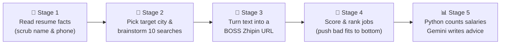

# Chapter 00: Get It Running in 10 Minutes (No Scraper Setup Needed!)

> 🌐 **Language Switcher**: **[简体中文](../zh/00-quickstart-and-sandbox.md)** | **English**
> 🧭 **Navigation**: **[Back to Tutorial Hub](../README.md)** | **[Next: 01 · Stop AI From Breaking Your Code →](./01-openspec-foundation.md)**

---

## 1. What We're Doing in This Chapter
Before we build everything from scratch, let's get the existing project running on your laptop in **10 minutes**. You'll see that:
1. You only need Python and a Gemini credential (either a free AI Studio API key or a Google Cloud login—the app automatically uses whichever one you have);
2. **You don't even need to open Chrome or scrape a website** to explore the full **5-Stage Evaluation Dashboard (`/#eval`)**;
3. With two quick `curl` commands, you can test the URL builder and job-ranking brain completely offline.

---

## 2. The Big Picture: How Does This Agent Actually Work?

When beginners build a "Job Search Agent," the first instinct is to stuff everything—reading the resume, searching jobs, picking the best ones, and writing a summary—into one giant prompt. When that breaks, you have no idea *where* it went wrong.

Instead, we split the job into **5 clean, bite-sized steps (Stage 1 to Stage 5)**, just like an assembly line:



> [!TIP]
> **Best Part for Learners**: Aside from actually fetching live web pages in Chrome, **every single thinking step has its own local API**. Even if you never touch the browser scraper, you can run and test 100% of the Agent's intelligence right from your terminal!

---

## 3. Step 1: Download the Code & Set Up Python (3 Minutes)

Copy and run these commands in your terminal:

```bash
# 1. Clone the repo
git clone git@github.com:jason-haha-69135/boss-zhipin-crawler.git
cd boss-zhipin-crawler

# 2. Create a clean virtual environment so we don't mess up global Python packages
python3 -m venv .venv
source .venv/bin/activate

# 3. Install dependencies
pip install -r requirements.txt

# 4. Copy the config template
cp .env.example .env
```

Now set up **one** way to talk to Gemini ([`core/gemini_client.py`](../../core/gemini_client.py) checks both and uses whichever is available):

### Option A: Google AI Studio API Key (Easiest for Personal Projects)
```bash
export GEMINI_API_KEY="YOUR_GEMINI_API_KEY"
```

### Option B: Google Cloud Login (If You Already Use GCP)
```bash
gcloud auth application-default login
export GOOGLE_CLOUD_PROJECT="YOUR_GCP_PROJECT_ID"
```

---

## 4. Step 2: Start the Web App & Tour the Scoreboard (2 Minutes)

Run:

```bash
python app.py
```

When you see `Uvicorn running on http://127.0.0.1:8000`, open these two pages in your browser:

1. **The 5-Stage Scoreboard (Works Out of the Box)**: `http://127.0.0.1:8000/#eval`
   - Click the **STAGE 1 → STAGE 2 → STAGE 3 → STAGE 4 → STAGE 5** cards along the top;
   - We've included real test reports in `eval/runs/` so you can immediately see how each step is graded (resume accuracy, search query format, URL match rate, job ranking order, and report accuracy).
2. **The Main Workspace (Try a Sample Resume)**: `http://127.0.0.1:8000/`
   - Pick a **Target City** above the upload box (say, `上海`), then drop in the fake test resume `eval/dataset/stage1/qualified/QUAL-01.pdf`;
   - Watch Stage 1 extract skills (with name and phone number scrubbed out) and Stage 2 generate 10 search ideas. Now switch the city dropdown to `杭州`—notice how Stage 2 updates the searches in seconds without re-uploading the PDF!

---

## 5. Step 3: Play With Stage 3 & Stage 4 From Your Terminal (No Browser!)

Leave `python app.py` running, open a second terminal tab, and try these two commands:

### Try It 1: Watch Stage 3 Turn a Sentence Into a Real BOSS Zhipin Link (`POST /api/intent/parse`)
```bash
curl -s -X POST http://127.0.0.1:8000/api/intent/parse \
  -H "Content-Type: application/json" \
  -d '{
    "query": "互联网软件行业的Java开发工程师岗位，月薪至少1.2w",
    "target_city": "杭州"
  }' | python3 -m json.tool
```
**Notice what happened**:
- `intent.query` was trimmed down to just `"Java开发工程师"` (we stripped out `"互联网软件行业的"`—you'll see why in Chapter 03!);
- Hangzhou became official code `"101210100"`, and `1.2w` became salary bracket `"405"` (`10-20K`);
- `boss_url` is a real, clickable search link!

### Try It 2: Watch Stage 4 Rank Jobs & Push Bad Fits to the Bottom (`POST /api/jobs/rank`)
```bash
curl -s -X POST http://127.0.0.1:8000/api/jobs/rank \
  -H "Content-Type: application/json" \
  -d '{
    "top_k": 2,
    "intent": {
      "raw_query": "广州Java开发工程师，月薪至少10K，周末双休",
      "query": "Java开发工程师",
      "city_name": "广州",
      "city_code": "101280100",
      "salary_code": "405",
      "min_salary_k": 10,
      "industry_keywords": ["互联网", "软件"],
      "require_double_weekend": true
    },
    "resume_profile": {"core_skills": ["Java", "MySQL", "SpringBoot"]},
    "jobs": [
      {"岗位名称": "Java开发工程师", "薪资范围": "18-25K", "工作地点": "深圳·南山", "所属行业": "互联网", "福利待遇": "周末双休", "技能标签": "Java"},
      {"岗位名称": "Java开发工程师", "薪资范围": "6-8K", "工作地点": "广州·天河", "所属行业": "互联网", "福利待遇": "周末双休", "技能标签": "Java"},
      {"岗位名称": "高级Java后端开发", "薪资范围": "12-18K", "工作地点": "广州·海珠", "所属行业": "软件", "福利待遇": "周末双休", "技能标签": "Java, MySQL"}
    ]
  }' | python3 -m json.tool
```
**Notice what happened**:
- `"高级Java后端开发"` took the `#1` spot even though its title wasn't an exact word-for-word match;
- Both the wrong-city Shenzhen job and the underpaid `6-8K` job were marked `is_demoted: true` and moved to the very bottom—without deleting them (`total_jobs` is still `3`).

*(Optional: If you want to try live scraping too, run `./start_chrome.sh`, log in to `zhipin.com` once in that Chrome window, and click any query on the main page.)*

---

## 6. Quick Checklist
- [x] `python app.py` is running locally;
- [x] Clicked through all 5 stages on `/#eval`;
- [x] Uploaded `QUAL-01.pdf` and switched cities on the main page;
- [x] Tested `/api/intent/parse` and `/api/jobs/rank` with `curl`.

Warm-up complete! Next: **[Chapter 01: Stop AI From Breaking Your Code — Setting Clear Rules with OpenSpec](./01-openspec-foundation.md)**!
