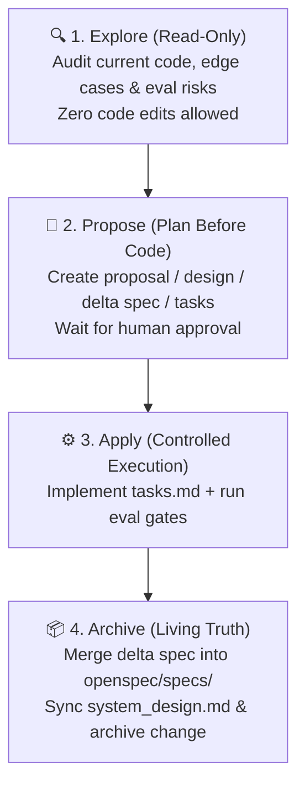

# Chapter 01: Taming Vibe Coding Tools — Spec-Driven Guardrails with OpenSpec

> 🌐 **Language Switcher**: **[简体中文](../zh/01-openspec-foundation.md)** | **English**
> 🧭 **Navigation**: **[← Prev: 00 · Quickstart & Sandbox](./00-quickstart-and-sandbox.md)** | **[Tutorial Hub](../README.md)** | **[Next: 02 · Stage 1 & 2 Decoupling →](./02-stage1-stage2-resume-to-queries.md)**

---

## 1. What You Will Learn
1. Why unstructured "chat-only Vibe Coding" collapses after a few iterations on multi-stage Agents;
2. How **Spec-Driven Development (OpenSpec)** structures persistent context (`openspec/project.md`, `openspec/AGENTS.md`, `specs/`, `changes/`);
3. How to drive Antigravity, Codex, or Claude Code using the strict **`Explore → Propose → Apply → Archive`** 4-step protocol;
4. How **OpenSpec AST validation** turns Markdown specifications into compiler-grade checks.

---

## 2. Mental Model: Why Chat-Only Vibe Coding Fails at Scale

When developers use AI coding agents without written specifications, three failure modes appear almost immediately:
- **Silent Assumption Drift**: You ask for "a city filter," and the AI hardcodes a default city, alters an API payload, and breaks the frontend without telling you;
- **Context Rot Across Sessions**: By turn 25—or in a fresh chat window—the AI forgets critical invariants like *"never write uploaded resumes to disk"* or *"never use unescaped `innerHTML`"*;
- **No Pre-Code Brake Pedal**: Before you even agree on the design, the agent edits 8 files at once.

**The Solution**: Move architectural invariants and change proposals out of ephemeral chat history and into **machine-validated OpenSpec files inside the repository**.



---

## 3. Hands-On From Scratch: Bootstrapping OpenSpec in an Empty Folder

Suppose you just ran `mkdir my-job-agent && cd my-job-agent && git init`. **Before writing a single line of Python**, send this bootstrap prompt to Antigravity or Codex:

### 💬 Step 1 Prompt (Copy-Paste to Antigravity / Codex)
```text
We are building a 5-stage "BOSS Zhipin Job Intelligence Agent" from scratch (FastAPI + Google GenAI SDK + Playwright CDP + Vanilla JS / Apache ECharts).
Before writing any application code, initialize our OpenSpec Spec-Driven Development directory `openspec/`:
1. Create `openspec/project.md` defining the tech stack, 5-stage physical module separation (Stage 1 Resume Parser, Stage 2 Query Generator, Stage 3 Intent & URL Parser, Stage 4 Two-Stage Crawler & Offline Ranker, Stage 5 6D Stats & Deep Matcher), model roles (`gemini-3.8-flash` for pipeline tasks, `gemini-4-argon` for Eval LLM-as-a-Judge), and 4 non-negotiable security rules (in-memory-only resume parsing, dual-end PII zero leakage, path-traversal protection, no unescaped `innerHTML`).
2. Create `openspec/AGENTS.md` enforcing our 4-phase workflow: `Explore` (read-only audit), `Propose` (create `proposal.md`, `design.md`, `tasks.md`, and delta `specs/<capability>/spec.md` under `openspec/changes/<id>/` with ZERO business code edits until I approve), `Apply`, and `Archive`. Include strict Fission-AI/OpenSpec AST rules (`### Requirement:` MUST contain uppercase `SHALL` or `MUST`; `#### Scenario:` MUST use `- **WHEN**` and `- **THEN**`).
Create only these two files for my review.
```

Compare what AI generates against the battle-tested files in this repo:
- Global project invariants: [`openspec/project.md`](../../openspec/project.md)
- Agent workflow & AST rules: [`openspec/AGENTS.md`](../../openspec/AGENTS.md)

---

## 4. OpenSpec AST Rules: Writing Specs That Code Can Validate

Prose design docs rot because nothing verifies them. Every master spec in `openspec/specs/<capability>/spec.md` obeys deterministic AST rules:
1. **Top-Level Headings**: `# <Capability> Specification`, `## Purpose` (>= 50 chars, no `TBD`), and `## Requirements`;
2. **Normative Requirements**: `### Requirement: <Name>` followed immediately by body text containing uppercase **`SHALL`** or **`MUST`**;
3. **Testable Scenarios**: At least one 4-hash `#### Scenario: <Name>` block per requirement using `- **WHEN**`, `- **THEN**`, and optional `- **AND**` bullets;
4. **Delta Specs During `Propose`**: Stored under `openspec/changes/<change-id>/specs/<capability>/spec.md` using `## ADDED Requirements` or `## MODIFIED Requirements`, then merged into `openspec/specs/` upon `Archive`.

> 💡 Browse [`openspec/changes/archive/`](../../openspec/changes/archive/) in this repository to inspect real proposals, technical designs, and task checklists from Stages 1 through 5!

---

## 5. The 4 Everyday Commands for Driving Your AI Coding Agent

Once `AGENTS.md` is in place, you steer every feature or refactor with four crisp commands:

| Phase | Your Prompt Trigger | What the Agent May Do | Your Human Gate |
| :--- | :--- | :--- | :--- |
| **1. Explore** | `OpenSpec explore Stage X: audit current logic, edge cases & eval needs` | Read-only inspection; surfaces trade-offs & questions | Decide key trade-offs (e.g., hard-drop vs. bottom-demote off-city jobs) |
| **2. Propose** | `OpenSpec propose Stage X: adopt options 1 & 2` | Write 4 markdown files in `openspec/changes/<id>/` | Review API contracts, edge-case scenarios & review gates in `tasks.md` |
| **3. Apply** | `Start apply` | Write code, unit tests & eval scripts; pause at manual review gates | Inspect test outputs & approve Ground Truth datasets |
| **4. Archive** | `Run archive` | Merge delta spec into `openspec/specs/`, move to `archive/`, sync `system_design.md` | Run the AST validator to confirm 100% spec compliance |

---

## 6. Verify Right Now on This Repo: Run the OpenSpec AST Validator

Run this command in the repo root (the exact same check runs automatically on every push in `.github/workflows/ci.yml`):

```bash
.venv/bin/python -c "
import re, pathlib
specs = sorted(pathlib.Path('openspec/specs').glob('*/spec.md'))
for sp in specs:
    txt = sp.read_text(encoding='utf-8')
    reqs = re.findall(r'^### Requirement: .+$', txt, re.M)
    scens = re.findall(r'^#### Scenario: .+$', txt, re.M)
    for block in re.split(r'^### Requirement: ', txt, flags=re.M)[1:]:
        assert ('SHALL' in block.split('#### Scenario:')[0] or 'MUST' in block.split('#### Scenario:')[0])
    for sblock in re.split(r'^#### Scenario: ', txt, flags=re.M)[1:]:
        assert '- **WHEN**' in sblock and '- **THEN**' in sblock
    print(f'[PASS] {sp} -> {len(reqs)} Requirements, {len(scens)} Scenarios')
"
```

---

## 7. Common Beginner Pitfalls
- **Pitfall 1: Jumping straight to "write the code" without `Explore` + `Propose`** — Spending 2 minutes reviewing a 50-line `design.md` saves 2 hours of untangling multi-file hallucinations.
- **Pitfall 2: Writing vague requirements ("make parsing accurate and fast")** — Always express requirements as verifiable `WHEN / THEN` contracts (e.g., `WHEN input contains "1.2w" THEN min_salary_k SHALL equal 12 AND salary_code SHALL equal "405"`).

Next, let's build our first two pipeline stages: **[Chapter 02: Requirement Discovery & Stage Decoupling — From Multimodal Resumes to Search Strategies (Stages 1 & 2)](./02-stage1-stage2-resume-to-queries.md)**!
