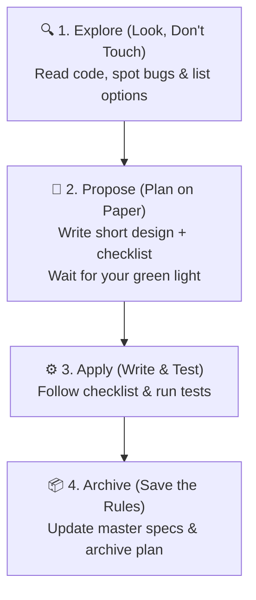

# Chapter 01: Stop AI From Breaking Your Code — Setting Clear Rules with OpenSpec

> 🌐 **Language Switcher**: **[简体中文](../zh/01-openspec-foundation.md)** | **English**
> 🧭 **Navigation**: **[← Prev: 00 · 10-Min Quickstart](./00-quickstart-and-sandbox.md)** | **[Tutorial Hub](../README.md)** | **[Next: 02 · Resumes to Search Queries →](./02-stage1-stage2-resume-to-queries.md)**

---

## 1. What Problem Are We Solving Here?
Building a tiny script with Antigravity or Codex feels effortless. Once your project grows past three files, though, you hit classic Vibe Coding headaches:
- **AI "helps" too much**: You ask to tweak a button label, and it quietly renames a backend JSON field, breaking your UI;
- **Long-chat amnesia**: Early on, you told it *"never save uploaded resumes to disk."* Twenty messages later (or in a new chat tab), it writes `open('temp.pdf', 'wb')`;
- **Coding before agreeing**: You ask a casual "what if" question, and it immediately rewrites 8 files before you even agree on the plan.

In this chapter, you'll learn a dead-simple habit called **OpenSpec (write down the plan and rules in plain files *before* letting AI touch code)** that fixes all three problems.

---

## 2. The Core Habit: Put Rules in Your Repo, Not Just in Chat

Think of it like renovating a kitchen:
1. **Explore (Measure the room)**: AI reads the current code, spots hidden traps, and gives you options—**zero code changes allowed**;
2. **Propose (Draw the blueprint)**: AI writes a short plan (`proposal.md`, `design.md`, `tasks.md`, and `spec.md`)—**still zero code changes until you say yes**;
3. **Apply (Build to the checklist)**: Once you say *"Start apply,"* AI writes the code and tests item by item;
4. **Archive (File the blueprint)**: When tests pass, AI merges the new rules into your master spec folder (`openspec/specs/`) and archives the proposal.



---

## 3. From Scratch: Your Very First Prompt in an Empty Folder

Imagine you just created an empty folder (`mkdir my-job-agent && cd my-job-agent && git init`). **Before writing any Python**, paste this into Antigravity or Codex:

### 💬 Step 1 Prompt (Copy-Paste to AI)
```text
We are building a 5-stage "BOSS Zhipin Job Assistant" from scratch (FastAPI + Google GenAI SDK + Playwright + Vanilla JS / ECharts).
Before writing any app code, create an `openspec/` folder with two rulebook files:
1. `openspec/project.md` (Project Ground Rules): list our tech stack, what each of the 5 stages does (Stage 1 read resume, Stage 2 brainstorm search queries, Stage 3 build BOSS Zhipin URL, Stage 4 scrape & rank jobs, Stage 5 calculate stats & write advice), which models we use (`gemini-3.8-flash` for daily tasks, `gemini-4-argon` for grading tests), and 4 hard safety rules (read resumes in memory only—never save to disk; scrub names/phones/addresses; block `../` file path tricks; never use raw `innerHTML`).
2. `openspec/AGENTS.md` (AI Workflow Rules): when I say Explore, only read files and suggest options; when I say Propose, only write plan docs inside `openspec/changes/<name>/` and DO NOT touch app code until I say "Start apply"; also define a consistent `Requirement` + `Scenario (WHEN/THEN)` heading format so a simple script can check our docs.
Only create those two files for me to review right now.
```

Check out the actual files in this repo to see how clean and readable they are:
- Project ground rules: [`openspec/project.md`](../../openspec/project.md)
- AI workflow rules: [`openspec/AGENTS.md`](../../openspec/AGENTS.md)

---

## 4. Why Use a Fixed `WHEN / THEN` Format in Specs?

Free-form docs go stale fast because nobody notices when a detail is missing. OpenSpec uses a simple fill-in-the-blanks pattern inside `openspec/specs/`:
- Every rule starts with `### Requirement: ...` and includes uppercase **`SHALL`** or **`MUST`**;
- Every rule has at least one concrete example under `#### Scenario: ...` written with **`WHEN`** (input) and **`THEN`** (expected result).

Here's a real example from [`openspec/specs/stage3-intent-parser/spec.md`](../../openspec/specs/stage3-intent-parser/spec.md):
```markdown
### Requirement: Stage 3 Intent Parsing with Gemini 3.8 Flash and Explicit City Priority
The `core/intent_parser.py` module MUST resolve the target city according to deterministic priority rules mapped 1:1 to BOSS Zhipin `CITY_CODE_MAP`.

#### Scenario: Use target_city when the search sentence doesn't mention a city
- **WHEN** `parse_user_intent` receives `"互联网新媒体行业的新媒体运营岗位，月薪至少0.7w"` along with `target_city="武汉"`
- **THEN** it SHALL resolve `city_name="武汉"` and `city_code="101200100"` instead of falling back to `"深圳"`
- **AND** `build_boss_url()` SHALL contain `city=101200100`
```
Writing `WHEN ... THEN ...` makes edge cases crystal clear to humans *and* lets AI turn each scenario directly into a unit test!

---

## 5. The Only 4 Phrases You Need for Every Feature

From here on out, building Stages 1 through 5 uses the exact same four everyday prompts:

| Step | What You Type to AI | What AI Does | What You Check |
| :--- | :--- | :--- | :--- |
| **1. Scout** | `OpenSpec explore Stage X: what bugs or edge cases should we watch out for?` | Reads code only; lists pitfalls & choices | Pick the option you prefer |
| **2. Plan** | `OpenSpec propose Stage X: go with option 1` | Writes 4 short plan files in `openspec/changes/` | Skim `design.md` & `tasks.md` (takes 1 minute) |
| **3. Build** | `Start apply` | Writes code, runs tests & pauses if human review is needed | Check test results & approve sample data |
| **4. Save** | `Run archive` | Merges new rules into `openspec/specs/` & moves plan to `archive/` | Run the doc-checker script |

> 💡 Want to see the real plans from when we built this repo? Peek inside [`openspec/changes/archive/`](../../openspec/changes/archive/)!

---

## 6. Try It Right Now: Run the Spec-Checker Script

Paste this into your terminal—in one second, it checks that all 5 stage specs in this repo follow every rule:

```bash
.venv/bin/python -c "
import re, pathlib
specs = sorted(pathlib.Path('openspec/specs').glob('*/spec.md'))
for sp in specs:
    txt = sp.read_text(encoding='utf-8')
    reqs = re.findall(r'^### Requirement: .+$', txt, re.M)
    scens = re.findall(r'^#### Scenario: .+$', txt, re.M)
    for block in re.split(r'^### Requirement: ', txt, flags=re.M)[1:]:
        assert ('SHALL' in block.split('#### Scenario:')[0] or 'MUST' in block.split('#### Scenario:')[0])
    for sblock in re.split(r'^#### Scenario: ', txt, flags=re.M)[1:]:
        assert '- **WHEN**' in sblock and '- **THEN**' in sblock
    print(f'[PASS] {sp} -> {len(reqs)} Requirements, {len(scens)} Scenarios')
"
```

---

## 7. Quick Tips Before Moving On
- **Never skip `Propose`**: Reading a 30-line plan takes 60 seconds; undoing an 8-file mess takes an afternoon.
- **Be specific, not vague**: Instead of *"handle salaries well,"* write *"WHEN input has `1.2w` THEN `min_salary_k` MUST be `12`."*

Now let's build our first real features: **[Chapter 02: From Resume to Search Queries — Why Split Into Two Steps? (Stages 1 & 2)](./02-stage1-stage2-resume-to-queries.md)**!
