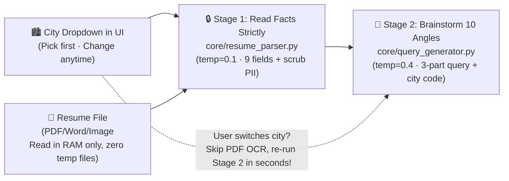

# Chapter 02: From Resume to Search Queries — Why Split Into Two Steps? (Stages 1 & 2)

> 🌐 **Language Switcher**: **[简体中文](../zh/02-stage1-stage2-resume-to-queries.md)** | **English**
> 🧭 **Navigation**: **[← Prev: 01 · Rules with OpenSpec](./01-openspec-foundation.md)** | **[Tutorial Hub](../README.md)** | **[Next: 03 · Search Links & Job Ranking →](./03-stage3-stage4-intent-and-ranking.md)**

---

## 1. What You'll Learn Here
1. **Look at the real website first**: Why typical AI-written job searches return zero results on BOSS Zhipin;
2. **Why we split "reading the resume" from "writing search queries"**: Reading facts needs a strict, no-nonsense temperature (`0.1`), while brainstorming career angles needs a slightly more creative one (`0.4`)—plus changing cities won't force a PDF re-upload;
3. **Scrubbing personal info safely**: Reading files purely in memory (never touching the hard drive) and wiping names, phone numbers, and street addresses with Python regexes;
4. **Why users pick their city *before* uploading a resume**.

---

## 2. Know the Website First: Why Naive AI Search Queries Flop

Ask a generic chatbot to write a job search from your resume, and it'll usually give you something like:
> ❌ *"Shanghai Internet New Media Operations / Content Operations, 8k+, weekends off, full benefits"*

Sounds reasonable—until you paste it into **BOSS Zhipin** and get **0 results**! Five minutes of testing the actual website shows why:
1. **City is picked from a top menu, not typed into the search box**: Almost no local company in Shanghai puts `"Shanghai"` inside the job title itself. Typing the city name into the search bar accidentally hides 95% of local jobs!
2. **Perks like "weekends off" aren't on the summary cards**: Rest schedules are tucked inside the full job description page. Searching for `"weekends off"` in the search bar throws away great companies that didn't put it in the title.
3. **Slashes (`/`) confuse keyword search**: Searching `New Media / Content Operations` makes the search engine hunt for titles containing both phrases together.

Once we knew those three rules, the right search template for Stage 2 became obvious:
> ✅ **`[Target Industry]的[Single Job Title]岗位，月薪至少[X.Xw]`** — while keeping the user's chosen `target_city` and official `target_city_code` cleanly separated in JSON!

---

## 3. Why Split "Read Resume" (Stage 1) and "Brainstorm Searches" (Stage 2)?



Putting them in two separate files pays off in three big ways:
1. **Different "personalities" (temperature settings)**:
   - **Stage 1 (Reading the resume)** must stick 100% to the facts—3 years of experience means 3, not 5—so we set `temperature=0.1`;
   - **Stage 2 (Brainstorming searches)** needs to suggest 10 different career angles (*Direct Match, Step-Up Promotion, Adjacent Industry Pivot, Salary Stretch, Safe Backup*, etc.), so `temperature=0.4` gives it healthy variety.
2. **Instant city switching**: If a user uploads a 5MB PDF for Shanghai and then wonders *"What about Hangzhou?"*, the browser just sends the tiny scrubbed JSON profile back to Stage 2—no re-uploading or re-reading the PDF!
3. **Privacy wall right at the front door**: Stage 1 runs Python regexes to mask names, phone numbers, emails, ID numbers, and street/dorm addresses *before* Stages 2–5 ever see the data.

---

## 4. From Scratch: Your Plain-English Prompt for Stages 1 & 2

Paste this into Antigravity or Codex in your new project:

### 💬 `Propose` Prompt (Copy-Paste to AI)
```text
Initiate an OpenSpec propose for Stage 1 and Stage 2:
1. Stage 1 (`core/resume_parser.py` + `POST /api/resume/parse-profile`):
   - Support PDF/DOCX/PNG/JPG/WEBP/TXT/MD up to 10MB. Check the real file header bytes first (so a renamed zip/exe gets blocked), and read everything in memory (`io.BytesIO`) without writing temp files to disk;
   - Require the user to pick a `target_city` from the official 48-city BOSS Zhipin list in the UI before uploading;
   - Use `gemini-3.8-flash` (`temperature=0.1`) to extract 9 profile fields, run Python regexes to scrub names, phone numbers, emails, IDs, and street addresses, and include `target_city` + `target_city_code` in the JSON output.
2. Stage 2 (`core/query_generator.py` + `POST /api/resume/generate-queries`):
   - Put this in its own file using `gemini-3.8-flash` (`temperature=0.4`) to generate 10 distinct search queries from the profile;
   - Every `query_text` must follow `"[行业]的[单一标准岗位]岗位，月薪至少[X.Xw]"`—no city names, no perks like "double weekend", and no `/` slashes—while passing `target_city` and `target_city_code` in JSON;
   - When the user changes the city dropdown in the UI, automatically re-run Stage 2 with the new city.
Write the OpenSpec plan files under `openspec/changes/` first without editing app code.
```

See the real code in this repo:
- Stage 1 Resume Reader & PII Scrubber: [`core/resume_parser.py`](../../core/resume_parser.py)
- Stage 2 10-Angle Query Generator: [`core/query_generator.py`](../../core/query_generator.py)

---

## 5. Try It Right Now on This Repo

### Hands-On 1: Call Stage 2 Directly & Check How Clean the Queries Are
With `python app.py` running:
```bash
curl -s -X POST http://127.0.0.1:8000/api/resume/generate-queries \
  -H "Content-Type: application/json" \
  -d '{
    "target_city": "上海",
    "query_count": 5,
    "profile": {
      "candidate_title": "新媒体运营",
      "years_of_experience": "应届生（2段运营实习）",
      "education_summary": "本科 · 市场营销",
      "target_cities": ["上海"],
      "industry_background": ["互联网/新媒体", "消费电子"],
      "core_skills": ["微信公众号与微博矩阵运营", "热点活动策划", "CET-6"],
      "experience_highlights": ["主导校园官微活动单条互动破1000次"],
      "inferred_salary_floor": "0.7w",
      "inferred_welfare_prefs": ["五险一金", "周末双休"]
    }
  }' | python3 -m json.tool
```

### Hands-On 2: Watch Stage 1 Catch a Disguised Bad File
```bash
.venv/bin/python -c "
from pathlib import Path
from core.resume_parser import validate_and_inspect_upload
raw = Path('eval/dataset/stage1/disqualified/DISQ-01.doc').read_bytes()
try:
    validate_and_inspect_upload('DISQ-01.doc', raw)
except ValueError as e:
    print('Blocked bad file cleanly:', e)
"
```

---

## 6. Quick Tips
- **Don't trust an LLM alone to hide phone numbers**: Always back up prompt instructions with hard Python regex replacements.
- **Check file header bytes, not just `.pdf` extensions**: Checking the first few bytes (`%PDF-`) stops disguised files at the door.

Next up: **[Chapter 03: Search Links & Job Ranking — Separate Scoring Logic From Browser Scraping (Stages 3 & 4)](./03-stage3-stage4-intent-and-ranking.md)**!
