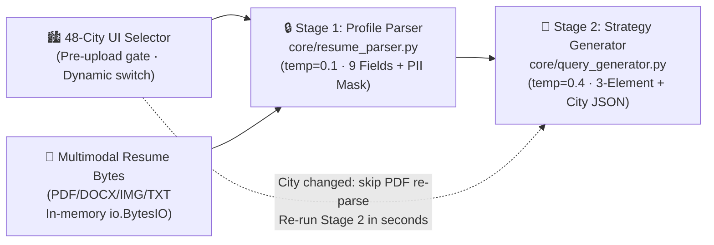

# Chapter 02: Requirement Discovery & Stage Decoupling — From Resumes to Search Strategies (Stages 1 & 2)

> 🌐 **Language Switcher**: **[简体中文](../zh/02-stage1-stage2-resume-to-queries.md)** | **English**
> 🧭 **Navigation**: **[← Prev: 01 · OpenSpec Guardrails](./01-openspec-foundation.md)** | **[Tutorial Hub](../README.md)** | **[Next: 03 · Search Recall & I/O Decoupling →](./03-stage3-stage4-intent-and-ranking.md)**

---

## 1. What You Will Learn
1. **Domain-First Requirement Discovery**: Reverse-engineering how the target platform (`zhipin.com`) actually indexes jobs before designing LLM outputs;
2. **Why Stage 1 & Stage 2 Must Be Physically Decoupled**: Temperature stratification (`0.1` convergent extraction vs. `0.4` divergent strategy generation) and profile caching;
3. **Shift-Left Privacy & File Security**: Magic-byte verification, zero-disk `io.BytesIO` parsing, and dual-layer deterministic PII redaction;
4. **UI-to-Domain Alignment**: Enforcing an upfront 1:1 BOSS Zhipin 48-city selector with instant Stage 2 re-triggering on city changes.

---

## 2. Domain Discovery: Why Naive LLM Search Queries Return Zero Jobs

If you ask an unconstrained LLM to generate job search queries from a resume, it typically writes:
> ❌ *"Shanghai Internet New Media Operations / Content Operations, at least 8k, double-weekend off, full insurance"*

If you paste that into **BOSS Zhipin**, you get **almost zero results**! During our `Explore` phase, inspecting real BOSS Zhipin search behavior revealed three hard domain constraints:
1. **City is a separate top-level filter (`city_code`), never part of keyword text**: Including `"上海"` inside the search box filters out 95% of local jobs whose titles don't repeat the city name;
2. **List cards omit full rest-schedule prose**: Searching `"周末双休"` in the keyword box kills recall because weekend policies live inside detail-page descriptions. Instead, the prefix slot should specify the **target industry**;
3. **Compound slash titles (`A/B`) break keyword matching**: Every query must target **one clean canonical role title**.

From those three facts, we derived Stage 2's strict **Three-Element Formula**:
> ✅ **`[Target Industry]的[Single Canonical Role]岗位，月薪至少[X.Xw]`** — paired with explicit `target_city` and `target_city_code` fields in the JSON payload.

---

## 3. Architectural Pattern: Why Split Resume Parsing (Stage 1) from Query Generation (Stage 2)?



Combining both into one monolithic prompt creates three problems:
1. **Temperature Conflict**: Extracting education, years of experience, and quantified achievements requires **strict factual convergence (`temperature=0.1`)**, whereas brainstorming 10 distinct career angles (*Core Match, Promotion Stretch, Cross-Domain Pivot, Salary Breakthrough, Safe Fallback*, etc.) benefits from **controlled creativity (`temperature=0.4`)**;
2. **Wasted Multimodal Latency**: When a user switches their target city from Shanghai to Hangzhou in the UI, decoupling lets the frontend resend the tiny redacted JSON profile to `POST /api/resume/generate-queries` without re-uploading or re-OCR-ing a multi-megabyte PDF;
3. **Hard PII Air-Gap**: Stage 1 scrubs names, phone numbers, emails, national IDs, and street/dormitory addresses via deterministic Python regexes *before* Stage 2 ~ Stage 5 ever see the profile.

---

## 4. Vibe Coding From Scratch: Proposing & Building Stages 1 & 2

### 💬 `Propose` Prompt Template for Antigravity / Codex
```text
Initiate an OpenSpec propose for Stage 1 and Stage 2:
1. Stage 1 (`core/resume_parser.py` + `POST /api/resume/parse-profile`):
   - Accept PDF/DOCX/PNG/JPG/WEBP/TXT/MD (<=10MB), verify file magic bytes, and parse strictly in memory (`io.BytesIO`) with zero temporary disk files;
   - Require the user to select a `target_city` mapped 1:1 to BOSS Zhipin `CITY_CODE_MAP` (48 official cities) before uploading;
   - Extract the 9-field `CandidateProfileSchema` via `gemini-3.8-flash` (`temperature=0.1`), run deterministic regex PII redaction (names, phones, emails, IDs, street addresses), and attach `target_city` + `target_city_code` to the JSON output.
2. Stage 2 (`core/query_generator.py` + `POST /api/resume/generate-queries`):
   - Decouple into its own module using `gemini-3.8-flash` (`temperature=0.4`) to generate 10 differentiated strategy queries;
   - Enforce the 3-element format `"[行业]的[单一标准岗位]岗位，月薪至少[X.Xw]"` (zero city names, zero welfare buzzwords, zero `/` slashes) while carrying `target_city` and `target_city_code` in JSON;
   - Allow dynamic city switching in the UI that automatically re-triggers Stage 2 with the updated JSON profile.
Write only the OpenSpec proposal files under `openspec/changes/` for my review.
```

Reference implementations in this repo:
- Master Specs: [`openspec/specs/stage1-resume-parser/spec.md`](../../openspec/specs/stage1-resume-parser/spec.md) & [`openspec/specs/stage2-query-generator/spec.md`](../../openspec/specs/stage2-query-generator/spec.md)
- Modules: [`core/resume_parser.py`](../../core/resume_parser.py) & [`core/query_generator.py`](../../core/query_generator.py)

---

## 5. Verify Right Now on This Repo

### Hands-On Test 1: Generate 3-Element Queries Directly from a Redacted Profile
With `python app.py` running:
```bash
curl -s -X POST http://127.0.0.1:8000/api/resume/generate-queries \
  -H "Content-Type: application/json" \
  -d '{
    "target_city": "上海",
    "query_count": 5,
    "profile": {
      "candidate_title": "新媒体运营",
      "years_of_experience": "应届生（2段运营实习）",
      "education_summary": "本科 · 市场营销",
      "target_cities": ["上海"],
      "industry_background": ["互联网/新媒体", "消费电子"],
      "core_skills": ["微信公众号与微博矩阵运营", "热点活动策划", "CET-6"],
      "experience_highlights": ["主导校园官微活动单条互动破1000次"],
      "inferred_salary_floor": "0.7w",
      "inferred_welfare_prefs": ["五险一金", "周末双休"]
    }
  }' | python3 -m json.tool
```

### Hands-On Test 2: Verify Adversarial / Invalid File Rejection
```bash
.venv/bin/python -c "
from pathlib import Path
from core.resume_parser import validate_and_inspect_upload
raw = Path('eval/dataset/stage1/disqualified/DISQ-01.doc').read_bytes()
try:
    validate_and_inspect_upload('DISQ-01.doc', raw)
except ValueError as e:
    print('Successfully blocked invalid upload:', e)
"
```

---

## 6. Common Beginner Pitfalls
- **Pitfall 1: Relying solely on LLM prompts for PII redaction** — Always pair prompt instructions with deterministic regex post-scrubbing (`redact_pii_in_profile`).
- **Pitfall 2: Trusting file extensions without checking Magic Bytes** — A renamed `.zip` or script uploaded as `.pdf` will crash naive parsers; always inspect header signatures first.

Next up: **[Chapter 03: Search Recall & Decoupling Logic from I/O — Intent URL Assembly & Job Ranking (Stages 3 & 4)](./03-stage3-stage4-intent-and-ranking.md)**!
