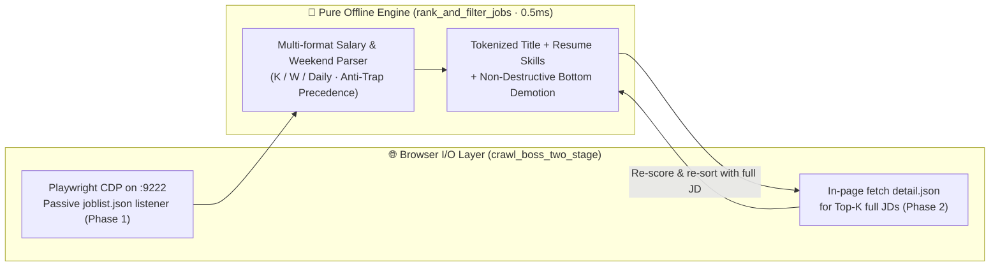

# Chapter 03: Search Recall & Decoupling Logic from I/O — Intent URLs & Job Ranking (Stages 3 & 4)

> 🌐 **Language Switcher**: **[简体中文](../zh/03-stage3-stage4-intent-and-ranking.md)** | **English**
> 🧭 **Navigation**: **[← Prev: 02 · Stage 1 & 2 Decoupling](./02-stage1-stage2-resume-to-queries.md)** | **[Tutorial Hub](../README.md)** | **[Next: 04 · Deterministic Math & Grounded Analysis →](./04-stage5-grounded-6d-analysis.md)**

---

## 1. What You Will Learn
1. **Hard URL Filters vs. Soft Semantic Signals (Stage 3)**: Maximizing search-engine recall without sacrificing downstream precision;
2. **Official Whitelist Validation & Deterministic City Priority**: Preventing hallucinated filter codes or silent city overrides;
3. **The Golden Rule of Testable Agents (Stage 4)**: Isolating **pure ranking computation (`rank_and_filter_jobs`)** from brittle **browser scraping I/O (`crawl_boss_two_stage`)**;
4. **Real Bug Post-Mortem**: Fixing substring-order bugs (`"单双休"` falsely matching `"双休"`) and implementing **non-destructive bottom demotion** for off-city and low-salary jobs.

---

## 2. Stage 3 Mental Model: Why Strip Industry Prefixes Before Building the Search URL?

When Stage 2 outputs `"服装零售行业的店面督导岗位，月薪至少1.2w"`:
- If you pass `query=服装零售店面督导` to BOSS Zhipin, major apparel brands (Uniqlo, UR, Bestseller) whose job titles simply say **`"店面督导"`** are completely missed!
- Stage 3 ([`core/intent_parser.py`](../../core/intent_parser.py)) solves this by splitting **Hard URL Parameters** from **Soft Reranking Signals**:
  - **Hard URL Parameters**: `query=店面督导`, `city=101280600`, `salary=405` (validated against 6 official whitelist dictionaries: `CITY_CODE_MAP`, `SALARY_CODE_LABELS`, `EXPERIENCE_CODE_LABELS`, `DEGREE_CODE_LABELS`, `SCALE_CODE_LABELS`, `STAGE_CODE_LABELS`);
  - **Deterministic City Priority**: `Explicit city in query text > Explicit target_city param > resume_profile city > Default "深圳"`—enforced in Python so an LLM hiccup can never overwrite the user's selected city;
  - **Soft Signals for Stage 4**: `min_salary_k=12`, expanded `industry_keywords=["服装", "服饰", "鞋服", "时尚", "零售", ...]`, and `require_double_weekend`.

---

## 3. Stage 4 Mental Model: Decouple Pure Intelligence from Brittle Browser I/O



If your scoring and filtering code is tangled inside Playwright browser loops, **every tweak to a scoring weight forces you to launch Chrome, hit live pages, and risk anti-bot sliders**—making automated regression testing impossible.

In Stage 4 ([`core/boss_crawler.py`](../../core/boss_crawler.py)), we apply two clean patterns:
1. **Pure Function Extraction (`rank_and_filter_jobs`) + `POST /api/jobs/rank`**: Takes plain JSON jobs + `ParsedSearchIntent`, attaches explainable `score_breakdown` dicts, and ranks 100 jobs in `< 1ms` with zero browser dependency;
2. **Non-Destructive Two-Tier Sorting `(0 if not is_demoted else 1, -score)`**:
   - Job feeds frequently leak adjacent-city roles (e.g., Foshan/Shenzhen mixed into Guangzhou) or below-floor salaries;
   - Deleting them loses data from the exported full-market Excel sheet; leaving them unpenalized wastes scarce Phase 2 detail-fetch slots;
   - **Best of both worlds**: Flag `is_demoted = is_city_mismatch or is_below_salary_floor`. Tuple sorting guarantees **100% of compliant jobs rank ahead of every demoted job** (zero contamination in Top-8), while preserving demoted jobs at the bottom of the full pool!

---

## 4. Vibe Coding From Scratch: Catching Real Bugs During `Explore → Propose`

### 💬 Step 1: `Explore` Prompt to Surface Subtle Edge Cases
```text
OpenSpec explore Stage 4: audit our salary parser, weekend-policy detector, and Top-K candidate scoring logic in read-only mode:
1. Check edge-case strings like "单双休" (alternating weekends), "隔周双休", "非双休" (no double weekend), "1.5-2.5W", and "200-300元/天" (daily wage);
2. Check how off-city leaks and below-floor salaries affect Top-K selection;
3. Propose how to decouple ranking from Playwright CDP so we can run offline NDCG@8 benchmarks.
Do not edit code yet.
```

> **Real Bug Caught in This Repo**: Originally, `detect_weekend_policy` checked `"双休" in text` *before* checking `"单双休"`, `"隔周双休"`, or `"非双休"`. Because all three contain the substring `"双休"`, alternating- and single-rest jobs were misclassified as `"周末双休"` and awarded `+15` bonus points! Reordering precedence (**Negated/Single → Alternating → Double Weekend**) fixed it to **100% accuracy**.

### 💬 Step 2: `Propose` Prompt for Stages 3 & 4
```text
OpenSpec propose for Stage 3 and Stage 4:
1. Stage 3 (`core/intent_parser.py` + `POST /api/intent/parse`): default to `gemini-3.8-flash` (`temp=0.1`), enforce deterministic city priority, add full 6-dictionary whitelist validation (`SCALE_CODE_LABELS` `301~306`, `STAGE_CODE_LABELS` `801~808`), and upgrade `fallback_parse_intent` for Stage 2 3-element queries and rounded decimal salaries.
2. Stage 4 (`core/boss_crawler.py` + `POST /api/jobs/rank`): fix `detect_weekend_policy` precedence, support K/W/daily-wage parsing in `parse_salary_bounds`, decouple `rank_and_filter_jobs` with tokenized title matching + `resume_profile["core_skills"]` bonus + `score_breakdown` + keep-in-pool mandatory bottom demotion, and re-sort `top_candidates` after Phase 2 JD enrichment.
Generate the OpenSpec proposal files first.
```

---

## 5. Verify Right Now on This Repo

```bash
.venv/bin/python -c "
from core.boss_crawler import detect_weekend_policy, parse_salary_bounds
from core.intent_parser import fallback_parse_intent

for txt in ['提供单双休', '隔周双休', '非双休，介意勿投', '周末双休']:
    print(f'{txt:12s} -> {detect_weekend_policy(txt)}')

for sal in ['12-18K·13薪', '1.5-2.5W·14薪', '200-300元/天']:
    print(f'{sal:14s} -> {parse_salary_bounds(sal)}')

intent = fallback_parse_intent('互联网软件行业的Java开发工程师岗位，月薪至少1.2w', target_city='广州')
print('BOSS URL:', intent.build_boss_url())
"
```

---

## 6. Common Beginner Pitfalls
- **Pitfall 1: Ordering substring rules from general to specific** — Always match negated and compound phrases (`"非双休"`, `"单双休"`) *before* shorter root substrings (`"双休"`).
- **Pitfall 2: Exact-substring-only job title scoring** — Combining ASCII tech tokens (`java`, `saas`, `ui`) with Chinese bi-gram overlap lets `"高级Java后端开发"` match `"Java开发工程师"` cleanly.

Next: **[Chapter 04: Deterministic Math + Grounded LLM Reasoning — Zero-Hallucination 6D Analysis (Stage 5)](./04-stage5-grounded-6d-analysis.md)**!
