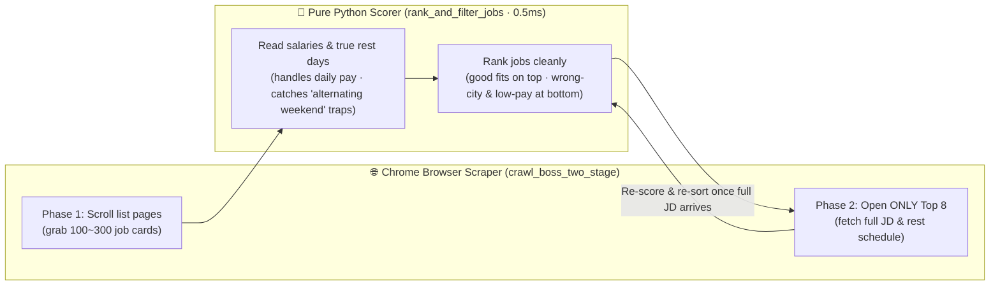

# Chapter 03: Search Links & Job Ranking — Separate Scoring From Scraping (Stages 3 & 4)

> 🌐 **Language Switcher**: **[简体中文](../zh/03-stage3-stage4-intent-and-ranking.md)** | **English**
> 🧭 **Navigation**: **[← Prev: 02 · Resumes to Search Queries](./02-stage1-stage2-resume-to-queries.md)** | **[Tutorial Hub](../README.md)** | **[Next: 04 · Python Math + LLM Advice →](./04-stage5-grounded-6d-analysis.md)**

---

## 1. What You'll Learn Here
1. **How to search without missing top companies (Stage 3)**: Put *only* the core job title into the search bar, and save industry words for scoring afterward;
2. **Check every URL code against official lists**: So an LLM can never invent a fake city or salary code;
3. **The #1 sanity-saver for scraper Agents (Stage 4)**: Keep your **job-scoring function** completely separate from your **Chrome browser scraper**—so you can test ranking tweaks in half a millisecond without triggering CAPTCHAs;
4. **Two real-world gotchas**: Stopping `"every other weekend off"` from fooling a `"weekends off"` check, and why pushing wrong-city / low-pay jobs to the bottom beats deleting them.

---

## 2. Stage 3's Trick: Why Strip Out the Industry Before Searching?

Suppose the user clicks `"服装零售行业的店面督导岗位，月薪至少1.2w"` (*Store Supervisor in the Apparel Retail industry, at least 12K/month*).
What happens if we stuff `"服装零售店面督导"` straight into BOSS Zhipin's search bar?
- Famous clothing brands like Uniqlo, Zara, or UR already *are* apparel companies—so their job postings are simply titled **`"店面督导"`** (*Store Supervisor*) without repeating the word *"Apparel"*! Searching the long phrase misses the best brands on the market!

So Stage 3 ([`core/intent_parser.py`](../../core/intent_parser.py)) splits the sentence into two buckets:
1. **Keep the URL short for maximum recall**: Put only `query=店面督导`, `city=101280600`, and `salary=405` (`10-20K`) into the URL, checking all 6 filter types (city, salary, experience, degree, company size, funding stage) against official dictionaries;
2. **Save expanded industry words for Stage 4**: Brainstorm related industry terms (`["服装", "服饰", "鞋服", "时尚", "零售"]`) and pass them to Stage 4 to boost companies in the right sector!

---

## 3. Stage 4's Golden Rule: Pull Scoring Out of the Browser Loop



If you write your scoring math inside your Playwright browser loop, changing a `+5` bonus means launching Chrome and scraping live pages all over again—until anti-bot sliders lock you out.

Pulling [`rank_and_filter_jobs`](../../core/boss_crawler.py) out into a plain Python function (with its own `POST /api/jobs/rank` endpoint) lets you test 100 jobs in **0.5 milliseconds** offline. Along the way, we solved two classic real-world traps:

### Gotcha 1: Don't Let "Alternating Weekends" Trick Your "Weekends Off" Check!
Our first version checked rest schedules like this: `if "双休" in text: return "周末双休"` (*if "double rest" is in the text, mark as full weekends off*).
Big mistake! In Chinese job ads, **"单双休"** (*1-day / 2-day alternating weekends*), **"隔周双休"** (*every other weekend off*), and even **"非双休"** (*NOT weekends off*) all literally contain the two characters `"双休"`! Our naive check gave them `+15` bonus points!
**The simple fix—check exceptions first**:
1. First check **`非双休 / 不双休 / 单休 / 排班`** (*no double weekend / 1 day off / shift work*);
2. Next check **`大小周 / 单双休 / 隔周双休`** (*alternating weekends*);
3. Only if neither matched, check **`周末双休 / 双休 / 做五休二`** (*true full weekends off*)!

### Gotcha 2: Push Wrong-City & Low-Pay Jobs to the Bottom—Don't Delete Them!
Job feeds often slip in nearby cities (e.g., Shenzhen jobs mixed into a Guangzhou search) or salaries below your minimum.
- **Why not delete them?** Users exporting the full Excel sheet want to see everything that came back;
- **Why not just subtract 15 points?** A flashy out-of-town tech giant might still outscore local companies and waste one of your 8 detail-page fetches!
- **The sweet spot**: Tag them `is_demoted = True` and sort by `(0 if not is_demoted else 1, -score)`. **Every valid local job ranks above every demoted job** (so 0 junk jobs enter the Top 8), while demoted jobs stay neatly parked at the bottom of the Excel sheet!

---

## 4. From Scratch: Prompts to Spot Bugs & Build Stages 3 & 4

### 💬 Step 1: Use `Explore` to Catch Edge Cases Before Coding
```text
OpenSpec explore Stage 4: without editing code yet, check our salary parser, weekend detector, and ranking logic for traps:
1. What happens on tricky strings like "单双休" (alternating weekends), "隔周双休", "非双休" (not weekends off), "1.5-2.5W", or "200-300元/天" (daily pay)?
2. How do we guarantee wrong-city or below-budget jobs never sneak into the Top 8, while still keeping them at the bottom of the exported Excel sheet?
3. How should we separate scoring from Playwright so we can test everything offline without Chrome?
```

### 💬 Step 2: `Propose` Prompt for Stages 3 & 4
```text
OpenSpec propose for Stage 3 and Stage 4:
1. Stage 3 (`core/intent_parser.py` + `POST /api/intent/parse`): use `gemini-3.8-flash` (`temp=0.1`), lock city priority (city in query > explicit `target_city` > resume city > default Shenzhen), and check all 6 filter codes against official dictionaries.
2. Stage 4 (`core/boss_crawler.py` + `POST /api/jobs/rank`): check negated/single/alternating rest rules strictly before `"双休"`; parse K, W, and daily pay (`元/天` × 21.75 workdays); extract pure offline `rank_and_filter_jobs` with word-piece title matching, resume skill bonuses, `score_breakdown`, and bottom-demotion sorting; and re-sort `top_candidates` after Phase 2 fetches full JDs.
Write the plan files first.
```

---

## 5. Try It Right Now on This Repo

```bash
.venv/bin/python -c "
from core.boss_crawler import detect_weekend_policy, parse_salary_bounds
from core.intent_parser import fallback_parse_intent

for txt in ['提供单双休', '隔周双休', '非双休，介意勿投', '周末双休']:
    print(f'{txt:12s} -> {detect_weekend_policy(txt)}')

for sal in ['12-18K·13薪', '1.5-2.5W·14薪', '200-300元/天']:
    print(f'{sal:14s} -> {parse_salary_bounds(sal)}')

intent = fallback_parse_intent('互联网软件行业的Java开发工程师岗位，月薪至少1.2w', target_city='广州')
print('BOSS URL:', intent.build_boss_url())
"
```

---

## 6. Quick Tips
- **Always check `"NOT X"` and special cases before `"X"`** in text rules.
- **Keep external I/O (browsers, APIs) separate from scoring math**—your future self will thank you every time you run tests!

Next up: **[Chapter 04: Let Python Do the Math, Let LLMs Write the Advice (Stage 5)](./04-stage5-grounded-6d-analysis.md)**!
