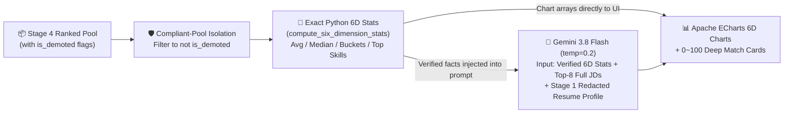

# Chapter 04: Deterministic Math + Grounded LLM Reasoning — Zero-Hallucination 6D Analysis (Stage 5)

> 🌐 **Language Switcher**: **[简体中文](../zh/04-stage5-grounded-6d-analysis.md)** | **English**
> 🧭 **Navigation**: **[← Prev: 03 · Search Recall & I/O Decoupling](./03-stage3-stage4-intent-and-ranking.md)** | **[Tutorial Hub](../README.md)** | **[Next: 05 · Eval-Driven Flywheel & Dashboard →](./05-eval-driven-flywheel-and-dashboard.md)**

---

## 1. What You Will Learn
1. **First Principle of Analytics Agents**: *"Never let an LLM do arithmetic"*—dividing labor cleanly between exact Python statistics and Gemini semantic reasoning;
2. **Compliant-Pool Statistical Isolation**: Keeping Stage 4 demoted off-city and low-salary traps out of market salary/industry distributions;
3. **Purging Domain-Bias Leakage**: How a single vertical example in a Pydantic `Field(description=...)` or fallback template can contaminate completely unrelated domains;
4. **XSS-Safe Frontend Rendering & Standalone `POST /api/analysis/evaluate`**.

---

## 2. Architectural Pattern: Python Computes the Numbers, Gemini Explains the Meaning

Dumping 150 raw job JSONs into an LLM prompt and asking it to compute averages, medians, and bucket counts causes two failures:
1. **Arithmetic Hallucinations**: LLMs miscount items and miscalculate medians, yielding different numbers on every run;
2. **Context Dilution**: 150 list items crowd out attention from the Top-8 full job descriptions that actually need deep resume-to-JD reasoning.

Stage 5 ([`core/gemini_analyzer.py`](../../core/gemini_analyzer.py)) separates the two concerns strictly:



1. **ECharts Data Comes 100% from Python**: Industry share, 7-bucket salary histograms, Top-15 skills, experience/degree rings, scale/funding tiers, and rest-schedule distributions are exact and instantaneous;
2. **Compliant-Pool Isolation**: `compute_six_dimension_stats` aggregates `compliant_jobs` (`not is_demoted`) so a few 5K low-salary or off-city traps never skew market salary medians, while explicitly reporting `compliant_jobs_count` and `demoted_jobs_count`;
3. **Strict Anti-Hallucination Prompting**: Gemini is instructed to cite *only* figures, company names, and rest policies present in `stats` and Top-8 JDs, enforce `0 <= score <= 100` bounds via Pydantic, and cover all `0..N-1` candidates 1:1.

---

## 3. Real Post-Mortem: Purging Vertical Domain Bias from Schemas & Fallbacks

Early in development, our first prototype query was *"Shenzhen apparel store supervisor"*, so several Pydantic `Field(description=...)` strings and `build_fallback_analysis` templates contained examples like `"store inspection"` and `"merchandise display"`.

During `OpenSpec Explore Stage 5`, we discovered that if a `"Java Backend Engineer"` query ever hit offline fallback—or when the model echoed schema hints—apparel phrases leaked into software engineering reports!

> **Takeaway**: Keep every Pydantic schema description, system prompt, and offline fallback template **100% domain-agnostic**, dynamically interpolating `{intent.query}`, `{intent.city_name}`, and `{skill_top}`.

---

## 4. Vibe Coding From Scratch: Stage 5 `Propose` Prompt

```text
Initiate an OpenSpec propose for Stage 5 (`core/gemini_analyzer.py` & `app.py`):
1. Compliant-pool isolation: `compute_six_dimension_stats` computes 6D distributions on `not is_demoted` jobs (with `compliant_jobs_count` & `demoted_jobs_count`);
2. Purge domain bias: remove all hardcoded retail/store-supervisor phrasing from `JobMatchEvaluationLLM`, `GeminiAnalysisLLMOutput`, and `build_fallback_analysis`;
3. Grounding & bounds: default to `gemini-3.8-flash` (`temperature=0.2`), add `ge=0, le=100` score validation, enforce 1:1 Top-K coverage, and require explicit risk deductions when rest policies violate `require_double_weekend`;
4. Expose standalone `POST /api/analysis/evaluate` and render all DOM nodes safely via `createElement` / `textContent`.
Create only the OpenSpec proposal files first.
```

---

## 5. Verify Right Now on This Repo: Test `POST /api/analysis/evaluate`

With `python app.py` running, send a 2-job pool (1 compliant Guangzhou Java role + 1 demoted 5–7K Shenzhen trap) and verify that `stats.salary.avg_min_k` equals `15.0` (unskewed by the demoted trap!):

```bash
curl -s -X POST http://127.0.0.1:8000/api/analysis/evaluate \
  -H "Content-Type: application/json" \
  -d '{
    "intent": {
      "raw_query": "广州Java开发工程师，月薪至少12K，周末双休",
      "query": "Java开发工程师",
      "city_name": "广州",
      "city_code": "101280100",
      "salary_code": "405",
      "min_salary_k": 12,
      "industry_keywords": ["互联网", "软件"],
      "require_double_weekend": true
    },
    "resume_profile": {
      "candidate_title": "Java后端开发工程师",
      "years_of_experience": "3年",
      "education_summary": "本科 · 计算机科学与技术",
      "core_skills": ["Java", "SpringBoot", "MySQL", "Redis"],
      "experience_highlights": ["主导高并发订单微服务重构，QPS提升3倍"]
    },
    "jobs": [
      {"岗位名称": "高级Java开发工程师", "公司名称": "云智科技", "薪资范围": "15-22K·14薪", "最低月薪K": 15, "最高月薪K": 22, "计薪月数": 14, "工作地点": "广州·天河", "所属行业": "互联网", "公司规模": "500-999人", "融资阶段": "C轮", "技能标签": "Java, SpringBoot, Redis", "福利待遇": "周末双休, 五险一金", "作息制度": "周末双休", "完整JD": "负责核心交易系统研发，要求熟悉SpringBoot与Redis分布式锁，周末双休。", "is_demoted": false},
      {"岗位名称": "Java开发工程师", "公司名称": "跨城干扰公司", "薪资范围": "5-7K", "最低月薪K": 5, "最高月薪K": 7, "计薪月数": 12, "工作地点": "深圳·宝安", "所属行业": "传统制造", "公司规模": "20-99人", "融资阶段": "未融资", "技能标签": "Java", "福利待遇": "单休", "作息制度": "排班轮休/单休", "完整JD": "驻场维护旧系统，单休。", "is_demoted": true}
    ],
    "top_candidates": [
      {"岗位名称": "高级Java开发工程师", "公司名称": "云智科技", "薪资范围": "15-22K·14薪", "最低月薪K": 15, "最高月薪K": 22, "计薪月数": 14, "工作地点": "广州·天河", "所属行业": "互联网", "公司规模": "500-999人", "融资阶段": "C轮", "技能标签": "Java, SpringBoot, Redis", "福利待遇": "周末双休, 五险一金", "作息制度": "周末双休", "完整JD": "负责核心交易系统研发，要求熟悉SpringBoot与Redis分布式锁，周末双休。", "is_demoted": false}
    ]
  }' | python3 -m json.tool
```

---

## 6. Common Beginner Pitfalls
- **Pitfall 1: Rendering scraped job titles or JDs with `innerHTML`** — Scraped web text is untrusted input; always render via `textContent` (`static/app.js`) to eliminate XSS vectors.
- **Pitfall 2: Neglecting offline fallback quality** — A clean, domain-neutral `build_fallback_analysis` ensures users still get accurate 6D charts and stats even during transient LLM quota hiccups.

Now that all 5 stages work end-to-end, how do we *prove* every prompt or code change improves quality without regressions? Next: **[Chapter 05: The Eval-Driven Flywheel — Human-in-the-Loop Ground Truth & the `#eval` Dashboard](./05-eval-driven-flywheel-and-dashboard.md)**!
