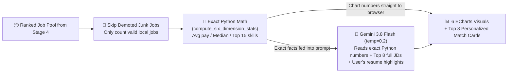

# Chapter 04: Let Python Do the Math, Let LLMs Write the Advice (Stage 5)

> 🌐 **Language Switcher**: **[简体中文](../zh/04-stage5-grounded-6d-analysis.md)** | **English**
> 🧭 **Navigation**: **[← Prev: 03 · Search Links & Job Ranking](./03-stage3-stage4-intent-and-ranking.md)** | **[Tutorial Hub](../README.md)** | **[Next: 05 · Automated Grading & `#eval` UI →](./05-eval-driven-flywheel-and-dashboard.md)**

---

## 1. What You'll Learn Here
1. **The #1 rule of data-analysis Agents**: Never ask an LLM to count rows or average 150 salaries! Do the math in Python first, then hand clean numbers to Gemini;
2. **Filter out junk before averaging**: Exclude Stage 4's demoted wrong-city and low-pay jobs before calculating market salaries so they don't drag down the average;
3. **A funny real-world bug**: How a leftover *"apparel store supervisor"* example from early testing snuck into a Java developer's report;
4. **Safe web rendering**: Displaying scraped job text without opening yourself up to script-injection (XSS) bugs.

---

## 2. Divide the Job Cleanly: Python Counts, Gemini Advises

Once you've collected 150 jobs, it's tempting to dump all 150 JSON items into one prompt and ask the LLM: *"Calculate average pay, make chart numbers, and review the top 8 jobs."*

That always backfires:
1. **LLMs are bad calculators**: Ask an LLM for the median of 150 numbers and you'll get a different guess every time;
2. **Too much noise hurts reading quality**: Stuffing 150 list cards into the prompt leaves the model rushing through the Top-8 full job descriptions that actually matter.

In Stage 5 ([`core/gemini_analyzer.py`](../../core/gemini_analyzer.py)), each side sticks to what it's best at:



1. **All 6 charts are powered 100% by Python math**: Industry breakdown, 7 salary brackets, Top 15 skills, experience/degree rings, big-name companies, and weekend-off ratios—zero guesswork, instant speed;
2. **Kick out demoted jobs before averaging**: Python skips `is_demoted=True` jobs when calculating market averages—so two underpaid `5K` traps won't make a `15K` market look underpaid;
3. **Strict "stick to the facts" rules for Gemini**: We hand Gemini the exact Python stats, the Top-8 full JDs, and the user's Stage 1 resume profile, telling it: **only quote numbers and companies shown above, score every single Top-8 job from `0` to `100`, and call out non-double-weekend schedules in the `risks` list!**

---

## 3. Real Bug Story: Watch Out for Leftover Examples From Early Testing!

When we built the very first prototype of this project, our test query was *"Shenzhen apparel store supervisor."* Without thinking, we wrote examples like *"highlight store inspection and merchandise display"* inside our schema descriptions and our offline backup template (`build_fallback_analysis`).

Weeks later, while testing *"Guangzhou Java Engineer,"* a brief network timeout triggered the offline backup—and the app earnestly advised a Java backend engineer to *"highlight store inspection and merchandise display on your resume"*!

> **Lesson learned**: Never hardcode industry-specific examples inside general-purpose schemas, prompts, or fallback templates! Use variables like `{intent.query}` and `{skill_top}` so the advice fits Java engineers, designers, and sales managers equally well.

---

## 4. From Scratch: Your Plain-English Prompt for Stage 5

```text
Initiate an OpenSpec propose for Stage 5 (`core/gemini_analyzer.py` & `app.py`):
1. Skip demoted jobs when counting: `compute_six_dimension_stats` should calculate salary averages, medians, and industry shares using only valid jobs (`not is_demoted`), while also returning `compliant_jobs_count` and `demoted_jobs_count`;
2. Remove leftover industry examples: clear out any hardcoded retail/store-supervisor phrases from schema descriptions and `build_fallback_analysis`, using `{intent.query}` dynamically instead;
3. Keep Gemini grounded: use `gemini-3.8-flash` (`temperature=0.2`), clamp all match scores to `0..100`, require 1:1 reviews for all Top-N candidates, and flag alternating/single-rest schedules under `risks` when the user asked for weekends off;
4. Add a standalone `POST /api/analysis/evaluate` endpoint so we can test Stage 5 without Chrome, and use `textContent` on the frontend so scraped text can never run scripts.
Write the plan files first.
```

---

## 5. Try It Right Now: See Junk-Job Filtering in Action

With `python app.py` running, send 1 good Guangzhou Java job (`15–22K`) plus 1 demoted Shenzhen junk job (`5–7K`):

```bash
curl -s -X POST http://127.0.0.1:8000/api/analysis/evaluate \
  -H "Content-Type: application/json" \
  -d '{
    "intent": {
      "raw_query": "广州Java开发工程师，月薪至少12K，周末双休",
      "query": "Java开发工程师",
      "city_name": "广州",
      "city_code": "101280100",
      "salary_code": "405",
      "min_salary_k": 12,
      "industry_keywords": ["互联网", "软件"],
      "require_double_weekend": true
    },
    "resume_profile": {
      "candidate_title": "Java后端开发工程师",
      "years_of_experience": "3年",
      "education_summary": "本科 · 计算机科学与技术",
      "core_skills": ["Java", "SpringBoot", "MySQL", "Redis"],
      "experience_highlights": ["主导高并发订单微服务重构，QPS提升3倍"]
    },
    "jobs": [
      {"岗位名称": "高级Java开发工程师", "公司名称": "云智科技", "薪资范围": "15-22K·14薪", "最低月薪K": 15, "最高月薪K": 22, "计薪月数": 14, "工作地点": "广州·天河", "所属行业": "互联网", "公司规模": "500-999人", "融资阶段": "C轮", "技能标签": "Java, SpringBoot, Redis", "福利待遇": "周末双休, 五险一金", "作息制度": "周末双休", "完整JD": "负责核心交易系统研发，要求熟悉SpringBoot与Redis分布式锁，周末双休。", "is_demoted": false},
      {"岗位名称": "Java开发工程师", "公司名称": "跨城干扰公司", "薪资范围": "5-7K", "最低月薪K": 5, "最高月薪K": 7, "计薪月数": 12, "工作地点": "深圳·宝安", "所属行业": "传统制造", "公司规模": "20-99人", "融资阶段": "未融资", "技能标签": "Java", "福利待遇": "单休", "作息制度": "排班轮休/单休", "完整JD": "驻场维护旧系统，单休。", "is_demoted": true}
    ],
    "top_candidates": [
      {"岗位名称": "高级Java开发工程师", "公司名称": "云智科技", "薪资范围": "15-22K·14薪", "最低月薪K": 15, "最高月薪K": 22, "计薪月数": 14, "工作地点": "广州·天河", "所属行业": "互联网", "公司规模": "500-999人", "融资阶段": "C轮", "技能标签": "Java, SpringBoot, Redis", "福利待遇": "周末双休, 五险一金", "作息制度": "周末双休", "完整JD": "负责核心交易系统研发，要求熟悉SpringBoot与Redis分布式锁，周末双休。", "is_demoted": false}
    ]
  }' | python3 -m json.tool
```

Check `stats.salary.avg_min_k` in the output—it's cleanly **`15.0`**, completely unaffected by the `5K` demoted job!

---

## 6. Quick Tip
- **Never put scraped web text into `innerHTML`**: Always use `textContent` (`static/app.js`) so malicious HTML tags inside a job ad are rendered harmlessly as plain text.

All 5 stages work! Now for the million-dollar question: **When you tweak a prompt tomorrow, how do you know you didn't break something else?** Let's build our automated grading setup in **[Chapter 05: How Do You Know It Got Better? Human-Reviewed Answer Keys & the `#eval` Scoreboard](./05-eval-driven-flywheel-and-dashboard.md)**!
