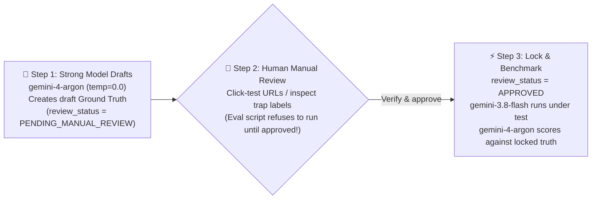

# Chapter 05: Eval-Driven Agent Development — Human-in-the-Loop Ground Truth & `#eval` Dashboard

> 🌐 **Language Switcher**: **[简体中文](../zh/05-eval-driven-flywheel-and-dashboard.md)** | **English**
> 🧭 **Navigation**: **[← Prev: 04 · Deterministic Math & Grounded Analysis](./04-stage5-grounded-6d-analysis.md)** | **[Tutorial Hub](../README.md)** | **[Next: 06 · Security Audit, CI & Public Release →](./06-security-ci-and-production.md)**

---

## 1. What You Will Learn
1. Why iterating on Prompts without per-stage benchmarks is flying blind;
2. **Dual-Engine Evaluation**: Pairing **100% deterministic code gates** with **stronger-model LLM-as-a-Judge (`gemini-4-argon`, `temperature=0.0`)** and IR metrics (`NDCG@8`);
3. **Human-in-the-Loop Ground Truth Bootstrapping**: Using a strong model to draft Ground Truth, pausing for **Manual Review**, locking `review_status="APPROVED"`, and only then running benchmarks;
4. Unifying all 5 stages into one interactive visual `#eval` workspace ([`eval/eval_store.py`](../../eval/eval_store.py)).

---

## 2. Mental Model: Stage-Isolated Benchmarks Beat End-to-End Guessing

If you only test end-to-end, a weak recommendation leaves you guessing whether Stage 1 missed a skill, Stage 2 wrote a bad query, Stage 3 mapped the wrong city code, Stage 4 buried the best job, or Stage 5 hallucinated.

Under `eval/`, each stage has its own isolated dataset, deterministic gates, and judge:

| Stage | Dataset (`eval/dataset/`) | Deterministic Hard Gates (Target: 100%) | Judge / Ranking Metric (`gemini-4-argon`) | Repo Baseline |
| :--- | :--- | :--- | :--- | :---: |
| **Stage 1** | 9 multimodal qualified resumes (`QUAL-01~09`) + 9 adversarial/corrupted files (`DISQ-01~09`) | 9-field schema valid, zero PII leak, 100% adversarial error-code rejection | 9-field atomic `0~10` entity/number exact match & hallucination check | `100%` adversarial block |
| **Stage 2** | `9 × 10 = 90` generated strategy queries from `QUAL-01~09` | 3-element format, zero city/welfare words, single role (no `/`), BOSS city 1:1 | 10-strategy relevance, salary progression & profile grounding | **`9.46 / 10`** (`100%` gates) |
| **Stage 3** | 18 stratified, human-approved BOSS Zhipin URL Ground Truth cases | Valid URL & 6 official whitelists, 1:1 city/salary codes, pure role keyword | 4D score: URL hard filters, role purification, industry synonyms, soft reqs | **`9.82 / 10`** (`94.4%` exact URL) |
| **Stage 4** | 6 human-approved scenarios (96 jobs w/ traps) + 12 salary/weekend edge cases | `100%` off-city/low-salary bottom demotion, `100%` weekend-trap & edge cases | **`NDCG@8`**, **`Recall@8`** + Argon 4D ranking quality judge | **`9.58 / 10`** (`NDCG@8=0.9754`) |
| **Stage 5** | 6 cross-industry scenarios from Stage 4 + Argon fact anchors | 6D schema complete, 100% Top-8 coverage, `0~100` bounds, **zero domain bias** | 4D score: JD/stat groundedness, profile alignment, risk flagging, advice | **`9.47 / 10`** (`100%` gates) |

---

## 3. Bootstrapping Ground Truth Fast: The Human-in-the-Loop Gate

Writing hundreds of Ground Truth records by hand is slow—but letting an unreviewed LLM grade itself is circular. Our 3-step workflow solves both:



### 💬 Prompt Template: Enforcing a Manual Review Gate in Vibe Coding
```text
OpenSpec propose for Stage 3 evaluation:
- Test `gemini-3.8-flash` as the Stage 3 parser and `gemini-4-argon` (`temperature=0.0`) as LLM-as-a-Judge;
- Reuse our Stage 1/2 dataset (`QUAL-01 ~ QUAL-09`), first writing `generate_stage3_ground_truth.py` with `gemini-4-argon` to draft expected BOSS Zhipin URLs (`review_status="PENDING_MANUAL_REVIEW"`);
- STOP immediately after generating the draft and print a clickable URL table for my Manual Review;
- Only after I approve the Ground Truth, mark it `APPROVED`, run `evaluate_stage3_intent.py`, and wire Stage 3 charts into `/#eval`.
```

Look inside [`eval/stage3_eval/evaluate_stage3_intent.py`](../../eval/stage3_eval/evaluate_stage3_intent.py) and [`eval/stage4_eval/evaluate_stage4_ranking.py`](../../eval/stage4_eval/evaluate_stage4_ranking.py)—both enforce this guard in code:
```python
if manifest.get("review_status") != "APPROVED":
    raise ValueError("Ground Truth has not passed Manual Review; evaluation aborted.")
```

---

## 4. Verify Right Now on This Repo: Run Live Stage Evaluations

With `GEMINI_API_KEY` or Vertex AI ADC configured, run any stage benchmark from the CLI—results archive automatically to `eval/runs/` and appear on `http://127.0.0.1:8000/#eval`:

```bash
# Stage 4 offline ranking benchmark (96 jobs NDCG@8 + 12 boundary cases + Argon judge)
.venv/bin/python eval/stage4_eval/evaluate_stage4_ranking.py

# Stage 3 intent & BOSS URL benchmark (18 human-approved URLs)
.venv/bin/python eval/stage3_eval/evaluate_stage3_intent.py

# Stage 5 grounded 6D analysis benchmark (6 cross-industry scenarios)
.venv/bin/python eval/stage5_eval/evaluate_stage5_analysis.py
```

---

## 5. Common Beginner Pitfalls
- **Pitfall 1: Using the same small model as both generator and judge** — Always use a stronger reasoning model (`gemini-4-argon` at `temperature=0.0`) as judge to avoid self-preference blind spots.
- **Pitfall 2: Relying on LLM Judge scores without deterministic gates** — Whitelist validity, PII redaction, URL syntax, and `NDCG@8` must be computed deterministically in Python.

Finally, let's harden our tested system for public release: **[Chapter 06: From Prototype to Public Release — Security Audit, CI Gates & OSS Checklist](./06-security-ci-and-production.md)**!
