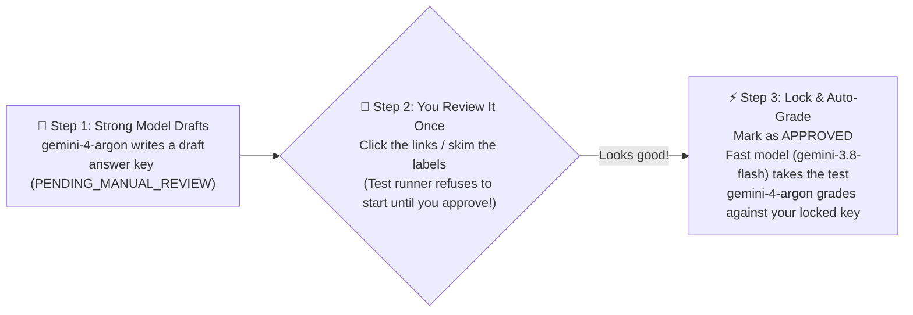

# Chapter 05: How Do You Know It Got Better? Answer Keys & the `#eval` Scoreboard

> 🌐 **Language Switcher**: **[简体中文](../zh/05-eval-driven-flywheel-and-dashboard.md)** | **English**
> 🧭 **Navigation**: **[← Prev: 04 · Python Math + LLM Advice](./04-stage5-grounded-6d-analysis.md)** | **[Tutorial Hub](../README.md)** | **[Next: 06 · Security Sweep & Going Public →](./06-security-ci-and-production.md)**

---

## 1. What You'll Learn Here
1. Why tweaking prompts "by gut feel" fixes Case #1 while quietly breaking Case #8;
2. **How to give your Agent a fair exam**: Hard Python pass/fail checks + a stronger model (`gemini-4-argon` at `temperature=0.0`) acting as the teacher grading the test;
3. **A huge time-saver for making Answer Keys (Ground Truth)**: Have the stronger model draft the answer key first, **spend 3 minutes checking it yourself**, lock it as `APPROVED`, and reuse it forever;
4. Putting all 5 stage scorecards onto one visual `/#eval` web dashboard.

---

## 2. Grade Every Stage Separately So Bugs Have Nowhere to Hide

If you only check the final report, a bad recommendation leaves you guessing which step messed up. Instead, we give **each of the 5 stages its own quiz**:

| Stage | What's on the Quiz? (`eval/dataset/`) | Hard Python Checks (Must Hit 100%) | What the AI Teacher Grades (`gemini-4-argon`) | Current Score |
| :--- | :--- | :--- | :--- | :---: |
| **Stage 1 Read Resume** | 9 fake resumes (PDF/Word/Images) + 9 broken or malicious files | All 9 fields present, names/phones masked, all 9 bad files blocked | Did it copy years, schools, and numbers accurately without making things up? | `100%` bad files blocked |
| **Stage 2 Search Ideas** | `9 × 10 = 90` generated search sentences | 3-part format, no city names, no perks, no `/` slashes, valid city code | Do the 10 career angles make sense for this resume and pay level? | **`9.46 / 10`** |
| **Stage 3 Search URL** | 18 human-checked BOSS Zhipin URLs | Valid URL syntax, all 6 filter codes in official lists, clean job title | Does the generated URL match our approved answer key? | **`9.82 / 10`** (`94.4%` exact URL) |
| **Stage 4 Rank Jobs** | 6 job pools (96 jobs mixed with wrong-city, low-pay & rest-day traps) | `100%` wrong-city/low-pay pushed to bottom, `100%` trap strings caught | Are the best jobs ranked in the Top 8 (`NDCG@8` ranking score)? | **`9.58 / 10`** (`NDCG@8=0.9754`) |
| **Stage 5 Write Report** | 6 full market & resume-match reports | All 6 sections filled, all Top-8 jobs scored `0..100`, zero leftover industry text | Do all numbers match Python's stats, and is the advice tailored to the resume? | **`9.47 / 10`** |

---

## 3. The Smart Shortcut: How to Build Answer Keys Without Writing 100 Rows by Hand

Writing 18 URLs and 96 job grades from scratch is tedious—but letting AI write the test, take the test, and grade itself without supervision is cheating.

Here's the 3-step shortcut we used for Stage 3 and Stage 4:



### 💬 How to Ask AI for This "Pause for My Review" Workflow
```text
I want to add Stage 3 evaluation and put charts on the #eval dashboard:
- Use `gemini-3.8-flash` to generate the URLs under test, and use `gemini-4-argon` (`temperature=0.0`) as the LLM-as-a-Judge grader;
- Reuse our 9 test resumes from Stages 1 & 2, but since we don't have an answer key for Stage 3 yet, first write a script using `gemini-4-argon` to draft the expected BOSS Zhipin URLs;
- Pause right after generating the draft and print a clickable URL table so I can do a Manual Review;
- Once I confirm the URLs look right, mark the file `APPROVED` and run the Stage 3 evaluation!
```

Inside [`eval/stage3_eval/evaluate_stage3_intent.py`](../../eval/stage3_eval/evaluate_stage3_intent.py), a two-line safety lock enforces that rule in code:
```python
if manifest.get("review_status") != "APPROVED":
    raise ValueError("Answer key hasn't passed Manual Review yet—aborting eval!")
```

---

## 4. Try Running a Live Exam Right Now!

With your Gemini key set up, run any stage exam from your terminal—results save to `eval/runs/` and show up on `http://127.0.0.1:8000/#eval`:

```bash
# Run Stage 4 job-ranking exam (96 jobs + 12 edge cases + Argon grading, ~40s)
.venv/bin/python eval/stage4_eval/evaluate_stage4_ranking.py

# Run Stage 3 URL exam (18 human-approved URLs)
.venv/bin/python eval/stage3_eval/evaluate_stage3_intent.py

# Run Stage 5 report exam (6 cross-industry scenarios)
.venv/bin/python eval/stage5_eval/evaluate_stage5_analysis.py
```

Refresh `http://127.0.0.1:8000/#eval` afterward and use the **Run History** dropdown to compare your brand-new run against previous baselines!

---

## 5. Quick Tips
- **Don't let a small model grade its own homework**: Use your fast model (`gemini-3.8-flash`) for the app, and bring in a heavier hitter (`gemini-4-argon` at `temperature=0.0`) to grade fairly and consistently.
- **Use Python for black-and-white checks**: Valid URLs, dictionary codes, and scrubbed phone numbers should always be checked with plain `True/False` Python code.

One last step left! Before sharing your repo with the world, let's do a quick safety sweep in **[Chapter 06: Going Public on GitHub — Security Sweep & Auto-Checks](./06-security-ci-and-production.md)**!
