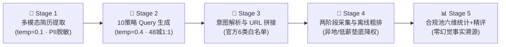

# 第 00 章：快速启动与「免爬虫离线沙盒」体验（10 分钟跑通全栈）

> 🌐 **语言切换**: **简体中文** | **[English](../en/00-quickstart-and-sandbox.md)**
> 🧭 **章节导航**: **[返回教程总目录](../README.md)** | **[下一章：01 · 用 OpenSpec 驯服 Vibe Coding 工具 →](./01-openspec-foundation.md)**

---

## 1. 本章目标
在动手从 0 到 1 复刻整个 Agent 系统之前，我们先花 **10 分钟** 把本仓库在本地完整跑起来。你将学会：
1. 配置 Python 虚拟环境与 Gemini API 凭证（AI Studio API Key 或 GCP Vertex AI 二选一）；
2. **无需配置 Chrome 爬虫**，直接在浏览器查看完整的 **Stage 1 ~ Stage 5 全链路评测大盘 (`/#eval`)**；
3. 用 `curl` 单独调通 Stage 3（意图解析）、Stage 4（离线粗排）、Stage 5（六维诊断）三个**零外部爬虫依赖**的微服务接口；
4. （可选）启动带 `9222` 调试端口的 Chrome，跑通端到端实时岗位采集。

---

## 2. 架构全景速览：我们在构建一个什么样的系统？

很多初学者做“求职助手 Agent”时，第一反应是写一个大 Prompt：*“给你简历和岗位，帮我挑几个好的”*。但在真实工程场景下，我们会把它拆解为 **5 个职责单一、可独立测试、可量化评分的 Stage**：



> [!TIP]
> **工程设计精髓**：本项目中 **Stage 1、2、3、5 以及 Stage 4 的核心粗排算法 (`rank_and_filter_jobs`) 全部支持纯离线 API 调用**！这意味着即使你不登录招聘网站、不启动浏览器，也能 100% 验证和学习整套 AI Agent 核心逻辑。

---

## 3. 第一步：克隆仓库与配置环境（3 分钟）

打开终端执行以下命令：

```bash
# 1. 克隆仓库并进入目录
git clone git@github.com:jason-haha-69135/boss-zhipin-crawler.git
cd boss-zhipin-crawler

# 2. 创建并激活独立虚拟环境（切勿污染系统全局 Python）
python3 -m venv .venv
source .venv/bin/activate

# 3. 安装依赖
pip install -r requirements.txt

# 4. 复制环境变量模板
cp .env.example .env
```

接下来配置 **Gemini 模型访问凭证**（二选一即可，底层 [`core/gemini_client.py`](../../core/gemini_client.py) 会自动探测可用通道）：

### 方式 A：使用 Google AI Studio API Key（最简单，推荐个人开发者）
```bash
export GEMINI_API_KEY="在这里填入你的_GEMINI_API_KEY"
```

### 方式 B：使用 Google Cloud Vertex AI（企业/GCP 开发者）
```bash
gcloud auth application-default login
export GOOGLE_CLOUD_PROJECT="你的_GCP_PROJECT_ID"
```

---

## 4. 第二步：启动服务并浏览全链路评测工作台（2 分钟）

启动 FastAPI 服务：

```bash
python app.py
```

看到终端输出 `Uvicorn running on http://127.0.0.1:8000` 后，在浏览器打开两个核心工作台：

1. **全链路 5 阶段评测大盘（零配置立即可看）**：访问 `http://127.0.0.1:8000/#eval`
   - 依次点击顶部的 **STAGE 1 → STAGE 2 → STAGE 3 → STAGE 4 → STAGE 5** 五张卡片；
   - 仓库已在 `eval/runs/` 内置了全部 5 个阶段的真实评测基准报告，你可以直观看到每个 Stage 的核心指标（如 Stage 1 的 9 字段原子核对、Stage 2 的 10 策略三要素完整率、Stage 3 的 BOSS URL 精准一致率 `94.4%`、Stage 4 的 `NDCG@8 = 0.9754`、Stage 5 的事实忠实度评分）。
2. **主求职分析工作台**：访问 `http://127.0.0.1:8000/`
   - 先在上传框上方选择 **BOSS直聘意向城市**（如 `上海` 或 `广州`），再上传任意一份测试简历（可直接选用 `eval/dataset/stage1/qualified/QUAL-01.pdf`），即可实时体验 **Stage 1 脱敏画像提取 → Stage 2 自动生成推荐求职 Query**，并试试动态切换城市观察 Stage 2 自动刷新！

---

## 5. 第三步：免爬虫沙盒实验——用 `curl` 逐个调通 Stage 3 / 4 / 5

保持 `python app.py` 运行，另开一个终端窗口，依次运行下面 3 条命令，亲眼验证各阶段的数据契约：

### 实验 1：测试 Stage 3 独立意图解析与 BOSS直聘 URL 拼接 (`POST /api/intent/parse`)
```bash
curl -s -X POST http://127.0.0.1:8000/api/intent/parse \
  -H "Content-Type: application/json" \
  -d '{
    "query": "互联网软件行业的Java开发工程师岗位，月薪至少1.2w",
    "target_city": "杭州"
  }' | python3 -m json.tool
```
**观察重点**：
- `intent.query` 被提纯为 `"Java开发工程师"`（剥离了 `"互联网软件行业的"` 和 `"岗位"`，防止搜索漏召回）；
- `intent.city_code` 精准映射为杭州官方编码 `"101210100"`，`salary_code` 映射为 `"405"`（10-20K）；
- `boss_url` 直接生成可点击的 BOSS直聘标准搜索链接。

### 实验 2：测试 Stage 4 纯离线岗位粗排与异地/低薪垫底降权 (`POST /api/jobs/rank`)
```bash
curl -s -X POST http://127.0.0.1:8000/api/jobs/rank \
  -H "Content-Type: application/json" \
  -d '{
    "top_k": 2,
    "intent": {
      "raw_query": "广州Java开发工程师，月薪至少10K，周末双休",
      "query": "Java开发工程师",
      "city_name": "广州",
      "city_code": "101280100",
      "salary_code": "405",
      "min_salary_k": 10,
      "industry_keywords": ["互联网", "软件"],
      "require_double_weekend": true
    },
    "resume_profile": {"core_skills": ["Java", "MySQL", "SpringBoot"]},
    "jobs": [
      {"岗位名称": "Java开发工程师", "薪资范围": "18-25K", "工作地点": "深圳·南山", "所属行业": "互联网", "福利待遇": "周末双休", "技能标签": "Java"},
      {"岗位名称": "Java开发工程师", "薪资范围": "6-8K", "工作地点": "广州·天河", "所属行业": "互联网", "福利待遇": "周末双休", "技能标签": "Java"},
      {"岗位名称": "高级Java后端开发", "薪资范围": "12-18K", "工作地点": "广州·海珠", "所属行业": "软件", "福利待遇": "周末双休", "技能标签": "Java, MySQL"}
    ]
  }' | python3 -m json.tool
```
**观察重点**：
- 排第 1 名的是 `"高级Java后端开发"`（虽不含完整字面串 `"Java开发工程师"`，但通过词元匹配 + 简历技能重合拿到高分，且 `score_breakdown` 清晰可查）；
- 深圳异地岗与 `6-8K` 低薪岗均被标记 `is_demoted: true` 并强制沉底，但 `total_jobs` 仍保留为 `3`（非破坏性降权）。

### 实验 3：（可选）启动调试 Chrome 体验端到端实时采集
如果你想在主界面点击推荐 Query 抓取真实岗位：
```bash
./start_chrome.sh
```
在弹出的独立 Chrome 窗口中扫码登录一次 BOSS直聘（Cookie 保存在本地忽略目录 `chrome-profile/` 中），回到 `http://127.0.0.1:8000/` 点击任意 Query 即可流式查看采集与六维图表生成全过程。

---

## 6. 本章通关自检清单
- [x] 本地 `python app.py` 成功在 `127.0.0.1:8000` 启动；
- [x] 打开 `/#eval` 看到了全部 5 个 Stage 的 `● 已就绪 (Live)` 状态与可视化图表；
- [x] 成功在主界面上传 `QUAL-01.pdf` 并体验了 Stage 1 → Stage 2 推荐 Query 生成；
- [x] 用 `curl` 调通了免爬虫的 `/api/intent/parse` 与 `/api/jobs/rank`。

准备好之后，我们正式进入 **[第 01 章：用 OpenSpec 驯服 Vibe Coding 工具](./01-openspec-foundation.md)**——看看如何从空白文件夹开始，给 Antigravity / Codex 立规矩！
