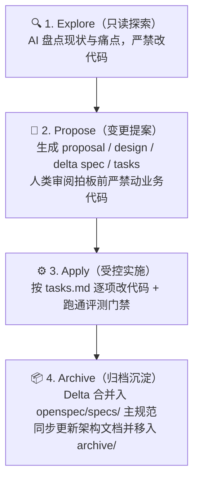

# 第 01 章：告别“抽卡式 Vibe Coding”——用 OpenSpec 建立 AI 编程护栏

> 🌐 **语言切换**: **简体中文** | **[English](../en/01-openspec-foundation.md)**
> 🧭 **章节导航**: **[← 上一章：00 · 快速启动与离线沙盒](./00-quickstart-and-sandbox.md)** | **[返回教程总目录](../README.md)** | **[下一章：02 · 需求挖掘与双阶段解耦 →](./02-stage1-stage2-resume-to-queries.md)**

---

## 1. 本章你将学会
1. 为什么直接对 AI 编程工具说“帮我写个求职 Agent”会在 3 轮对话后失控；
2. **Spec-Driven Development（规范驱动开发）** 的核心文件结构（`openspec/project.md` + `openspec/AGENTS.md` + `specs/` + `changes/`）；
3. 如何与 Antigravity / Codex 进行严格的 **`Explore → Propose → Apply → Archive`** 四步对话；
4. 什么是 **OpenSpec AST 语法树规则**，以及如何用 20 行 Python 脚本让规范具备像编译器一样的硬约束。

---

## 2. 思维框架：为什么纯靠聊天（Chat-Only Vibe Coding）做不出复杂 Agent？

新手使用 Antigravity 或 Codex 时最常见的反模式是**“边想边改、上下文漂移”**：
- **隐式假设黑盒**：你说“加个城市筛选”，AI 擅自把默认城市写死成北京、顺手改坏了前端请求格式，还不写测试；
- **会话失忆（Context Rot）**：对话超过 20 轮或开启新会话后，AI 忘记了之前定下的安全红线（例如“简历绝不能落盘”、“前端严禁用 `innerHTML`”）；
- **没有“改代码前的刹车片”**：需求还没想清楚，AI 已经一口气改了 8 个文件，回滚都不知道从哪回滚。

**解法：把“口头约定”变成仓库里的“持久化机器可读契约（OpenSpec）”**。



---

## 3. 从 0 到 1 实战：在空白项目中搭建 OpenSpec 地基

假设你刚刚执行了 `mkdir my-job-agent && cd my-job-agent && git init`。**在写第一行 Python 业务代码之前**，先给 Antigravity / Codex 发送下面这条初始化指令。

### 💬 Step 1 Prompt（复制发给 Antigravity / Codex）
```text
我现在要从 0 构建一个五阶段的「BOSS直聘智能求职分析 Agent」（FastAPI + Google GenAI SDK + Playwright CDP + 原生 JS/ECharts）。
在写任何业务代码之前，请先帮我初始化 OpenSpec 规范驱动目录 `openspec/`：
1. 创建 `openspec/project.md`：写入全局技术栈、五阶段物理隔离约定（Stage 1 简历解析、Stage 2 策略 Query 生成、Stage 3 意图 URL 映射、Stage 4 两阶段采集与离线粗排、Stage 5 六维统计与深度匹配）、默认模型分工（主链路 gemini-3.8-flash，评测裁判 gemini-4-argon），以及 4 条安全红线（简历纯内存解析零落盘、双端 PII 零泄露、路径遍历防护、前端禁用未转义 innerHTML）。
2. 创建 `openspec/AGENTS.md`：定义严格的工作流规则——当用户说 Explore 时只读不改码；当用户说 Propose 时只在 `openspec/changes/<change-id>/` 下创建 `proposal.md`、`design.md`、`tasks.md` 和 `specs/<capability>/spec.md`，未经用户确认“开始 apply”严禁修改业务代码；同时写明符合 Fission-AI/OpenSpec 源码解析器的 AST 规范（`### Requirement:` 必须含大写 `SHALL`/`MUST`，`#### Scenario:` 必须使用 `- **WHEN**` / `- **THEN**`）。
请只创建这两个文件供我审阅。
```

### 为什么要这样写 Prompt？
- **先立宪法再写业务**：一旦 `openspec/project.md` 和 `openspec/AGENTS.md` 落盘，后续无论是第 1 次会话还是第 50 次新开会话，AI 都会自动读取它们，永远不会违背“简历零落盘”或“未批准先改码”的红线。
- 你可以直接对照本仓库已落地的真实文件查看效果：
  - 全局上下文契约：[`openspec/project.md`](../../openspec/project.md)
  - AI 协作与 AST 规则：[`openspec/AGENTS.md`](../../openspec/AGENTS.md)

---

## 4. 深入理解 OpenSpec 的 AST 硬规范（为什么不能写散文？）

很多团队写的设计文档过两周就沦为废纸，因为自然语言散文无法被程序自动校验。OpenSpec 要求每一份主规范 `openspec/specs/<模块名>/spec.md` 必须能被解析为一棵确定性的语法树（AST）：

1. **顶层结构**：必须包含 `# <Title> Specification`、`## Purpose`（不少于 50 字符，严禁出现 `TBD`）与 `## Requirements`；
2. **需求块（Requirement）**：三级标题 `### Requirement: <名称>`，紧随其后的正文**必须包含大写规范词 `SHALL` 或 `MUST`**；
3. **场景块（Scenario）**：每个 Requirement 下至少包含一个四级标题 `#### Scenario: <场景名>`，且正文使用 `- **WHEN** ...`、`- **THEN** ...`、`- **AND** ...` 描述可测试的输入与预期输出；
4. **提案阶段的增量规范（Delta Spec）**：在 `openspec/changes/<change-id>/specs/<模块>/spec.md` 中使用 `## ADDED Requirements` 或 `## MODIFIED Requirements`，只写本次变更的部分，Archive 时再合并进主规范。

示例（摘自本仓库 [`openspec/specs/stage3-intent-parser/spec.md`](../../openspec/specs/stage3-intent-parser/spec.md)）：
```markdown
### Requirement: Stage 3 Intent Parsing with Gemini 3.8 Flash and Explicit City Priority
The `core/intent_parser.py` module SHALL parse natural-language job search queries into structured `ParsedSearchIntent` objects using `gemini-3.8-flash` (`DEFAULT_STAGE3_INTENT_MODEL`) at `temperature=0.1`, and MUST resolve the target city according to deterministic priority rules mapped 1:1 to BOSS直聘 `CITY_CODE_MAP`.

#### Scenario: Resolve city from Stage 2 target_city when query text contains no city
- **WHEN** `parse_user_intent` receives a city-free Stage 2 `query_text` alongside `target_city="武汉"`
- **THEN** the parser SHALL resolve `city_name="武汉"` and `city_code="101200100"` rather than defaulting to `"深圳"`
- **AND** `build_boss_url()` SHALL contain `city=101200100`
```

---

## 5. 日常跟 Vibe Coding 工具沟通的“四句标准口令”

立好 `AGENTS.md` 后，你在后续开发 Stage 1 ~ Stage 5 时，只需要用这 **4 句短口令** 就能精准控制 AI 的节奏：

| 阶段 | 你对 Antigravity / Codex 说的口令 | AI 允许做的事 | 你的把关重点 |
| :--- | :--- | :--- | :--- |
| **1. 盘点** | `OpenSpec explore Stage X：帮我盘点现状、边界问题与评测难点` | 只读代码/查资料，输出问题清单与决策选项 | 拍板架构取舍（如“异地岗位直接删还是垫底降权？”） |
| **2. 提案** | `发起 Stage X 的 propose：采纳方案 1、2，先生成提案` | 仅创建 `openspec/changes/<id>/` 下的 4 份文档 | 检查 `design.md` 接口签名、`spec.md` 边界场景、`tasks.md` 卡点 |
| **3. 实施** | `开始 apply` | 编写业务代码、单测与评测脚本，遇到人工审核卡点自动暂停 | 核验测试输出与人工审核卡点（Manual Review） |
| **4. 归档** | `执行 archive` | 将 Delta Spec 合入 `openspec/specs/`，移入 `changes/archive/`，同步 `system_design.md` | 运行 AST 校验确认主规范 100% 合规 |

> 💡 你可以打开本仓库的 [`openspec/changes/archive/`](../../openspec/changes/archive/) 目录，里面完整保留了我们推进各阶段时留下的真实历史提案（`proposal.md`、`design.md`、`tasks.md`）供你逐字参考！

---

## 6. 立即在本仓库运行验证：OpenSpec AST 校验器

在本仓库根目录运行下面这条命令，亲自验证全部 5 个 Stage 的主规范是否 100% 符合 OpenSpec AST 规范（这段脚本同样已内置在 `.github/workflows/ci.yml` 中）：

```bash
.venv/bin/python -c "
import re, pathlib
specs = sorted(pathlib.Path('openspec/specs').glob('*/spec.md'))
for sp in specs:
    txt = sp.read_text(encoding='utf-8')
    reqs = re.findall(r'^### Requirement: .+$', txt, re.M)
    scens = re.findall(r'^#### Scenario: .+$', txt, re.M)
    for block in re.split(r'^### Requirement: ', txt, flags=re.M)[1:]:
        assert ('SHALL' in block.split('#### Scenario:')[0] or 'MUST' in block.split('#### Scenario:')[0])
    for sblock in re.split(r'^#### Scenario: ', txt, flags=re.M)[1:]:
        assert '- **WHEN**' in sblock and '- **THEN**' in sblock
    print(f'[PASS] {sp} -> {len(reqs)} Requirements, {len(scens)} Scenarios')
"
```

---

## 7. 新手最容易踩的坑
- **坑 1：跳过 `Explore` 和 `Propose`，一上来就喊“帮我改代码”** —— 结果 AI 按错误假设改完十几个文件，返工成本极高。记住：**在 `design.md` 达成共识前，一行代码都别让 AI 写**。
- **坑 2：在 `spec.md` 里写模糊形容词（“解析要快、结果要准”）** —— 模糊需求无法测试。必须写成 `WHEN 输入含 1.2w THEN min_salary_k SHALL 等于 12 且 salary_code SHALL 等于 "405"`。

下一章，我们正式开始写第一块核心业务：**[第 02 章：需求挖掘与双阶段解耦——从多模态简历到求职策略 (Stage 1 & Stage 2)](./02-stage1-stage2-resume-to-queries.md)**！
