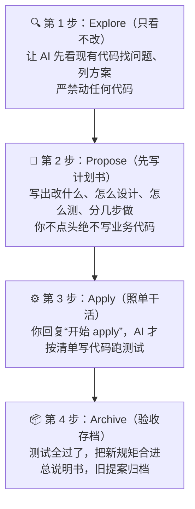

# 第 01 章：别让 AI 乱改代码——用 OpenSpec 给 Vibe Coding 立规矩

> 🌐 **语言切换**: **简体中文** | **[English](../en/01-openspec-foundation.md)**
> 🧭 **章节导航**: **[← 上一章：00 · 10分钟跑通项目](./00-quickstart-and-sandbox.md)** | **[返回教程总目录](../README.md)** | **[下一章：02 · 读简历与想搜词 →](./02-stage1-stage2-resume-to-queries.md)**

---

## 1. 这一章咱们解决什么痛点？
用 Antigravity 或 Codex 写小脚本很爽，但一旦项目超过 3 个文件，你肯定遇到过这些崩溃瞬间：
- **AI 太“自作聪明”**：你只让它改个按钮文字，它顺手把你后端接口字段名也改了，前端直接报错；
- **聊久了就“失忆”**：前面千叮万嘱“用户上传的简历千万别存硬盘”，聊了二十轮或者新开个窗口，它又偷偷给你写了个 `open('temp.pdf', 'wb')`；
- **还没商量好就瞎改一通**：你只是随口问问“加个城市筛选怎么搞比较好？”，它二话不说哗啦啦改了 8 个文件，想撤回都费劲。

这一章教你用一套特别好懂的方法——**OpenSpec（先把规矩和方案写成文档，再让 AI 动手写代码）**，彻底治好这些毛病。

---

## 2. 核心思路：把“聊天记录里的口头交代”变成“文件夹里的白纸黑字”

怎么做呢？其实就两件事：**立两份长期规矩文件** + **每次改功能按四步走**。



这就像装修房子：**Explore 是量房看现场，Propose 是出施工图纸和报价单，你签字同意了才开始 Apply 砸墙施工，干完了验收合格做 Archive 留存水电图。** 这样 AI 永远不可能脱离你的掌控！

---

## 3. 从 0 到 1 实战：新建空文件夹，第一句话跟 AI 说什么？

假设你刚建好一个空文件夹 `mkdir my-job-agent && cd my-job-agent && git init`。**先别急着让它写 Python 代码**，把下面这段话直接复制给 Antigravity / Codex：

### 💬 第一步实战 Prompt（直接复制给 AI）
```text
我现在要从零做一个五阶段的「BOSS直聘智能求职助手」（后端用 FastAPI + Google GenAI SDK + Playwright，前端用原生 JS + ECharts）。
在写任何代码之前，请先帮我建一个 `openspec/` 文件夹，立好两份规矩文件：
1. `openspec/project.md`（项目总背景）：写清楚技术栈、五个阶段各自干什么（Stage 1 读简历、Stage 2 生搜索词、Stage 3 拼搜索链接、Stage 4 抓岗位与打分排序、Stage 5 算统计数据与写分析报告）、默认用什么模型（日常干活用 gemini-3.8-flash，给结果打分当裁判用 gemini-4-argon），以及 4 条死规矩（简历只在内存里读绝不存硬盘、姓名电话住址必须打码、读写文件要防路径越界、前端不准直接用 innerHTML 塞未过滤的内容）。
2. `openspec/AGENTS.md`（给 AI 看的工作纪律）：规定以后我说 Explore 时只准看代码提建议，不准改文件；我说 Propose 时只准在 `openspec/changes/<变更名>/` 下写提案文档（`proposal.md`、`design.md`、`tasks.md`、`specs/`），没等我说“开始 apply”绝对不准动业务代码；同时写清楚文档的固定标题格式，方便以后用脚本自动检查。
现在只创建这两个文档给我看，不要写别的代码。
```

你可以点开本仓库里真实生成的这两个文件看看长啥样，非常清爽：
- 项目总背景：[`openspec/project.md`](../../openspec/project.md)
- AI 工作纪律：[`openspec/AGENTS.md`](../../openspec/AGENTS.md)

---

## 4. 为什么要给规格文档定“固定格式”？

平时我们写文档爱写大段散文，过两周代码改了、文档忘了改，文档就废了。
OpenSpec 的聪明之处在于，它要求 `openspec/specs/` 里的每份说明书都按**像填空题一样的固定格式**写：
- 每个功能要求用 `### Requirement: ...` 开头，里面必须带上大写的 **`SHALL`** 或 **`MUST`**（表示“必须做到”）；
- 每个要求下面必须配至少一个具体例子 `#### Scenario: ...`，用 **`WHEN`（当输入什么时）** 和 **`THEN`（就必须输出什么）** 写清楚。

看个本仓库里最直观的真实例子（来自 [`openspec/specs/stage3-intent-parser/spec.md`](../../openspec/specs/stage3-intent-parser/spec.md)）：
```markdown
### Requirement: Stage 3 Intent Parsing with Gemini 3.8 Flash and Explicit City Priority
`core/intent_parser.py` MUST 按确定性优先级解析目标城市并与 `CITY_CODE_MAP` 一一对应。

#### Scenario: 搜索句里没写城市时，用外部传入的意向城市
- **WHEN** 输入查询是 `"互联网新媒体行业的新媒体运营岗位，月薪至少0.7w"` 且传入 `target_city="武汉"`
- **THEN** 解析出的城市名必须是 `"武汉"`、编码是 `"101200100"`（不能偷偷变回默认的深圳）
- **AND** 拼出来的搜索网址里必须包含 `city=101200100`
```
你看，写成 `WHEN ... THEN ...` 有两个巨大好处：一是人一眼就能看懂边界情况；二是 AI 写测试代码时，直接照着 `WHEN` 和 `THEN` 就能翻译成自动化测试用例！

---

## 5. 以后开发任何新功能，记住这“四句口令”就够了

立好规矩后，后面几章我们做 Stage 1 到 Stage 5，全都是重复这四句超简单的大白话口令：

| 第几步 | 你跟 AI 说的话 | AI 会做什么 | 你需要看一眼什么 |
| :--- | :--- | :--- | :--- |
| **1. 先摸底** | `OpenSpec explore Stage X：帮我看看这块逻辑有什么坑？` | 只读代码不动手，列出潜在问题和几个可选方案 | 做选择题（比如“异地岗位是删掉还是排到最后？”） |
| **2. 出方案** | `发起 Stage X 的 propose：按方案 1 来` | 只在 `openspec/changes/` 下写 4 个计划小文档 | 扫一眼 `design.md` 和 `tasks.md` 合不合你心意 |
| **3. 动手干** | `开始 apply` | 照着 `tasks.md` 一条条写代码、跑测试、打勾 | 看看测试过了没，需要人工确认的地方点个头 |
| **4. 存好档** | `执行 archive` | 把新规则合进总说明书 `openspec/specs/`，把临时计划挪进 `archive/` 留底 | 跑一下检查脚本确认格式没写歪 |

> 💡 好奇真实开发过程留下的“施工图纸”长啥样？直接点开本仓库的 [`openspec/changes/archive/`](../../openspec/changes/archive/) 文件夹，里面原汁原味保留了每一次改动的历史记录！

---

## 6. 马上在本仓库试一下：用脚本自动检查所有说明书合不合格

复制下面这段命令到终端运行，它会像批改填空题一样，1 秒钟检查完本仓库全部 5 个阶段的说明书有没有漏掉 `SHALL/MUST` 或 `WHEN/THEN`：

```bash
.venv/bin/python -c "
import re, pathlib
specs = sorted(pathlib.Path('openspec/specs').glob('*/spec.md'))
for sp in specs:
    txt = sp.read_text(encoding='utf-8')
    reqs = re.findall(r'^### Requirement: .+$', txt, re.M)
    scens = re.findall(r'^#### Scenario: .+$', txt, re.M)
    for block in re.split(r'^### Requirement: ', txt, flags=re.M)[1:]:
        assert ('SHALL' in block.split('#### Scenario:')[0] or 'MUST' in block.split('#### Scenario:')[0])
    for sblock in re.split(r'^#### Scenario: ', txt, flags=re.M)[1:]:
        assert '- **WHEN**' in sblock and '- **THEN**' in sblock
    print(f'[检查通过] {sp} -> 共 {len(reqs)} 条要求, {len(scens)} 个测试场景')
"
```

---

## 7. 新手避坑小贴士
- **千万别省掉 `Propose` 这一步**：花 1 分钟看一眼 AI 写的 30 行计划书，能省掉后面 2 小时帮它修 Bug 的冤枉时间。
- **要求别写虚词**：别写“解析要准一点”，要写“输入 `1.2w` 时，最低月薪数字必须算成 `12`”。

规矩立好了！下一章咱们正式动手做第一个核心功能：**[第 02 章：从简历到搜索词——为什么要拆成两步走？（Stage 1 & Stage 2）](./02-stage1-stage2-resume-to-queries.md)**！
