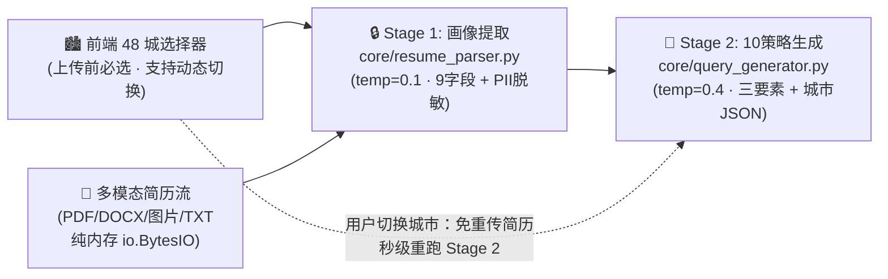

# 第 02 章：需求挖掘与双阶段解耦——从多模态简历到求职策略（Stage 1 & Stage 2）

> 🌐 **语言切换**: **简体中文** | **[English](../en/02-stage1-stage2-resume-to-queries.md)**
> 🧭 **章节导航**: **[← 上一章：01 · OpenSpec 护栏](./01-openspec-foundation.md)** | **[返回教程总目录](../README.md)** | **[下一章：03 · 搜索召回与 I/O 解耦 →](./03-stage3-stage4-intent-and-ranking.md)**

---

## 1. 本章你将学会
1. **需求挖掘方法论**：如何从目标平台（BOSS直聘）的真实搜索机制倒推 Agent 的输入输出格式；
2. **为什么必须拆成两个 Stage**：温度分层（`temperature=0.1` 事实提取 vs `temperature=0.4` 策略发散）与缓存复用架构；
3. **隐私与文件安全左移**：Magic Bytes 文件头校验、内存级零落盘解析、双端确定性 PII 脱敏；
4. **UI 交互与领域规则对齐**：为什么“意向城市”不能靠简历瞎猜，而要在前端做 1:1 官方城市编码选择器并支持动态重算 Stage 2。

---

## 2. 需求挖掘：先研究业务领域，再设计 Agent 接口

很多初学者设计“简历生成搜索词”功能时，会让 LLM 生成类似这样的句子：
> ❌ *“上海互联网大厂新媒体运营/内容运营，月薪8k以上，周末双休五险一金”*

看起来很通顺对不对？但如果你真的去 **BOSS直聘** 搜这句话，结果几乎为 **0**！通过 `Explore` 阶段的领域调研，我们挖掘出招聘搜索引擎的 **3 条铁律**：
1. **城市是前置独立筛选器，绝不能混进搜索词文本**：用户在网站顶部先选定城市（对应官方 9 位编码如上海 `101020100`），搜索框里带“上海”反而会过滤掉标题没写“上海”的 95% 本地岗位；
2. **列表页没有完整福利描述，搜“双休/五险一金”会严重误伤召回**：“双休”往往藏在详情页正文中，把福利词放进搜索句会导致颗粒无收，应该改为**【目标行业赛道】**；
3. **严禁斜杠 `/` 拼接多个岗位名**：搜 `新媒体运营/内容运营` 会被当成字面长串匹配，必须拆成单一标准岗位名。

由此，我们倒推出 Stage 2 每条推荐 Query 的**黄金三要素标准句式**：
> ✅ **`[目标行业赛道]的[单一标准核心岗位名]岗位，月薪至少[X.Xw]`**（同时在 JSON 结构中显式携带 1:1 映射的 `target_city` 与 `target_city_code`）。

---

## 3. 架构心法：为什么把“读简历”和“生 Query”物理拆成 Stage 1 和 Stage 2？



如果把两件事塞进同一个函数、同一个 Prompt，会有三大硬伤：
1. **温度冲突（Temperature Conflict）**：提取工作年限、学历、量化业绩需要**零幻觉、高度收敛（`temperature=0.1`）**；而发散出“精准对口、晋升冲刺、跨界拓展、高薪突破、稳健保底”等 10 条差异化求职策略需要**适度创造力（`temperature=0.4`）**；
2. **重复消耗多模态算力**：当用户在前端想把意向城市从“上海”切成“杭州”，或者把底薪预期调高 2K 时，如果未解耦就必须重新上传并解析几 MB 的 PDF/图片；解耦后前端只需拿着内存里已脱敏的 JSON 画像重调 `POST /api/resume/generate-queries`，速度提升数倍；
3. **隐私隔离（PII Air-Gap）**：Stage 1 在返回画像前执行 Python 正则确定性脱敏（抹除姓名、11 位手机号、邮箱、身份证、门牌住址），确保下游 Stage 2 ~ Stage 5 永远接触不到原始个人敏感信息。

---

## 4. 从 0 到 1 Vibe Coding 实战：用两轮 OpenSpec 搭出 Stage 1 & Stage 2

### 💬 第一轮 Prompt：发起 Stage 1 & Stage 2 的 `Propose`
```text
发起 Stage 1 和 Stage 2 的 OpenSpec propose：
1. Stage 1 (`core/resume_parser.py` + `POST /api/resume/parse-profile`)：
   - 支持 PDF/DOCX/PNG/JPG/WEBP/TXT/MD（<=10MB），必须校验文件真实 Magic Bytes，全流程纯内存 `io.BytesIO` 解析，严禁写临时文件；
   - 上传简历前强制要求用户在前端选择与 BOSS直聘 `CITY_CODE_MAP`（48个官方城市）1:1 映射的 `target_city`；
   - 使用 `gemini-3.8-flash` (`temperature=0.1`) + Pydantic Schema 提取 9 字段求职画像 (`CandidateProfileSchema`)，叠加确定性正则脱敏（姓名/手机/邮箱/身份证/详细门牌地址零泄露），并将 `target_city` 与 `target_city_code` 写入输出 JSON。
2. Stage 2 (`core/query_generator.py` + `POST /api/resume/generate-queries`)：
   - 物理拆分为独立模块，使用 `gemini-3.8-flash` (`temperature=0.4`) 基于 Stage 1 画像生成覆盖 10 大求职策略的推荐 Query；
   - 每条 `query_text` 必须严格符合 `"[行业]的[单一标准岗位]岗位，月薪至少[X.Xw]"` 三要素格式（严禁含城市名、福利套话或斜杠 `/`），同时在每条 Query JSON 中附带 `target_city` 与 `target_city_code`；
   - 前端允许用户随时动态切换意向城市，切换后自动重新传入画像触发 Stage 2 更新推荐列表。
请先在 `openspec/changes/` 下生成提案文件供我审阅，不要修改业务代码。
```

### 审阅提案时的 3 个关键检查点（Human Review）
当 AI 生成 `proposal.md`、`design.md`、`spec.md`、`tasks.md` 后，重点核查：
1. **反例防御是否写进 `spec.md`**：损坏的 PDF、伪装成 `.pdf` 的 `.exe`、超大文件、空白文件、非简历文本（如菜谱/发票）、Prompt 注入攻击是否有明确的 `error_code`（如 `MAGIC_MISMATCH`、`NOT_A_RESUME`、`FILE_TOO_LARGE`）？
2. **城市未选择拦截**：前端未选城市点击上传是否直接拦截提示，后端缺省非法城市是否返回 `HTTP 400`？
3. 确认无误后回复 **`开始 apply`**，AI 就会按清单实现 [`core/resume_parser.py`](../../core/resume_parser.py)、[`core/query_generator.py`](../../core/query_generator.py) 及前端选择器逻辑。

---

## 5. 对照本仓库源码与立即运行验证

你可以直接打开本仓库对应文件对照学习：
- Stage 1 主规范：[`openspec/specs/stage1-resume-parser/spec.md`](../../openspec/specs/stage1-resume-parser/spec.md)
- Stage 2 主规范：[`openspec/specs/stage2-query-generator/spec.md`](../../openspec/specs/stage2-query-generator/spec.md)
- Stage 1 实现：[`core/resume_parser.py`](../../core/resume_parser.py)
- Stage 2 实现：[`core/query_generator.py`](../../core/query_generator.py)

### 动手验证 1：测试 Stage 2 独立接口与三要素纯净度
保持 `python app.py` 运行，执行以下命令直接基于脱敏画像生成求职策略 Query：
```bash
curl -s -X POST http://127.0.0.1:8000/api/resume/generate-queries \
  -H "Content-Type: application/json" \
  -d '{
    "target_city": "上海",
    "query_count": 5,
    "profile": {
      "candidate_title": "新媒体运营",
      "years_of_experience": "应届生（2段运营实习）",
      "education_summary": "本科 · 市场营销",
      "target_cities": ["上海"],
      "industry_background": ["互联网/新媒体", "消费电子"],
      "core_skills": ["微信公众号与微博矩阵运营", "热点活动策划", "CET-6"],
      "experience_highlights": ["主导校园官微活动单条互动破1000次"],
      "inferred_salary_floor": "0.7w",
      "inferred_welfare_prefs": ["五险一金", "周末双休"]
    }
  }' | python3 -m json.tool
```
检查返回结果：你会看到 `target_city: "上海"`、`target_city_code: "101020100"`，且每条 `query_text` 都严格不含“上海”和“双休”，全部是干净的 `"[行业]的[岗位]岗位，月薪至少[X.Xw]"`！

### 动手验证 2：验证非法文件签名安全拦截
试着用 Stage 1 校验器检测仓库自带的伪造/恶意测试样本：
```bash
.venv/bin/python -c "
from pathlib import Path
from core.resume_parser import validate_and_inspect_upload
raw = Path('eval/dataset/stage1/disqualified/DISQ-01.doc').read_bytes()
try:
    validate_and_inspect_upload('DISQ-01.doc', raw)
except ValueError as e:
    print('成功拦截非法简历文件:', e)
"
```

---

## 6. 新手最容易踩的坑
- **坑 1：只靠 Prompt 让 LLM 脱敏 PII** —— LLM 偶尔会漏掉角落里的手机号或学校宿舍门牌号。**工程准则**：LLM 脱敏指令 + Python 正则后处理（`redact_pii_in_profile`）双保险缺一不可。
- **坑 2：只看文件后缀名 `.pdf` 就丢给解析库** —— 攻击者把 `.zip` 炸弹或脚本改名为 `.pdf` 会导致解析崩溃。必须先核验文件头前几个字节的 **Magic Bytes**（如 PDF 必须以 `%PDF-` 开头）。

有了高质量的 Stage 2 推荐 Query，下一章我们将解决最硬核的外部系统对接与反爬解耦问题：**[第 03 章：搜索召回工程与 I/O 解耦——意图 URL 映射与岗位粗排 (Stage 3 & Stage 4)](./03-stage3-stage4-intent-and-ranking.md)**！
