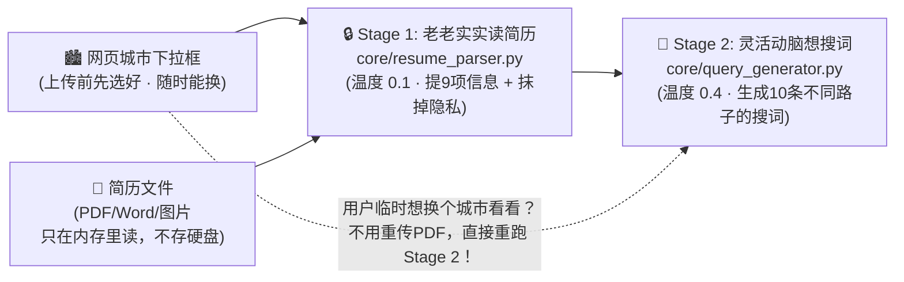

# 第 02 章：从简历到搜索词——为什么要拆成两步走？（Stage 1 & Stage 2）

> 🌐 **语言切换**: **简体中文** | **[English](../en/02-stage1-stage2-resume-to-queries.md)**
> 🧭 **章节导航**: **[← 上一章：01 · 给 AI 立规矩](./01-openspec-foundation.md)** | **[返回教程总目录](../README.md)** | **[下一章：03 · 拼搜索链接与挑好岗位 →](./03-stage3-stage4-intent-and-ranking.md)**

---

## 1. 这一章咱们学什么？
1. **怎么挖出真需求**：为什么让大模型随便生成的求职搜索词，放到 BOSS直聘上会一条结果都搜不出来？
2. **为什么要把“读简历”和“想搜索词”拆成两个独立步骤**：一个要老实不瞎编（温度 `0.1`），一个要思路活（温度 `0.4`），而且换城市时不用重新传简历；
3. **怎么保护个人隐私**：文件只放在内存里读（绝不存硬盘），并且用代码死规则把姓名、手机号、门牌住址统统打码抹掉；
4. **前端小细节大作用**：为什么上传简历前要先让用户选好城市？

---

## 2. 先摸透业务规律：为什么大模型默认写的搜索词根本不好使？

如果你直接把简历丢给普通聊天 AI，说“帮我写几句去 BOSS直聘搜工作的关键词”，它十有八九会写出这种话：
> ❌ *“上海互联网新媒体运营/内容运营，月薪8k以上，周末双休五险一金”*

看着挺像人话对吧？但你真复制到 BOSS直聘搜索框里一搜，**结果几乎是 0 条！** 为什么？只要花 5 分钟研究一下 BOSS直聘的网页，你就会发现三个真相：
1. **城市是在网页左上角单独选的，不能写进搜索词里**：绝大部分上海公司的岗位标题只写 `新媒体运营`，不会写 `上海新媒体运营`。你搜词里带上“上海”，反而把 95% 的本地好工作全筛没了！
2. **列表卡片上根本没写双休，搜“周末双休”等于自断后路**：双休还是单休一般写在点进去的详情页里，在外面的搜索框搜“双休”，会把大批没在标题写双休的好公司全漏掉。
3. **千万别用斜杠 `/` 把两个岗位连一块**：搜 `新媒体运营/内容运营`，搜索引擎会傻乎乎去找标题里同时带这俩词的岗位，肯定搜不到。

摸清这三个真相后，我们就定下了 Stage 2 生成搜索词的**黄金三要素模板**：
> ✅ **`[目标行业]的[单一岗位名]岗位，月薪至少[X.Xw]`**（比如：`互联网新媒体行业的新媒体运营岗位，月薪至少0.8w`），同时把用户选的城市（如 `上海` 和编号 `101020100`）单独放在 JSON 字段里往后传！

---

## 3. 核心设计思路：为什么要把“读简历”和“想搜词”拆成 Stage 1 和 Stage 2？



新手最容易把这两步合在一起写，但拆开之后好处太大了：
1. **性格要求完全相反（温度设置不同）**：
   - **Stage 1（读简历）必须绝对老实**：人家干了 3 年就是 3 年、本科就是本科，半个字都不能编，所以模型 `temperature` 设成很低的 **`0.1`**；
   - **Stage 2（想搜索词）需要帮用户打开思路**：除了“精准对口”，还要帮他想到“往上升一级的岗位”、“跨行业能干的岗位”、“稳妥保底的岗位”共 10 条路子，所以 `temperature` 设成 **`0.4`** 让它稍微活跃一点。
2. **换城市不用重新传几兆大的简历**：用户在网页上本来选了上海，突然想看看“如果去杭州发展有哪些机会？”，只要下拉框一切换杭州，前端直接拿着刚才提炼好的几行文字画像重跑 Stage 2，几秒钟就刷新完，不用重新上传识别整份 PDF！
3. **把隐私拦在第一关**：Stage 1 读完简历后，立刻用 Python 正则表达式把姓名、11 位手机号、邮箱、身份证号、家庭或宿舍门牌号全部替换抹掉。后面的 Stage 2 ~ Stage 5 根本接触不到用户的真实隐私。

---

## 4. 从 0 到 1 跟 AI 对话：用一段大白话 Prompt 搭出 Stage 1 和 Stage 2

在你的空项目里，可以直接把下面这段 Prompt 发给 Antigravity / Codex 发起提案：

### 💬 实战 Prompt（复制发给 AI）
```text
发起 Stage 1 和 Stage 2 的 OpenSpec propose：
1. Stage 1（`core/resume_parser.py` + 接口 `POST /api/resume/parse-profile`）：
   - 支持上传 PDF/DOCX/PNG/JPG/WEBP/TXT/MD（最大 10MB）。先检查文件头是不是真货（防止把别的乱七八糟文件改后缀传上来），全程只在内存 `io.BytesIO` 里读，不准在硬盘生成临时文件；
   - 网页上要求用户上传简历前，必须先从下拉框选好意向城市（跟 BOSS直聘官方 48 个城市编码一一对应）；
   - 用 `gemini-3.8-flash`（`temperature=0.1`）提取 9 个字段的简历画像，再用 Python 正则把姓名、手机号、邮箱、身份证、详细门牌住址全部打码抹掉，最后把选好的 `target_city` 和 `target_city_code` 一起放进返回的 JSON 里。
2. Stage 2（`core/query_generator.py` + 接口 `POST /api/resume/generate-queries`）：
   - 单独拆成一个文件，用 `gemini-3.8-flash`（`temperature=0.4`）根据简历画像生成 10 条不同角度的推荐搜索句；
   - 每条搜索句必须严格写成 `"[行业]的[单一岗位名]岗位，月薪至少[X.Xw]"`，里面不准出现城市名、不准写“双休/五险一金”、不准用斜杠 `/` 拼两个岗位名；同时每条 JSON 带上 `target_city` 和 `target_city_code`；
   - 网页上允许用户随时改选意向城市，一改就自动把画像发给 Stage 2 重新生成推荐词。
先按规矩在 `openspec/changes/` 下写方案文档给我看，先别改业务代码。
```

等 AI 写出方案文档，你扫一眼确认它把“坏文件拦截”和“未选城市提示”都考虑到了，回复一句 **`开始 apply`**，这两大模块就稳稳当当地写好了！

你可以对照本仓库的真实代码看看实现细节：
- Stage 1 读简历与打码：[`core/resume_parser.py`](../../core/resume_parser.py)
- Stage 2 生成 10 条搜索词：[`core/query_generator.py`](../../core/query_generator.py)

---

## 5. 马上在本仓库动手试一下

### 动手实验 1：直接传一段画像给 Stage 2，看看生成的搜索词干不干净
确保 `python app.py` 正在运行，在终端跑这条命令：
```bash
curl -s -X POST http://127.0.0.1:8000/api/resume/generate-queries \
  -H "Content-Type: application/json" \
  -d '{
    "target_city": "上海",
    "query_count": 5,
    "profile": {
      "candidate_title": "新媒体运营",
      "years_of_experience": "应届生（2段运营实习）",
      "education_summary": "本科 · 市场营销",
      "target_cities": ["上海"],
      "industry_background": ["互联网/新媒体", "消费电子"],
      "core_skills": ["微信公众号与微博矩阵运营", "热点活动策划", "CET-6"],
      "experience_highlights": ["主导校园官微活动单条互动破1000次"],
      "inferred_salary_floor": "0.7w",
      "inferred_welfare_prefs": ["五险一金", "周末双休"]
    }
  }' | python3 -m json.tool
```
你会看到返回的 5 条 `query_text` 全是干干净净的 `"[行业]的[岗位]岗位，月薪至少[X.Xw]"`，半个“上海”或“双休”都没混进去，而 `target_city_code` 稳稳地写着 `"101020100"`！

### 动手实验 2：拿一个假冒损坏文件试试 Stage 1 会不会上当
```bash
.venv/bin/python -c "
from pathlib import Path
from core.resume_parser import validate_and_inspect_upload
raw = Path('eval/dataset/stage1/disqualified/DISQ-01.doc').read_bytes()
try:
    validate_and_inspect_upload('DISQ-01.doc', raw)
except ValueError as e:
    print('成功拦住问题文件:', e)
"
```

---

## 6. 新手避坑小贴士
- **隐私打码别只靠叮嘱大模型**：大模型百密一疏，万一漏掉一个手机号就麻烦了。一定要在后面加一道 Python 正则替换兜底。
- **别只看文件后缀名是 `.pdf` 就信了**：有人把压缩包改名叫 `简历.pdf` 传上来会把程序搞崩，先读文件最开头几个字节验明正身最稳妥。

搜索词准备好了！下一章咱们看看怎么把它变成真能搜出好岗位的链接，以及怎么给几百个岗位快速挑出前 8 名：**[第 03 章：拼搜索链接与挑好岗位——把打分逻辑和网页爬虫拆开（Stage 3 & Stage 4）](./03-stage3-stage4-intent-and-ranking.md)**！
