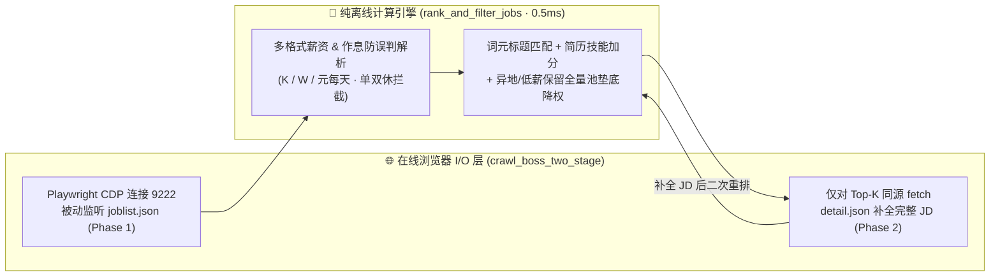

# 第 03 章：搜索召回工程与 I/O 解耦——意图 URL 映射与岗位粗排（Stage 3 & Stage 4）

> 🌐 **语言切换**: **简体中文** | **[English](../en/03-stage3-stage4-intent-and-ranking.md)**
> 🧭 **章节导航**: **[← 上一章：02 · 需求挖掘与双阶段解耦](./02-stage1-stage2-resume-to-queries.md)** | **[返回教程总目录](../README.md)** | **[下一章：04 · 确定性统计与零幻觉分析 →](./04-stage5-grounded-6d-analysis.md)**

---

## 1. 本章你将学会
1. **硬筛选参数 vs 软语义条件分离（Stage 3）**：如何兼顾搜索引擎的高召回率与下游筛选的高精准度；
2. **全量官方编码白名单与确定性城市优先级**：防止 LLM 幻觉出不存在的过滤码或篡改用户选定的城市；
3. **Agent 测试架构黄金法则（Stage 4）**：将**纯计算排序引擎 (`rank_and_filter_jobs`)** 从脆弱的**外部浏览器反爬 I/O (`crawl_boss_two_stage`)** 中彻底剥离；
4. **真实生产级 Bug 复盘**：如何解决 `"单双休"` / `"隔周双休"` / `"非双休"` 被误判为 `"周末双休"`，以及为什么“异地/低薪非破坏性垫底降权”优于暴力删除。

---

## 2. Stage 3 架构心法：为什么不能把“服装零售行业的店面督导”直接塞进 URL？

当用户点击 Stage 2 生成的 `"服装零售行业的店面督导岗位，月薪至少1.2w"`（或自己手敲 `"深圳的服装店面督导，月薪至少1w，周末双休"`）时：
- 如果直接拼成 `query=服装零售店面督导`，优衣库、UR、绫致时装等大批职位标题只写 **`"店面督导"`** 的头部品牌岗位会被搜索引擎直接漏掉！
- 因此 Stage 3（[`core/intent_parser.py`](../../core/intent_parser.py)）必须执行**「剥离定语提纯核心岗位 + 行业同义词组扩展 + 6 类官方白名单校验」**：
  - **硬性 URL 参数**（送入 BOSS直聘搜索地址）：`query=店面督导`、`city=101280600`、`salary=405`（以及可选的 `experience`/`degree`/`scale`/`stage`，全部强制核对官方字典白名单，非法编码一律清零）；
  - **确定性城市防覆盖优先级**：`Query 文本显式城市 > 显式传入 target_city > resume_profile 城市 > 默认深圳`——哪怕 LLM 在推理时走神输出了默认城市，Python 后置守卫也会强制锁死用户选定的城市；
  - **软性语义判据**（透传给 Stage 4 粗排）：`min_salary_k=12`、`industry_keywords=["服装", "服饰", "鞋服", "时尚", "零售", ...]`、`require_double_weekend=True`。

---

## 3. Stage 4 架构心法：把“纯逻辑”从“脆弱外部 I/O”中解耦出来



很多初学者写爬虫类 Agent 时，把打分、过滤、排序全写死在 Playwright 循环里。结果**每次改一行打分权重，都得启动浏览器去真网站抓几十页，抓两次就触发滑块验证码，根本没法做自动化回归测试**！

我们在 `OpenSpec Explore Stage 4` 时立下了两条关键设计决策：
1. **物理抽离纯函数 `rank_and_filter_jobs` + 独立接口 `POST /api/jobs/rank`**：输入 JSON 岗位数组与 `ParsedSearchIntent`，0.5 毫秒内纯内存返回排序结果与分项得分 `score_breakdown`，完全不碰浏览器；
2. **非破坏性双层确定性排序 `(0 if not is_demoted else 1, -score)`**：
   - 搜索流常混入周边异地岗（如搜广州混入佛山/深圳）或最高薪资仍低于底薪的岗位；
   - 如果直接删除，用户导出的全量 Excel 会缺数据；如果不拦截，高薪异地岗会挤占宝贵的 Top-8 详情页抓取配额；
   - **最佳平衡**：标记 `is_demoted = is_city_mismatch or is_below_salary_floor`，二元组排序保证**所有合规岗位 100% 排在降权岗位前面**（0 混入 Top-8），同时降权岗位完整保留在全量列表与 Excel 最底部！

---

## 4. 从 0 到 1 Vibe Coding 实战：用 `Explore → Propose → Apply` 打造 Stage 3 & 4

### 💬 Step 1 Prompt：先用 `Explore` 让 AI 帮你找出现有逻辑的隐蔽 Bug
```text
OpenSpec explore Stage 4：帮我只读盘点岗位薪资解析、双休作息识别与 Top-K 粗排打分逻辑，重点检查：
1. 边界字符串（如“单双休”、“隔周双休”、“非双休”、“1.5-2.5W”、“200-300元/天”）会不会解析出错？
2. 异地混入岗位与低于期望底薪的岗位如何防止挤占 Top-K 详情抓取名额？
3. 如何解耦才能在不启动 Chrome 的前提下做可复现的离线排序评测？
不要改任何代码，先给出分析与决策点。
```

> **真实复盘亮点**：在本项目的真实研发过程中，正是这一步 `Explore` 抓出了一个极具迷惑性的生产级 Bug——原代码先判断 `"双休" in text`，再判断 `"大小周"`，结果所有写着 **“单双休”**、**“隔周双休”**、**“非双休”** 的岗位全因为字面包含“双休”二字被误判成了“周末双休”并加了 15 分！

### 💬 Step 2 Prompt：拍板决策并发起 `Propose`
```text
发起 Stage 3 与 Stage 4 的 OpenSpec propose：
1. Stage 3 (`core/intent_parser.py` + `POST /api/intent/parse`)：
   - 默认使用 `gemini-3.8-flash` (`temperature=0.1`)，实现确定性城市优先级（Query显式城市 > target_city > resume_profile > 深圳）；
   - 补齐城市/薪资/经验/学历/规模(`301`~`306`)/融资(`801`~`808`)全量 6 类官方白名单校验，并升级离线正则兜底 `fallback_parse_intent` 支持 Stage 2 三要素拆解与小数薪资四舍五入。
2. Stage 4 (`core/boss_crawler.py` + `POST /api/jobs/rank`)：
   - 修复 `detect_weekend_policy` 判定顺序：严格按「否定/单休/排班 → 大小周/单双休/隔周双休 → 周末双休」执行；
   - 扩展 `parse_salary_bounds` 支持 K、W/万、元/天（按 21.75 工作日换算）；
   - 解耦纯离线 `rank_and_filter_jobs`，支持中英文词元模糊标题匹配、`resume_profile["core_skills"]` 技能重合加分、可解释 `score_breakdown`，以及异地/低薪保留全量池但强制垫底降权；Phase 2 拉取完整 JD 后对 `top_candidates` 二次重排。
先生成 OpenSpec 提案供我审阅。
```

审阅通过后回复 **`开始 apply`**，即可一次生成高质量、零耦合的 Stage 3 与 Stage 4 核心引擎。

---

## 5. 立即在本仓库运行验证：亲手测试边界防线

在终端运行这段单测脚本，验证作息防误判、多格式薪资换算与非破坏性垫底降权：

```bash
.venv/bin/python -c "
from core.boss_crawler import detect_weekend_policy, parse_salary_bounds, rank_and_filter_jobs
from core.intent_parser import fallback_parse_intent

# 1. 验证作息文字陷阱零误判
for txt in ['提供单双休', '隔周双休', '非双休，介意勿投', '周末双休']:
    print(f'{txt:12s} -> {detect_weekend_policy(txt)}')

# 2. 验证 W 与日薪换算
for sal in ['12-18K·13薪', '1.5-2.5W·14薪', '200-300元/天']:
    print(f'{sal:14s} -> {parse_salary_bounds(sal)}')

# 3. 验证离线粗排与异地/低薪垫底降权
intent = fallback_parse_intent('互联网软件行业的Java开发工程师岗位，月薪至少1.2w，周末双休', target_city='广州')
print('BOSS直聘目标 URL:', intent.build_boss_url())
"
```

---

## 6. 新手最容易踩的坑
- **坑 1：子串匹配不注意否定词与包含关系** —— `"双休"` 是 `"单双休"` 和 `"非双休"` 的子串！写规则匹配时，**更具体、带否定前缀的规则永远要排在最前面**。
- **坑 2：只做精确标题匹配 `query in job_name`** —— 真实招聘中 `Java开发工程师` 常写成 `高级Java后端开发`。引入英文词元 + 中文 2-gram 重合度打分（`_compute_title_score`）能让同义岗位召回率从 0 直接拉升至 90%+。

现在我们已经拿到了全量岗位池和精挑细选的 Top-8 完整 JD，下一章进入 **[第 04 章：确定性统计 + 受控推理——打造零幻觉六维分析报告 (Stage 5)](./04-stage5-grounded-6d-analysis.md)**！
