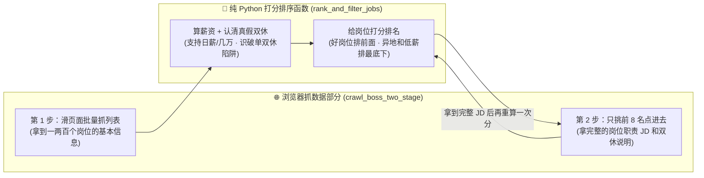

# 第 03 章：拼搜索链接与挑好岗位——把打分逻辑和网页爬虫拆开（Stage 3 & Stage 4）

> 🌐 **语言切换**: **简体中文** | **[English](../en/03-stage3-stage4-intent-and-ranking.md)**
> 🧭 **章节导航**: **[← 上一章：02 · 读简历与想搜词](./02-stage1-stage2-resume-to-queries.md)** | **[返回教程总目录](../README.md)** | **[下一章：04 · 算数据与写点评 →](./04-stage5-grounded-6d-analysis.md)**

---

## 1. 这一章咱们学什么？
1. **怎么搜才不会漏掉大厂好工作（Stage 3）**：搜索框里只填最核心的岗位名，把行业词留到抓回来之后再比对；
2. **给网址参数加一道“官方字典检查”**：防止大模型瞎编一个不存在的薪资码或城市码；
3. **做爬虫类 Agent 最省心的秘诀（Stage 4）**：把**“给岗位打分排序”**和**“开浏览器爬网页”**彻底拆成两块——这样你调打分规则时，0.5 毫秒就能测完，根本不用开浏览器看验证码脸色！
4. **两个超实用的真实细节**：怎么防止把“单双休/非双休”错当成“周末双休”？遇到异地或钱太少的岗位，为什么“留着排到最后”比“直接删掉”更好？

---

## 2. Stage 3 的小心机：为什么搜索框里要把“服装零售行业的”去掉？

假设用户在网页上点了一条推荐词：`"服装零售行业的店面督导岗位，月薪至少1.2w"`。
如果咱们傻乎乎把 `"服装零售店面督导"` 整个塞进 BOSS直聘的搜索网址里，会发生什么？
- 像优衣库、UR、Zara 这些大品牌，人家公司本来就是卖衣服的，所以发布的职位名往往只写简短的 **`"店面督导"`** 四个字，根本不会多此一举写“服装”俩字！你搜词太长，反而把这些最棒的大牌公司全漏掉了！

所以 Stage 3（[`core/intent_parser.py`](../../core/intent_parser.py)）专门干了一件“拆解分流”的活儿：
1. **放进搜索网址里的参数越精简越好**：只把最核心的岗位名 `query=店面督导`、城市码 `city=101280600`、薪资档位码 `salary=405`（10-20K）拼进网址，先把所有叫“店面督导”的岗位全捞回来；
2. **用官方字典查一遍代码真假**：城市、薪资、经验、学历、公司规模、融资阶段这 6 类代码，全都要在 Python 官方字典里查一遍——万一大模型胡编了一个不存在的代码，立刻清空，绝不让拼出来的网址报错；
3. **把行业词攒起来留给下一步用**：同时自动联想出一串同义词 `["服装", "服饰", "女装", "鞋服", "时尚", "零售"]`，传给下一步 Stage 4，去跟抓回来的“公司所属行业”做加分匹配！

---

## 3. Stage 4 的黄金经验：把“打分排序”从“浏览器爬虫”里单独拎出来



很多新手写爬虫项目，喜欢一边用浏览器翻页，一边在爬虫循环里写打分逻辑。结果你想改一下“双休加几分”，还得重新开 Chrome 去真网站爬一遍，爬两三次就弹滑块验证码，调试起来痛苦万分！

所以我们在做 Stage 4（[`core/boss_crawler.py`](../../core/boss_crawler.py)）时，专门把打分排序抽成了一个**完全不碰浏览器的普通 Python 函数 `rank_and_filter_jobs`**（还配了个独立接口 `POST /api/jobs/rank`）。随便喂给它一堆岗位 JSON，眨眼间就能排好名！

这里面还有两个我们在真实开发时踩过坑、特别值得分享的小设计：

### 细节 1：千万小心“单双休”和“非双休”的文字游戏！
早期的代码判断是不是双休，写得特别天真：`if "双休" in text: return "周末双休"`。
结果一跑真实数据傻眼了——好多公司写的是 **“单双休”**、**“隔周双休”**，甚至直接写 **“非双休，介意勿投”**！因为这几个词里全都带着“双休”俩字，老代码居然把它们全当成真双休，还给加了 15 分！
**怎么修？调整先后顺序就行了**：
1. 先查有没有 **`非双休 / 不双休 / 单休 / 排班`** → 有就直接判为单休排班；
2. 再查有没有 **`大小周 / 单双休 / 隔周双休`** → 有就判为大小周；
3. 前面都没撞上，最后再看有没有 **`双休 / 做五休二`** → 这才是真真正正的周末双休！

### 细节 2：遇到异地岗和低薪岗，别直接删，把它们排到最底下！
BOSS直聘的列表里经常会夹杂几个周边城市的岗位（比如你搜广州，它给你塞两条佛山、深圳的），或者最高工资都不到你底线的岗位。
- **为什么不直接删掉？** 因为用户最后可能会下载全量 Excel 表格做市场参考，偷偷删数据会让用户觉得抓少了；
- **为什么不能只扣几分了事？** 万一某条深圳异地岗是大厂、技能全中、福利写满，光扣十几分它可能还是排进前 8 名，白白浪费一次进详情页抓全文的名额！
- **最聪明的办法**：给异地或低薪岗贴个 `is_demoted = True`（降级）的标签。排序时先看标签再看分数——**所有正常岗位永远排在前面，所有贴了降级标签的岗位整整齐齐排在最底下垫底**。既保住了前 8 名干干净净，Excel 里也一条没丢！

---

## 4. 从 0 到 1 跟 AI 对话：让 AI 先找茬，再动手写 Stage 3 & Stage 4

### 💬 第一步：用 `Explore` 让 AI 帮你把隐藏的坑全翻出来
```text
OpenSpec explore Stage 4：先别改代码，帮我检查一下岗位薪资解析、双休识别和打分排序逻辑有没有坑：
1. 如果岗位写的是“单双休”、“隔周双休”、“非双休”，或者薪资写“1.5-2.5W”、“200-300元/天”，现在的代码能算对吗？
2. 如果列表里混进了外地城市的岗位，或者钱给得不够底线的岗位，怎么保证它们绝对混不进前 8 名，但导出 Excel 时还能留着？
3. 怎么把打分排序代码跟浏览器爬虫拆开，方便咱们不用开 Chrome 也能随时测试？
```

### 💬 第二步：拍板方案并发起 `Propose`
```text
发起 Stage 3 和 Stage 4 的 OpenSpec propose：
1. Stage 3（`core/intent_parser.py` + `POST /api/intent/parse`）：
   - 默认用 `gemini-3.8-flash`（`temperature=0.1`）；城市按“搜索句里写的城市 > 外部传进来的 target_city > 简历里的城市 > 默认深圳”的顺序定死，别让大模型乱改；
   - 把城市、薪资、经验、学历、公司规模、融资阶段 6 套官方编码字典全加上检查，不在字典里的编码一律清空。
2. Stage 4（`core/boss_crawler.py` + `POST /api/jobs/rank`）：
   - 修好双休识别顺序：先判“非双休/单休/排班”，再判“大小周/单双休/隔周双休”，最后才判“周末双休”；
   - 薪资解析加上对 `W/万` 和 `元/天`（按每月 21.75 个工作日换算）的支持；
   - 单独抽出不依赖浏览器的 `rank_and_filter_jobs` 函数：支持标题关键词拆分匹配（让“高级Java后端开发”也能匹配上“Java开发工程师”）、加上简历技能重合加分、把每一项加了几分写进 `score_breakdown`；异地和低薪岗留在列表里但强制排到最后面；抓完前 8 名完整 JD 后再按新分数重排一次顺序。
先写提案文档给我看。
```

审阅完提案回复 **`开始 apply`**，AI 就会把这套又稳又好测的逻辑完整写出来。

---

## 5. 马上在本仓库动手试一下

把下面这段命令复制到终端运行，亲眼看看“单双休/非双休”和日薪换算是不是算得明明白白：

```bash
.venv/bin/python -c "
from core.boss_crawler import detect_weekend_policy, parse_salary_bounds
from core.intent_parser import fallback_parse_intent

for txt in ['提供单双休', '隔周双休', '非双休，介意勿投', '周末双休']:
    print(f'{txt:12s} -> {detect_weekend_policy(txt)}')

for sal in ['12-18K·13薪', '1.5-2.5W·14薪', '200-300元/天']:
    print(f'{sal:14s} -> {parse_salary_bounds(sal)}')

intent = fallback_parse_intent('互联网软件行业的Java开发工程师岗位，月薪至少1.2w，周末双休', target_city='广州')
print('拼好的搜索链接:', intent.build_boss_url())
"
```

---

## 6. 新手避坑小贴士
- **写关键词判断时，永远先判断“否定词和特例”**：比如先查 `"非双休"` 和 `"单双休"`，最后才查 `"双休"`。
- **凡是跟外部网页、第三方接口打交道的代码，一定要把“抓数据”和“算结果”拆成两个函数**：这样以后不管外部网站怎么变，你的核心算法随时都能离线跑测试。

好岗位挑出来了、完整 JD 也拿到了！下一章咱们来做最后一步：**[第 04 章：算术归 Python，分析归大模型——写出绝不瞎编数字的六维报告（Stage 5）](./04-stage5-grounded-6d-analysis.md)**！
