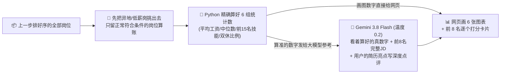

# 第 04 章：算术归 Python，分析归大模型——写出绝不瞎编数字的报告（Stage 5）

> 🌐 **语言切换**: **简体中文** | **[English](../en/04-stage5-grounded-6d-analysis.md)**
> 🧭 **章节导航**: **[← 上一章：03 · 拼链接与挑好岗位](./03-stage3-stage4-intent-and-ranking.md)** | **[返回教程总目录](../README.md)** | **[下一章：05 · 自动打分与评测看板 →](./05-eval-driven-flywheel-and-dashboard.md)**

---

## 1. 这一章咱们学什么？
1. **做数据分析 Agent 最核心的一条铁律**：千万别让大模型自己去数数、算平均工资！用 Python 算好精确数字，再喂给大模型写点评；
2. **算平均工资前先剔除干扰项**：把上一关挑出来的异地岗、低薪岗先挪开再统计，免得把市场真实工资拉低；
3. **一个特别隐蔽的翻车现场**：为什么早期测试时随手写的一句“服装店长”例子，会串台跑到 Java 程序员的分析报告里？
4. **网页防注入小常识**：爬回来的岗位文字怎么安全地显示在网页上？

---

## 2. 核心思路：让专业的人干专业的事（Python 算账 + 大模型写分析）

拿到抓回来的 150 个岗位之后，新手最容易干的一件事就是：把这 150 个岗位的文字一股脑全塞给大模型，说*“帮我统计一下平均工资、画图数据，再挑 8 个岗位点评一下”*。

这么干百分百会翻车：
1. **大模型算术真的很差**：让它数 150 个数算平均值和中位数，它每次算出来的数都不一样，经常张口就来；
2. **塞太多杂活会让它分心**：150 条简略列表把上下文塞得满满当当，到了真正需要仔细阅读的前 8 名完整岗位职责（JD）时，它反而草草敷衍两句就完事了。

所以在 Stage 5（[`core/gemini_analyzer.py`](../../core/gemini_analyzer.py)）里，我们把活儿分得清清楚楚：



1. **网页上的 6 张图表，数字 100% 由 Python 直接算出来**：行业占比、工资分档、最常考的 15 个技能、学历经验要求、大公司名单、双休比例——半毛钱不用大模型操心，又快又准；
2. **算账前先把“搅局的”踢出去**：上一章我们把外地岗位和不够底薪的岗位留在了列表最底下（贴了 `is_demoted=True` 标签）。Python 在算市场平均工资时，会自动跳过这些降级岗位只算正常岗位——不然混进两条 5K 的打杂岗，整个市场的平均起薪就被拉低了！
3. **给大模型戴上“不准瞎编”的紧箍咒**：我们把 Python 算好的现成数字、前 8 名的完整 JD，还有用户 Stage 1 提出来的简历技能摆在大模型面前，明确规定：**报告里提到的每一个数字、每一家公司名，必须原封不动来自上面给你的材料；如果某个岗位写着单双休而用户想要双休，必须在风险栏里点名扣分！**

---

## 3. 真实翻车故事：别让测试时写的例子“串台”！

跟大家分享一个我们自己开发时真实遇到的搞笑 Bug：
最开始写第一版代码时，我们拿“深圳服装店面督导”当测试例子，顺手就在代码的数据结构说明和断网备选模板（`build_fallback_analysis`）里写了句：*“建议在简历中突出门店巡检、商品陈列经验”*。

结果后来测“广州 Java 开发工程师”时，有一次网络超时触发了备选模板，网页上竟然一本正经地建议这位 Java 程序员去“突出门店巡检和商品陈列经验”！

**这个教训特别实用**：
> 写通用 Agent 的时候，Prompt、字段说明和断网兜底文字里**千万别写死某一个具体行业的词**！全部用变量（比如当前搜的岗位名 `{intent.query}` 和算出来的高频技能 `{skill_top}`）动态填进去，这样不管搜程序员、设计师还是销售，说出来的话都严丝合缝。

---

## 4. 从 0 到 1 跟 AI 对话：搭出 Stage 5 分析器

### 💬 实战 Prompt（复制发给 AI）
```text
发起 Stage 5（`core/gemini_analyzer.py` & `app.py`）的 OpenSpec propose：
1. 算账先踢掉干扰项：`compute_six_dimension_stats` 只拿正常符合条件的岗位（`not is_demoted`）算平均工资、中位数和行业分布，同时返回正常岗位有几条、降级岗位有几条；
2. 别留固定行业套话：检查所有字段说明和断网兜底函数 `build_fallback_analysis`，把以前写死的“服装/门店督导”之类的话全清掉，改成根据当前搜索岗位动态生成；
3. 管住大模型不瞎编：默认用 `gemini-3.8-flash`（`temperature=0.2`），所有匹配分限制在 `0~100` 之间，要求前 N 个候选岗位必须一个不落地逐个打分点评，遇到大小周或单休要明确写进风险提示里；
4. 加一个不用开爬虫也能单独调的接口 `POST /api/analysis/evaluate`；前端把文字填进网页时全部用安全的 `textContent`，防止外部网页文字里带恶意脚本。
先写提案文档给我审阅。
```

---

## 5. 马上在本仓库动手试一下：看看干扰项是不是真被隔离了

保持 `python app.py` 运行，复制下面这条命令跑一下——注意我们故意塞了 1 条广州 `15-22K` 的正常好工作，和 1 条深圳 `5-7K` 已经被降级的干扰项：

```bash
curl -s -X POST http://127.0.0.1:8000/api/analysis/evaluate \
  -H "Content-Type: application/json" \
  -d '{
    "intent": {
      "raw_query": "广州Java开发工程师，月薪至少12K，周末双休",
      "query": "Java开发工程师",
      "city_name": "广州",
      "city_code": "101280100",
      "salary_code": "405",
      "min_salary_k": 12,
      "industry_keywords": ["互联网", "软件"],
      "require_double_weekend": true
    },
    "resume_profile": {
      "candidate_title": "Java后端开发工程师",
      "years_of_experience": "3年",
      "education_summary": "本科 · 计算机科学与技术",
      "core_skills": ["Java", "SpringBoot", "MySQL", "Redis"],
      "experience_highlights": ["主导高并发订单微服务重构，QPS提升3倍"]
    },
    "jobs": [
      {"岗位名称": "高级Java开发工程师", "公司名称": "云智科技", "薪资范围": "15-22K·14薪", "最低月薪K": 15, "最高月薪K": 22, "计薪月数": 14, "工作地点": "广州·天河", "所属行业": "互联网", "公司规模": "500-999人", "融资阶段": "C轮", "技能标签": "Java, SpringBoot, Redis", "福利待遇": "周末双休, 五险一金", "作息制度": "周末双休", "完整JD": "负责核心交易系统研发，要求熟悉SpringBoot与Redis分布式锁，周末双休。", "is_demoted": false},
      {"岗位名称": "Java开发工程师", "公司名称": "跨城干扰公司", "薪资范围": "5-7K", "最低月薪K": 5, "最高月薪K": 7, "计薪月数": 12, "工作地点": "深圳·宝安", "所属行业": "传统制造", "公司规模": "20-99人", "融资阶段": "未融资", "技能标签": "Java", "福利待遇": "单休", "作息制度": "排班轮休/单休", "完整JD": "驻场维护旧系统，单休。", "is_demoted": true}
    ],
    "top_candidates": [
      {"岗位名称": "高级Java开发工程师", "公司名称": "云智科技", "薪资范围": "15-22K·14薪", "最低月薪K": 15, "最高月薪K": 22, "计薪月数": 14, "工作地点": "广州·天河", "所属行业": "互联网", "公司规模": "500-999人", "融资阶段": "C轮", "技能标签": "Java, SpringBoot, Redis", "福利待遇": "周末双休, 五险一金", "作息制度": "周末双休", "完整JD": "负责核心交易系统研发，要求熟悉SpringBoot与Redis分布式锁，周末双休。", "is_demoted": false}
    ]
  }' | python3 -m json.tool
```

看一眼返回的 JSON：
- `stats.salary.avg_min_k` 稳稳当当是 **`15.0`**（那条 5K 的干扰岗完全没把平均数拉低！）；
- 点评文字里还会专门提到候选人简历里的 `SpringBoot`、`Redis` 和微服务经验跟这家公司正好对口！

---

## 6. 新手避坑小贴士
- **爬回来的网页文字千万别直接拼进 HTML 代码里（`innerHTML`）**：万一外面某条招聘简介里藏了一段恶意网页脚本，你的浏览器打开就会中招。像本项目 [`static/app.js`](../../static/app.js) 这样用 `textContent` 填纯文本是最安全的。

到这里，5 个阶段的业务功能就全串通了！但最关键的问题来了：**以后你每次改 Prompt、换模型，怎么知道系统是变聪明了还是变笨了？** 下一章咱们来搭最酷的“自动考试打分系统”：**[第 05 章：怎么知道改得好不好？人工把关参考答案 + 自动评测看板](./05-eval-driven-flywheel-and-dashboard.md)**！
