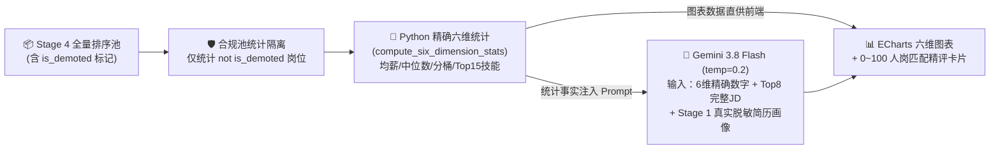

# 第 04 章：确定性统计 + 受控 LLM 推理——打造零幻觉六维分析报告（Stage 5）

> 🌐 **语言切换**: **简体中文** | **[English](../en/04-stage5-grounded-6d-analysis.md)**
> 🧭 **章节导航**: **[← 上一章：03 · 搜索召回与 I/O 解耦](./03-stage3-stage4-intent-and-ranking.md)** | **[返回教程总目录](../README.md)** | **[下一章：05 · Eval 评测飞轮与看板 →](./05-eval-driven-flywheel-and-dashboard.md)**

---

## 1. 本章你将学会
1. **数据分析型 Agent 的第一性原理**：“绝不让 LLM 做算术统计”——Python 精确计算与 Gemini 语义洞察如何分工；
2. **统计口径污染治理**：为什么要把 Stage 4 标记降权的异地/低薪岗位从六维市场统计中隔离出去；
3. **清除隐性领域偏置（Domain-Bias Leakage）**：为什么 Schema 示例或兜底模板里的一句“门店督导”会污染所有技术岗报告；
4. **前端 XSS 安全渲染与独立离线接口 `POST /api/analysis/evaluate`**。

---

## 2. 架构心法：Python 算术零误差 + Gemini 归因深洞察

新手做“市场分析报告 Agent”时，经常把抓回来的 150 条岗位 JSON 直接全塞进 Prompt 让大模型自己算平均薪资、中位数和行业占比。这会导致两个灾难：
1. **算术幻觉**：LLM 数错条数、算错中位数几乎是必然事件，而且每次刷新数字还不一样；
2. **Token 爆炸与注意力稀释**：150 条原始 JSON 占满上下文，导致模型对真正重要的 Top-8 岗位完整 JD 反而分析得很肤浅。

正确的工程架构（见 [`core/gemini_analyzer.py`](../../core/gemini_analyzer.py)）是**严格二八分工**：



1. **图表数据 100% 由 Python 直接喂给前端 ECharts**：行业饼图、薪资 7 档柱状图、Top 15 技能条形图、经验/学历双环图、规模/融资分布、作息与福利统计——**零幻觉、毫秒级完成**；
2. **合规池隔离（Compliant-Pool Isolation）**：`compute_six_dimension_stats` 自动剔除 Stage 4 标记 `is_demoted=True` 的异地与低薪陷阱岗（仅统计 `compliant_jobs`），防止几条 5K 低薪陷阱把真实市场均薪拉低，同时显式输出 `compliant_jobs_count` 与 `demoted_jobs_count`；
3. **Gemini 只做它最擅长的两件事**：
   - 基于给定的真实统计数字撰写 6 段精炼的专家解读（Prompt 红线强制规定：**所有引用的数字、比例、企业名必须 100% 来自输入，严禁捏造**）；
   - 将候选人的 **Stage 1 真实简历画像**（核心技能、过往行业、量化亮点）与 **Top-8 完整 JD** 逐一比对，输出 `0~100` 匹配分、推荐理由、亮点标签与风险预警（如点明某岗是“单双休”或“起薪略低于期望”）。

---

## 3. 真实踩坑复盘：警惕 Schema 描述与 Fallback 中的“领域偏置污染”

在早期原型开发时，我们最初是用“深圳服装店面督导”这个例子调通的全流程，当时顺手在 Pydantic `Field(description=...)` 和离线兜底函数 `build_fallback_analysis` 里写了诸如 `"如巡店督导、商品陈列"`、`"建议突出管辖门店数"` 的示例文字。

后来在 `OpenSpec Explore Stage 5` 审查时发现：**哪怕用户搜的是“广州 Java 开发工程师”，一旦网络抖动触发兜底、甚至偶尔在模型推理受 Schema 示例暗示时，报告里竟会冒出“门店巡检”！**

**重要教训**：
> 通用 Agent 的 Pydantic Schema 描述、System Prompt 和离线 Fallback 模板必须保持 **100% 领域中立（Domain-Agnostic）**，动态引用 `{intent.query}`、`{intent.city_name}` 与 `{skill_top}`，绝不能硬编码某一个垂直行业的业务术语。

---

## 4. 从 0 到 1 Vibe Coding 实战：生成并验证 Stage 5

### 💬 Stage 5 `Propose` Prompt 模板
```text
发起 Stage 5 (`core/gemini_analyzer.py` & `app.py`) 的 OpenSpec propose：
1. 合规池统计隔离：`compute_six_dimension_stats` 优先在 `not is_demoted` 的合规岗位池上计算六维分布，并输出 `compliant_jobs_count` 与 `demoted_jobs_count`；
2. 清除领域偏置：彻底移除 Schema 字段描述与 `build_fallback_analysis` 中任何特定行业（如门店/服装/督导）硬编码话术，改为完全动态绑定 `intent.query` 与真实统计结果；
3. 结构化与防幻觉护栏：默认使用 `gemini-3.8-flash` (`temperature=0.2`)，对 `overall_match_score` 和 `match_score` 强制加上 Pydantic `ge=0, le=100` 校验，Prompt 强制要求 1:1 覆盖全部 `0..N-1` 候选岗、严格溯源真实统计与 JD 且对非双休岗显式预警扣分；
4. 新增免爬虫独立接口 `POST /api/analysis/evaluate`，前端渲染全量使用 `textContent` / `createElement` 严防存储型/反射型 XSS。
先输出提案文档供我审阅。
```

---

## 5. 立即在本仓库运行验证：测试合规池隔离与 Stage 5 独立接口

运行下面这段命令，直接调用本仓库 `POST /api/analysis/evaluate` 接口（注意看深圳异地岗是如何被自动隔离出薪资统计之外的）：

```bash
curl -s -X POST http://127.0.0.1:8000/api/analysis/evaluate \
  -H "Content-Type: application/json" \
  -d '{
    "intent": {
      "raw_query": "广州Java开发工程师，月薪至少12K，周末双休",
      "query": "Java开发工程师",
      "city_name": "广州",
      "city_code": "101280100",
      "salary_code": "405",
      "min_salary_k": 12,
      "industry_keywords": ["互联网", "软件"],
      "require_double_weekend": true
    },
    "resume_profile": {
      "candidate_title": "Java后端开发工程师",
      "years_of_experience": "3年",
      "education_summary": "本科 · 计算机科学与技术",
      "core_skills": ["Java", "SpringBoot", "MySQL", "Redis"],
      "experience_highlights": ["主导高并发订单微服务重构，QPS提升3倍"]
    },
    "jobs": [
      {"岗位名称": "高级Java开发工程师", "公司名称": "云智科技", "薪资范围": "15-22K·14薪", "最低月薪K": 15, "最高月薪K": 22, "计薪月数": 14, "工作地点": "广州·天河", "所属行业": "互联网", "公司规模": "500-999人", "融资阶段": "C轮", "技能标签": "Java, SpringBoot, Redis", "福利待遇": "周末双休, 五险一金", "作息制度": "周末双休", "完整JD": "负责核心交易系统研发，要求熟悉SpringBoot与Redis分布式锁，周末双休。", "is_demoted": false},
      {"岗位名称": "Java开发工程师", "公司名称": "跨城干扰公司", "薪资范围": "5-7K", "最低月薪K": 5, "最高月薪K": 7, "计薪月数": 12, "工作地点": "深圳·宝安", "所属行业": "传统制造", "公司规模": "20-99人", "融资阶段": "未融资", "技能标签": "Java", "福利待遇": "单休", "作息制度": "排班轮休/单休", "完整JD": "驻场维护旧系统，单休。", "is_demoted": true}
    ],
    "top_candidates": [
      {"岗位名称": "高级Java开发工程师", "公司名称": "云智科技", "薪资范围": "15-22K·14薪", "最低月薪K": 15, "最高月薪K": 22, "计薪月数": 14, "工作地点": "广州·天河", "所属行业": "互联网", "公司规模": "500-999人", "融资阶段": "C轮", "技能标签": "Java, SpringBoot, Redis", "福利待遇": "周末双休, 五险一金", "作息制度": "周末双休", "完整JD": "负责核心交易系统研发，要求熟悉SpringBoot与Redis分布式锁，周末双休。", "is_demoted": false}
    ]
  }' | python3 -m json.tool
```

**验证结果**：
- `stats.compliant_jobs_count` 为 `1`，`stats.demoted_jobs_count` 为 `1`；
- `stats.salary.avg_min_k` 精准等于 `15.0`（完全没有被那条降权的 `5-7K` 岗拉低！）；
- `report.recommended_jobs[0].match_reason` 会直接结合候选人简历里的 `SpringBoot` / `Redis` / `高并发订单重构` 给出定制化点评。

---

## 6. 新手最容易踩的坑
- **坑 1：把外部爬回来的岗位标题/JD 直接拼进前端 `innerHTML`** —— 如果某条招聘 JD 里含有 ``，前端就会直接触发 XSS 漏洞！查看 [`static/app.js`](../../static/app.js) 可以看到，本项目全量使用 `document.createElement` 与 `textContent` 安全渲染。
- **坑 2：只关注主流程，忽略离线兜底 (`build_fallback_analysis`) 的质量** —— 网络超时或配额耗尽在生产环境随时会发生，干净、准确的确定性统计兜底能保证用户体验永不白屏。

五阶段业务流水线已经全部打通！但**你怎么证明你改完 Prompt 后系统是真的变强了，而不是拆东墙补西墙？** 下一章进入全教程最核心的护城河：**[第 05 章：Eval-Driven Agent 开发——构建 Human-in-the-Loop 真值闭环与 `#eval` 看板](./05-eval-driven-flywheel-and-dashboard.md)**！
