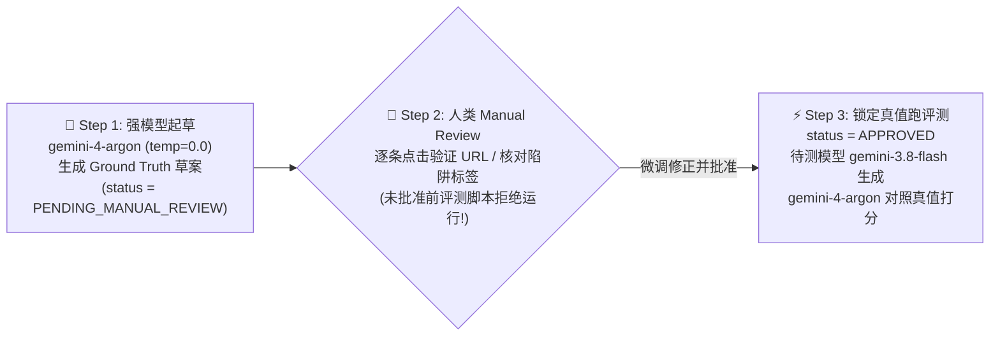

# 第 05 章：Eval-Driven Agent 开发——构建 Human-in-the-Loop 真值闭环与 `#eval` 看板

> 🌐 **语言切换**: **简体中文** | **[English](../en/05-eval-driven-flywheel-and-dashboard.md)**
> 🧭 **章节导航**: **[← 上一章：04 · 确定性统计与零幻觉分析](./04-stage5-grounded-6d-analysis.md)** | **[返回教程总目录](../README.md)** | **[下一章：06 · 安全审计、CI 与开源上线 →](./06-security-ci-and-production.md)**

---

## 1. 本章你将学会
1. 为什么**“没有评测集的 Agent 迭代就是在盲人摸象”**；
2. **双引擎评测架构**：确定性规则门禁（100% 红线）+ 强模型 LLM-as-a-Judge（`gemini-4-argon`, `temperature=0.0`）+ 信息检索指标（`NDCG@8`）；
3. **Human-in-the-Loop（人在回路）Ground Truth 构建法**：缺少标准答案时，如何先用强模型生成真值草案、暂停做人工 **Manual Review**、批准后再跑自动化评测；
4. 如何设计统一数据协议（[`eval/eval_store.py`](../../eval/eval_store.py)），在一个 `#eval` 前端看板上把 5 个完全不同形态的 Stage 可视化出来。

---

## 2. 思维框架：如何为五阶段流水线设计“分层解耦评测”？

如果只做端到端（End-to-End）测试，一旦最终推荐的岗位不理想，你根本分不清是 **Stage 1 简历读漏了**、**Stage 2 搜索词写歪了**、**Stage 3 城市码映射错了**、**Stage 4 把好岗位排丢了**，还是 **Stage 5 总结产生幻觉了**。

因此，我们在 `eval/` 目录下按阶段建立了 **5 套独立隔离的数据集与双层评测器**：

| 阶段 | 评测数据集 (`eval/dataset/`) | 确定性硬门禁 (Target: 100%) | 语义/排序评测 (`gemini-4-argon` / IR) | 本仓实测基线 |
| :--- | :--- | :--- | :--- | :---: |
| **Stage 1** | 9 份多模态正例 (`QUAL-01~09` 含 PDF/DOCX/图片/MD) + 9 份攻击/损坏反例 (`DISQ-01~09`) | 9 字段 Schema 合法、PII 零泄露、反例 100% 精准拦截 | 9 字段逐项 `0~10` 原子核对（硬实体/数字零篡改、幻觉检测） | 全反例 `100%` 拦截 |
| **Stage 2** | 复用 `QUAL-01~09` 标准画像生成 `9×10=90` 条策略 Query | 三要素完整率、无城市/无福利纯净率、单一岗位无斜杠、BOSS 城市 1:1 | 10 大策略维度相关性、薪资梯度合理性与履历锚定评分 | **`9.46 / 10`**（硬门禁全 `100%`） |
| **Stage 3** | 从 Stage 2 分层抽样 18 条并经人工批准的 BOSS URL 真值集 | URL 格式与 6 类官方白名单合法率、城市 1:1、薪资码准确、岗位纯净率 | URL硬筛 / 岗位提纯 / 行业扩展 / 软条件 四维评分 | **`9.82 / 10`**（URL一致 `94.4%`） |
| **Stage 4** | 人工批准的 6 场景 96 条含陷阱岗位池 + 12 条薪资/作息边界用例 | 异地/低薪垫底降权 `100%`、单双休陷阱拦截 `100%`、边界用例 `100%` | **`NDCG@8`**、**`Recall@8`** + Argon 四维排序合理性评审 | **`9.58 / 10`**（`NDCG@8=0.9754`） |
| **Stage 5** | 复用 Stage 4 的 6 组场景 + Argon 自动事实锚点 | 六维 Schema 完整、Top-8 全覆盖、分值 `0~100`、**零领域硬编码污染** | JD事实忠实度 / 人岗契合 / 风险识别 / 建议可执行性 四维评分 | **`9.47 / 10`**（硬门禁全 `100%`） |

---

## 3. 核心技巧：缺少 Ground Truth 时，如何用 Human-in-the-Loop 快速冷启动？

初学者做 Eval 最头疼的问题是：**“手写几百条 Ground Truth 太累了；但如果直接让 AI 既当运动员又当裁判，岂不是自欺欺人？”**

我们在 Stage 3 和 Stage 4 采用了一套极高效的 **「强模型起草 → 人类审核锁死 → 快模型受测」三步闭环**：



### 💬 实战 Prompt 模板：在 Vibe Coding 中植入人工审核卡点
```text
发起 Stage 3 评测的 OpenSpec propose：
- 待测解析模型使用 `gemini-3.8-flash`，LLM-as-a-Judge 裁判使用 `gemini-4-argon` (`temperature=0.0`)；
- 复用 `QUAL-01 ~ QUAL-09` 的 Stage 2 输出，但目前缺少 Stage 3 的 Ground Truth（即期望拼接出的 BOSS直聘 URL 与结构化参数）；
- 请先写一个生成脚本用 `gemini-4-argon` 生成一版 Ground Truth 草案（标记为 `PENDING_MANUAL_REVIEW`），打印出可点击验证的 URL 表格后**立即暂停**；
- 等我完成 Manual Review 确认无误后，再标记为 `APPROVED` 并运行 Stage 3 Eval 接入前端 `#eval` 看板！
```

> **代码级防呆设计**：打开 [`eval/stage3_eval/evaluate_stage3_intent.py`](../../eval/stage3_eval/evaluate_stage3_intent.py) 和 [`eval/stage4_eval/evaluate_stage4_ranking.py`](../../eval/stage4_eval/evaluate_stage4_ranking.py)，你会看到评测入口处都有一道硬校验：
> ```python
> if manifest.get("review_status") != "APPROVED":
>     raise ValueError("Ground Truth 尚未通过人工 Review，禁止运行评测。")
> ```
> 这从代码层面杜绝了 AI 跳过人类确认自己给自己判满分的隐患！

---

## 4. 立即在本仓库运行体验：跑一次真实的分阶段评测

配置好 `GEMINI_API_KEY` 或 Vertex AI ADC 后，你可以在终端独立运行任意一个 Stage 的评测脚本，结果会自动归档到 `eval/runs/` 并实时同步到 `http://127.0.0.1:8000/#eval` 看板：

```bash
# 运行 Stage 4 离线粗排评测（96 条岗位 NDCG@8 + 12 条边界单测 + Argon 裁判，约 40 秒）
.venv/bin/python eval/stage4_eval/evaluate_stage4_ranking.py

# 运行 Stage 3 意图与 BOSS URL 评测（18 条批准真值集，gemini-3.8-flash 解析 + Argon 裁判）
.venv/bin/python eval/stage3_eval/evaluate_stage3_intent.py

# 运行 Stage 5 六维报告忠实度评测（6 组跨行业场景）
.venv/bin/python eval/stage5_eval/evaluate_stage5_analysis.py
```

跑完后刷新浏览器 `http://127.0.0.1:8000/#eval`，在 **「历史评测批次」** 下拉框中就能直接对比刚才新跑出的批次与历史基线的得分差异！

---

## 5. 新手最容易踩的坑
- **坑 1：让待测模型自己给自己当 Judge（例如用同一个小模型既生成又打分）** —— 同源盲区会导致它对自己犯的逻辑错误视而不见。**准则**：裁判模型（如 `gemini-4-argon`, `temperature=0.0`）应比线上低延迟生成模型（`gemini-3.8-flash`）高一个能力量级，且温度必须设为 `0.0` 保证判罚一致。
- **坑 2：只看 LLM Judge 总分，不设确定性硬门禁** —— 格式合规、城市码白名单、PII 零泄露、`NDCG@K` 必须由确定性 Python 代码 100% 计算，绝不能只靠大模型肉眼估分。

现在我们拥有了规范驱动的代码和全链路 `9.4+ / 10` 的评测保障。最后一章，我们把这套原型打磨成真正可以安心公开到 GitHub 的作品：**[第 06 章：从原型到开源/上线——安全审计、CI 门禁与发布 Checklist](./06-security-ci-and-production.md)**！
