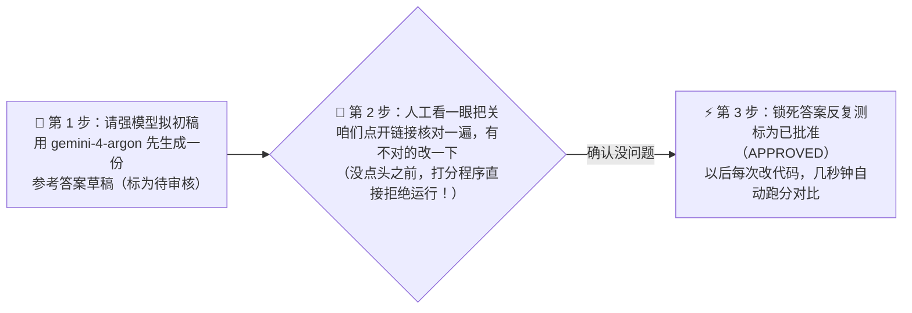

# 第 05 章：怎么知道改得好不好？人工把关参考答案 + 自动评测看板

> 🌐 **语言切换**: **简体中文** | **[English](../en/05-eval-driven-flywheel-and-dashboard.md)**
> 🧭 **章节导航**: **[← 上一章：04 · 算数据与写点评](./04-stage5-grounded-6d-analysis.md)** | **[返回教程总目录](../README.md)** | **[下一章：06 · 安全大扫除与开源上线 →](./06-security-ci-and-production.md)**

---

## 1. 这一章咱们学什么？
1. 为什么做 Agent 最怕“凭感觉调 Prompt”（改好第 1 个例子，悄悄搞坏第 8 个例子）；
2. **怎么给 AI 办一场靠谱的“期末考试”**：Python 死规则检查及格线 + 请更聪明的大模型当阅卷老师（`gemini-4-argon`）；
3. **超省力的“参考答案”制作法**：不用自己苦哈哈手写几百道题的标准答案——先让强模型帮你拟一份初稿，**咱们人工看一眼把把关**，点个头就能当标准答案长期复用！
4. 怎么把 5 个阶段的考试成绩单全都放到 `/#eval` 网页看板上直观对比。

---

## 2. 核心思路：每一关单独考试，出了问题一眼定位

如果只看最后生成的报告好不好，一旦结果不满意，你根本不知道是哪一步掉链子了。所以我们给 **Stage 1 到 Stage 5 每一关都单独准备了“考题”和“评分标准”**：

| 哪一关 | 考题是什么？（都在 `eval/dataset/` 里） | Python 硬规矩检查（错一个都不行） | 大模型阅卷老师看什么？（`gemini-4-argon`） | 咱们仓库现在的成绩 |
| :--- | :--- | :--- | :--- | :---: |
| **Stage 1 读简历** | 9 份不同格式的假简历 + 9 个故意损坏或带攻击的文件 | 9 个字段齐全、手机号姓名全打码、坏文件 100% 拦住 | 逐个字段核对工作年限、学校、业绩数字有没有抄错或瞎编 | 坏文件 `100%` 拦住 |
| **Stage 2 想搜词** | 拿 9 份简历生成 `9×10=90` 条推荐搜索词 | 必须是“行业+岗位+底薪”三要素、不带城市名、不带斜杠 | 10 个求职角度拉没拉开差距、底薪定得合不合理 | **`9.46 / 10`** |
| **Stage 3 拼链接** | 挑出 18 条代表性搜词，核对拼出来的 BOSS直聘网址 | 网址格式对、城市码和薪资码全在官方字典里、岗位词干净 | 拼出来的网址跟人工确认的标准网址是不是一模一样 | **`9.82 / 10`**（网址一致率 `94.4%`） |
| **Stage 4 排岗位** | 6 个行业共 96 个真假混合岗位（故意塞了异地、低薪、单双休陷阱） | 异地和低薪岗 `100%` 排最后、单双休绝没误判成双休 | 最匹配的岗位有没有排进前 8 名（`NDCG@8` 排名分） | **`9.58 / 10`**（排名分 `0.9754`） |
| **Stage 5 写报告** | 拿上面排好序的 6 组岗位生成六维分析报告 | 6 个维度全写齐、前 8 名全打分、没串台冒出别的行业套话 | 报告里的数字跟真实统计对不对得上、有没有结合简历给建议 | **`9.47 / 10`** |

---

## 3. 最实用的偷懒妙招：没有标准答案（Ground Truth）怎么办？

很多新手一听要做评测就打退堂鼓：*“难道我要自己手写 18 条网址、96 个岗位的标准打分吗？那得写到猴年马月！”*
反过来，如果你让 AI 自己出题、自己做题、自己改卷，它肯定给自己打满分，那也白测了。

我们在做 Stage 3 和 Stage 4 时，用了一个**既省力又靠谱的三步法**：



### 💬 跟 AI 提需求时，怎么把这个“人工把关”卡点说清楚？
你可以直接这样跟 Antigravity / Codex 说：
```text
我现在要做 Stage 3 的评测并放到前端 #eval 看板上：
- 实际干活的解析模型用速度快的 `gemini-3.8-flash`，打分当裁判的模型用更强的 `gemini-4-argon`（`temperature=0.0`）；
- 继续用前面 9 份测试简历生成的搜词当考题，但现在还缺标准答案（也就是每道题应该拼出什么样的 BOSS直聘网址）；
- 你先用 `gemini-4-argon` 帮我生成一版参考答案草稿，打印成带链接的表格停下来让我人工检查（Manual Review）；
- 等我检查完说没问题了，你再去跑正式打分！
```

你看，在我们的 [`eval/stage3_eval/evaluate_stage3_intent.py`](../../eval/stage3_eval/evaluate_stage3_intent.py) 代码里，专门写了这么两行“铁门栓”：
```python
if manifest.get("review_status") != "APPROVED":
    raise ValueError("参考答案还没经过人工确认，不准直接跑分！")
```
花 3 分钟人工扫一眼 18 条网址，换来一套永远客观、随时能重跑的自动化考卷，这笔账太划算了！

---

## 4. 马上在本仓库跑一次“自动考试”试试！

只要你配好了第 00 章里的 Gemini 密钥，现在就可以在终端随便挑一关跑跑看。跑完之后成绩单会自动存进 `eval/runs/`，刷新网页看板就能看到新成绩：

```bash
# 跑一遍 Stage 4 岗位排序考试（测 96 个岗位排名 + 12 个边界陷阱 + Argon 阅卷，大约 40 秒）
.venv/bin/python eval/stage4_eval/evaluate_stage4_ranking.py

# 跑一遍 Stage 3 拼网址考试（18 道人工把过关的真题）
.venv/bin/python eval/stage3_eval/evaluate_stage3_intent.py

# 跑一遍 Stage 5 六维报告考试（6 个不同行业的完整报告核验）
.venv/bin/python eval/stage5_eval/evaluate_stage5_analysis.py
```

跑完去浏览器刷新一下 `http://127.0.0.1:8000/#eval`，点开 **「历史评测批次」** 下拉框，你就能清楚看到刚才这一把跟之前的历史成绩相比是涨分了还是跌分了！

---

## 5. 新手避坑小贴士
- **别让同一个小模型“既当考生又当阅卷老师”**：平时跑线上业务为了快和省钱用轻量模型（`gemini-3.8-flash`），但改卷子一定要请更强的大模型（`gemini-4-argon`），而且温度要设成 `0.0`（保证每次判分标准一致，不看心情给分）。
- **能用 Python 代码算清的对错，绝不麻烦大模型估分**：比如“网址能不能打开”、“城市编码对不对”、“姓名手机号打码了没”，直接用几行 Python 判断 `True/False` 最铁面无私。

到这里，咱们的 Agent 不仅功能全齐，还有了一套漂亮的五阶段体检大盘！最后一章，咱们看看把代码公开到 GitHub 给别人看之前，要做哪些安全大扫除：**[第 06 章：准备发到 GitHub 公开——安全大扫除与自动检查](./06-security-ci-and-production.md)**！
